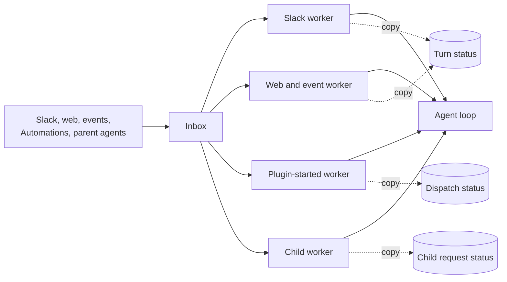
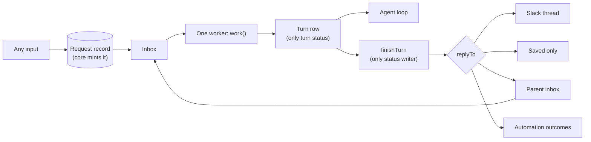
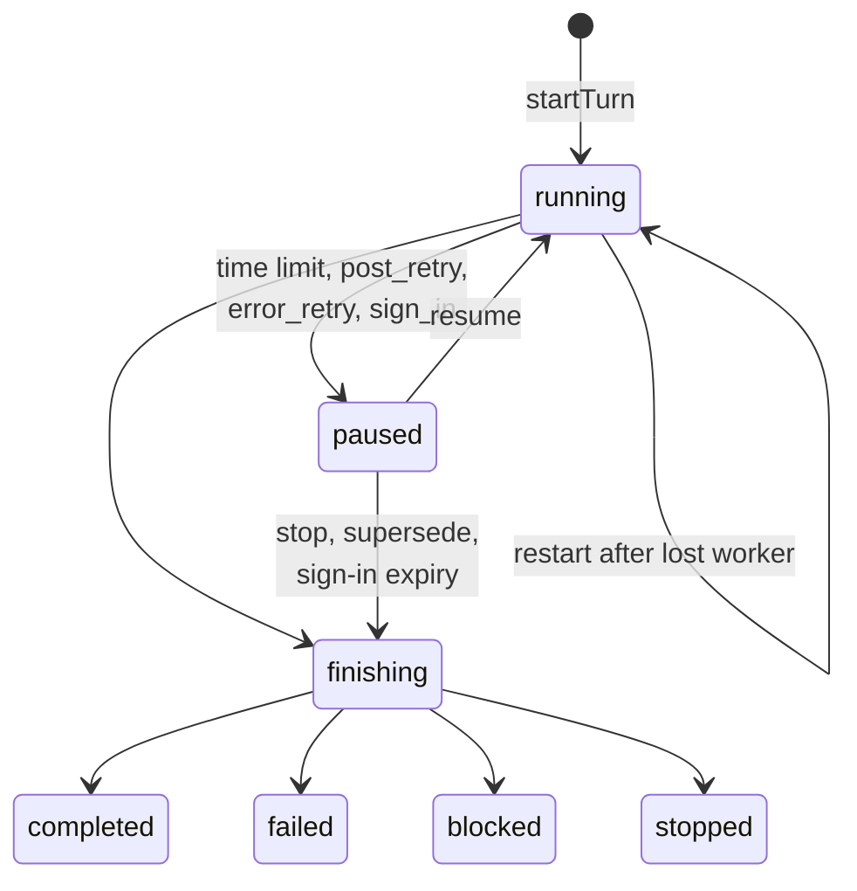

# Design

This file gives the words, the model, the rules and the answers (P-numbers).
`interfaces/` has the type sketches and worked examples: `inbox.md`,
`turn.md`, `agents.md`, `access.md` and `edges.md`. Labels:

- **Decided:** David Cramer answered it on #2567 or in the planning thread.
  Every item is Decided.

Paths are under `packages/junior/src/chat/` unless noted. Evidence was read on
`main` at `d595bfb`. "Bug N" is the numbered bug list in #2567.

## Words

These are the #2567 words, plus three that this plan adds (marked).

- **conversation:** one thread of work with its own history. A child agent is
  one too.
- **turn:** Junior handles new input until it sends its response or an error
  message. It can take several attempts.
- **attempt:** one worker's run of a turn. At most 5 minutes. (Added.)
- **inbox:** a conversation's waiting messages. "Queue" means only the real
  work queue, which only carries "notify a worker" messages.
- **worker:** runs a conversation's next turn. **Notify a worker:** a queue
  message that names only the conversation.
- **worker lock:** only one worker runs a conversation at a time. The worker
  holding it checks in every 15 s. After 90 s with no check-in, it expires.
- **lock version:** goes up each time a worker takes the lock. Every save and
  post carries it, and an old version is refused.
- **checkpoint:** saved turn progress, kept outside the worker. Before the
  attempt limit, the worker saves one and the turn continues later.
- **actor:** the person or system the turn acts for. **Whose access:** whose
  credentials the turn uses.
- **request record:** who asked, with whose access, and where results go.
- **child agent, parent agent:** an agent that another agent started, and
  that agent. A **top-level agent** has no parent.
- **join now / wait:** a new message joins the running turn at its next safe
  point, or waits for its own turn.
- **plugin-started agent:** work that a plugin or Automation starts.
- **sandbox:** the VM where Junior runs commands, one per conversation. The
  **credential proxy** adds credentials to its calls, only for declared
  domains. A **sandbox pass** lets the sandbox use one turn's access. It ends
  with the turn.
- **sender check:** the check of who sent a saved message.
- **action review:** the check that runs before a risky tool call.
- **stop time:** saved on a conversation by a stop. A turn that took in
  input that Junior received before it is stopped. (Added.)
- **closing turn:** a turn row that takes in input and ends at once, without
  the agent. It records input that will not run. (Added, P30.)

**The response rule (Decided).** Junior sends each assistant response when it
is produced. A failed turn sends an error message. Every turn ends with
something the person can see. A turn that takes in several messages handles
them together, and the agent decides what to say. The runtime never splits,
merges or rewrites responses.

### Decided Rules

From the #2567 decision comments and the planning thread:

- Another person's message never joins a running turn. A plain reply from
  the turn's own person waits. Events never join.
- A message to a busy child joins its running turn (join now or wait, same
  actor and access). One result covers both requests.
- After a lost worker, every kind of turn gets one restart from its last
  checkpoint, and the restart counts as an error (P4). One retry limit per
  turn. Message delivery attempts stay separate.
- Every save and every post checks the lock version. A worker that lost its
  lock stops at its next check-in, save or post.
- An error after the input is saved retries from the last save. On the last
  try the turn fails visibly. Its error message is that turn's end.
- A stop after the provider accepted a post: the turn ends `stopped` and the
  post stays.
- New input from the same person ends a turn that waits for sign-in, with a
  short note. Then that new input runs. Other people and events wait until
  sign-in or link expiry (10 minutes). Same rule for every kind.
- Every stop of a top-level agent stops its tree. A child stopped by
  anything but `stopAgent` sends its parent a `stopped` result.
- A child that needs sign-in ends `blocked`.
- `maxAgentDepth` defaults to 1. The child result limit keeps today's rule.
- The sandbox pass ends with its turn. One sandbox per conversation; the
  sharing is explicit. Undeclared domains stay open; only declared domains
  get credentials.
- Any workspace bot can start a turn when no allowed domains are set.
  Allowed-domain checks cover all thread input, as part of this redesign.
- CLI top-level turns go through the inbox.
- Verified trusted authors and trusted system events go in. Unverified and
  untrusted authors are discarded (comment on #2567; P19 says where).
- Every release, revert and migration runs through normal CI/CD with zero
  downtime and no manual steps (P47).

`TERMINOLOGY.md` still uses older words. Step 2 in `tasks.md` reconciles
them (P16).

### Code Names

Prose uses the words above. Code names appear in this table, in the type
sketches, and in evidence lines.

| Plain word                           | Code name today                                              |
| ------------------------------------ | ------------------------------------------------------------ |
| inbox                                | Mailbox, `pendingMessages` on Conversation execution         |
| worker lock                          | Lease (`execution.lease`)                                    |
| lock version                         | (new) replaces lease token fencing (`fenceLock`)             |
| check in                             | Lease check-in                                               |
| notify a worker                      | Queue wake                                                   |
| turn record                          | Turn cursor / `TurnRecord` (`task-execution/turn-cursor.ts`) |
| attempt                              | Run, Execution slice                                         |
| save a checkpoint and continue later | Yield                                                        |
| gave up after the last retry         | Dead-letter, retry exhaustion                                |
| joins the running turn               | Steering                                                     |
| join now / wait                      | `interrupt` / `defer`                                        |
| request record                       | Agent invocation row, Agent dispatch record                  |
| plugin-started agent                 | Agent dispatch                                               |
| whose access                         | Credential subject, `credentialContext`                      |
| credential proxy                     | Egress proxy                                                 |
| sandbox pass                         | Signed egress context token in the network policy            |
| sender check                         | Provenance                                                   |
| action review                        | Guardian                                                     |
| timer job                            | Heartbeat (`task-execution/heartbeat.ts`)                    |

## Today And Target





Turn states:



## Model

### Owners

Each fact has one owner and one store.

| Fact                                               | Owner          | Store                      |
| -------------------------------------------------- | -------------- | -------------------------- |
| Worker lock expiry and lock version                | worker lock    | SQL conversation row (P5)  |
| Stop time                                          | stop module    | SQL conversation row (P34) |
| Inbox, duplicate check, `inboxSeq`, wake time      | inbox module   | Redis conversation record  |
| Request records                                    | request module | SQL                        |
| Turn status, requests taken in, totals, deliveries | turn module    | SQL turn row (P2)          |
| Agent history and `turn_*` events                  | history module | SQL conversation events    |
| Sandbox ref                                        | sandbox module | SQL conversation row       |
| Current sandbox pass id                            | sandbox module | SQL turn row (P36)         |
| Agent bindings (named children)                    | agent module   | SQL (as today)             |

Deleted copies: Agent invocation run statuses and parent mailbox statuses,
dispatch progress statuses, Slack thread `activeTurnId` and `pendingAuth`,
the Redis turn cursor, the Redis worker lock, and the copied SQL
`execution_status` (P3).

### Rules The Model Holds

1. A conversation has at most one open turn (`running`, `paused` or
   `finishing`). The store enforces it (P2).
2. A finished turn (`completed`, `failed`, `blocked`, `stopped`) never
   changes.
3. Every turn save, history commit and delivery intent carries the lock
   version, and checks it in the same SQL write (P5). It also
   refuses when the turn is under the stop, except the saves of
   `finishTurn(stopped)` (P34).
4. A turn acts for one actor and one whose-access, taken from its starting
   request record. Input that joins must have the same actor, exactly the
   same signed subject and the same source (Decided, P20).
5. Another person's message never joins a running turn. Events never join
   (Decided). Results never join (today's rule).
6. A message is taken into a turn only after the turn row lists its request
   id. Then the inbox entry is removed. Never the other order.
7. Only `finishTurn` writes a finished turn status, and only `finishTurn`
   moves a request record out of `open`. Both writes are conditional: the
   turn row must still be open, and the record must still have
   `status = 'open'` (P30).
8. Only `credentialsForTurn` builds credentials.
9. A request record has no run status: `open`, `answered` or `stopped`.
10. Inbox entries hold no access. Core mints request ids. Access lives only
    on a request record in the receiving conversation whose
    `conversationId` and `inboundMessageId` match the message. A result or
    a message to the parent has its own record there, minted in the child's
    transaction. Its sender comes from the child's turn row, never from
    message fields (P26).
11. What differs by kind is stored data. The core takes no per-kind
    callbacks and has no per-kind branch.
12. Only core person ingress (Slack, web, ACP, CLI) makes a
    `VerifiedPersonActor`, and a person-actor record needs one. Only the
    core agent module (`finishTurn`, `askChild`, `messageParent`) makes
    `source: "agent"` messages and their records (P26, P39).
13. Server times (lock expiry, turn start, wake time) come from database
    `now()`. A stop and the input it judges are both stamped with database
    `now()` when Junior receives them (P34, P44).
14. A worker never releases the lock while its turn is `running`. When the
    pause save fails, the lock expires instead (P8).

### Lock Order (Decided: P5)

A worker takes locks in this order and never waits on another
conversation's worker lock:

1. Worker lock: one compare-and-set `UPDATE` on its SQL conversation row.
   It returns the new lock version.
2. Inside one save transaction: the conversation row (`FOR SHARE`, to check
   the version and a live expiry), then the turn row, then conversation
   events.
3. Redis inbox writes happen only after the SQL transaction commits. They
   are never inside one.

Writes to another conversation are `send()` calls, which touch only the
target's Redis record, and the insert of a result record in the child's save
transaction, which takes no lock on the parent's row. `askChild` takes the
parent conversation row `FOR UPDATE` for the caps and the stop check,
inserts the child conversation and request record, commits, then calls
`send()`. This removes the per-turn Redis mutation lock
(`task-execution/turn-cursor.ts`, `withTurnCursorMutation`).

### What Differs By Kind

Stored once on the conversation (`ConversationPolicy`) and on each request
record (`replyTo`). There is no `kind` field: the rows below differ only in
these values. The only per-kind code is at the edges: ingress parsing, and
one delivery adapter per `replyTo.kind`, plus one outcome adapter for
Automation outcomes (`interfaces/edges.md`).

| Kind           | Actor from                     | `canAskUser` | `joinRule`    | Default `replyTo`         |
| -------------- | ------------------------------ | ------------ | ------------- | ------------------------- |
| Slack          | verified message author        | yes          | `now`         | `location`                |
| Web            | session user                   | yes          | `now`         | `stored`                  |
| ACP            | session user                   | yes          | `now`         | `stored`                  |
| CLI            | local CLI user                 | yes          | `now`         | `stored`                  |
| Child agent    | request record from the parent | no           | `now_or_wait` | `parent`                  |
| Plugin-started | request record, system actor   | no           | `now`         | `location`                |
| Automation run | request record, system actor   | no           | `now`         | `stored`, plus `outcomes` |

`send()` never refuses input. ACP ingress refuses a prompt while the
conversation has an open turn, before it calls `createRequest`.
`createRequest` refuses an event or a top-level agent message at the
automated-turn limit before it saves anything, so `messageAgent` still gets
a sync error.

`canAskUser` applies only when the turn's actor is a person (P13). Events
reach any kind. An event runs as the system actor, with access only from its
Watch or Automation grant, and never joins.

## Answers

Every item is Decided. A Decided item with no source line was accepted as
written in the planning thread. Numbers stay stable across reviews. Retired
numbers say where they went.

### P1. Which ships first (Q13) — Decided

- **Decided:** full design first. Source: the planning thread.
- **Detail:** pre-work ships first: the verification gate with the full
  model (step G), then the `TERMINOLOGY.md` words (P16). #2556 (a reviewed
  PR for a live bug) lands on its own, outside this plan and ungated. Then
  the new core is built beside today's code. It is not
  wired to production traffic; the conformance tests and the gate run
  against it. One cutover release routes every kind through `work()`
  (P45). A later release deletes today's workers and their records. The
  end state has one worker and no per-kind last-try branch.
- **Risk:** one large cutover, and no smaller-option fixes for today's
  workers before it.

### P2. Where turn status lives (Q6) — Decided

- **Decided:** a SQL turn row is the only turn status, with one open row
  per conversation (unique index). Source: the planning thread.
- **Detail:** a SQL turn row is the only turn status. A partial unique index
  allows one open row per conversation. `currentTurn` reads that row; there is
  no separate pointer. At cutover (P45), a worker that takes the lock and finds
  an open Redis turn cursor moves it into a SQL row and deletes the cursor in
  the same locked step. There is no read fallback, so two open turns can never
  exist.
- **Why:** history is already in SQL, so one transaction covers both. The
  Redis turn cursor expires (24 h open, 1 h finished), so status disappears.
- **Alternatives:** Redis turn record with a Lua compare-and-set (history is
  in another store, so a save needs two fence checks); a 24 h read fallback
  (allows two open turns during the window).
- **Evidence:** `task-execution/turn-cursor.ts` (`TURN_CURSOR_RESUME_TTL_MS`,
  `TURN_CURSOR_TERMINAL_TTL_MS`, `upsertTurnRecordLocked` has no finished
  guard); `conversations/projection.ts` (`commitMessages`).

### P3. SQL status column (Q5) — Decided

- **Decided:** remove the copied SQL status columns; reporting reads turn
  rows. Source: the planning thread.
- **Detail:** the copied columns are `execution_status` and `run_id`.
  Reporting, the dashboard and `listAgents` read the open turn row and the
  last finished turn row. The delete release removes their code, and the
  columns drop one release later (`tasks.md` steps 16 and 17).
- **Alternatives:** keep one column with one writer.
- **Evidence:** `conversations/sql/store.ts` (`recordExecution`).

### P4. Restart and the retry limit (Q3 open part) — Decided

- **Decided:** one restart after a lost worker, and the restart counts as
  an error. One retry limit per turn: 5 errors, restarts included. Message
  delivery attempts stay separate. Source: the planning thread.
- **Detail:** one failure counts once. `errors` counts every failure of the
  turn: an error after take-in (P31) and a lost-worker restart. `restarts`
  counts restarts only, and is at most 1. The turn fails when `errors`
  reaches 5: `failed: error`, or `failed: lost_worker` when the restart
  would be the fifth error. A second lost worker ends it
  `failed: lost_worker`.
- **What stops a double count:** P31. An error saves `paused: error_retry`
  with `errors + 1`, so the next worker resumes a `paused` turn, and case 3
  of `work()` does not fire. A turn is lost only when it is still `running`
  under an expired lock (P8), so no error was saved for that failure.
  Without P31, an error save leaves the turn `running`; a crash right after
  it makes the next worker restart it, and one failure uses two errors
  (`errors_noPause oneChargePerAttempt`, 8 steps).
- **Checks:** `errors_design safety` (`errorBudget`, `oneChargePerAttempt`)
  holds; `errors_design ex_restartUsesLastError` reaches the
  `failed: lost_worker` end at 4 errors.
- **Evidence:** `task-execution/paused-turn.ts` (`MAX_LOST_WORKER_RESUMES`);
  `task-execution/state.ts` (`CONVERSATION_WORK_MAX_RETRIES = 5`).

### P5. Worker lock, fencing and lock order (gap 2) — Decided

- **Decided:** every save and post checks the lock version. A worker that
  lost its lock stops on its next check-in, save or post. The lock is a SQL
  worker lock taken with a compare-and-set (with P43). Source: #2567 and
  the planning thread.
- **The lock version, in plain words:** each time a worker takes the lock,
  the version goes up by one. Every save and post carries the version that
  the worker was given. The database refuses a write with an old version,
  so a worker that paused and lost its lock cannot overwrite the new
  worker's work.
- **Why not a plain Redis lock:** it stops two workers from starting at
  once. It cannot stop a worker that already holds a stale lock from
  committing a SQL write after the lock expired. Only a check inside the
  same SQL write can.
- **Detail:**
  - The worker lock lives on the SQL conversation row. The version only
    goes up. A Redis expiry cannot reset it.

    ```sql
    -- take: one compare-and-set
    UPDATE conversations
       SET lock_version = lock_version + 1,
           lock_expires_at = now() + interval '90 seconds'
     WHERE id = $c AND (lock_expires_at IS NULL OR lock_expires_at < now())
    RETURNING lock_version;

    -- check in (no row: the lock is lost); release sets
    -- lock_expires_at = NULL with the same match
    UPDATE conversations
       SET lock_expires_at = now() + interval '90 seconds'
     WHERE id = $c AND lock_version = $v AND lock_expires_at > now();
    ```

  - The version alone fences: each take raises it, so only one holder has
    a given version. There is no lock token.

  - Every save transaction first reads the row with the same `WHERE` and
    throws `LockLostError` on no match. Turn row, history and delivery
    intent writes are in that transaction.
  - Before each post, the worker checks in, then saves a checkpoint that
    commits the response to history and records the delivery intent with
    its id and text. It posts with the delivery id attached (Slack: message
    metadata), then saves the provider message id.
  - An expired lock needs no clearing: the next compare-and-set takes it.
    The timer job only notifies a worker.

- **Limit (Decided, the planning thread):** a post is not in a
  transaction. A worker that saved its intent and then stalls past 90 s
  can still post once after a new worker checked. A repeat post after a
  takeover is detected, not prevented (I7).
- **Alternatives:** a Redis lock with a SQL version counter (P43); a
  Redis lock plus a Redis counter that SQL writes only when higher (two
  stores to reason about); checking only at check-in (leaves a 90 s
  window).
- **Evidence:** `task-execution/state.ts` (`extendLock` then a separate
  `SET`; `CONVERSATION_WORK_LEASE_TTL_MS = 90_000`); `state/ttl.ts` (7-day
  record expiry); `providers/slack/turn.ts` (post before commit).

### P6. What "answered" means (gap 1) — Decided

- **Decided:** a turn answers the request records it took in. A later input,
  such as a grandchild result, starts a new turn. A request is answered when
  its posts are sent or failed; later output for it is a follow-up; no
  follow-up after a stop. Source: #2567 and the planning thread.
- **Detail:** `finishTurn` marks a record `answered` once its deliveries
  are `sent` or `failed` (P33). A later turn's output for an answered record
  goes as a follow-up. No follow-up for a `stopped` record. A turn started by
  a result for record `r` replies to the reply target of `r.onBehalfOf`.
- **Why:** keeps "one input, one output" and removes `replaced`.
- **Evidence:** `agent-invocations/store.ts` (`hasOpenChildWork`,
  `completeAgentInvocation`).

### P7. One repair job (gap 5) — Decided

- **Decided:** the timer job runs one repair pass with three parts:
  1. An `open` record with no `inputAppendedAtMs`, older than 60 s: call
     `send()` again with the fixed inbound message id. On `accepted` or
     `duplicate`, stamp `inputAppendedAtMs`. After 5 attempts or 24 h,
     stamp `gaveUpAtMs`.
  2. Notify a worker for: a conversation with a given-up record;
     a conversation with no live lock whose `wakeAtMs` has passed; a
     `running` turn whose lock expired, on the first pass after expiry.
     A Redis sorted set (member: conversation id, score: `wakeAtMs`) is
     the wake-time index. `send()`, `recordSignIn` and the pre-release set
     write it. An index on `lock_expires_at` for conversations with an open
     turn finds expired locks. With P32's delayed notify, the job is a
     backstop for wakes: L3 holds without it. A `running` turn whose worker
     died still waits for this job.
  3. Nothing else. The worker, not the job, closes records through a
     closing turn (P30), so `finishTurn` stays the only status writer.
- **Why:** a record and its inbox entry are in two stores. Lost wakes leave
  open turns idle (P32). One job covers both.
- **Deleted:** the Agent invocation result sweep, the dispatch outbox sweep
  with its 10,000-id list (bug 9), and the plugin-started 24 h failure rule.
- **Evidence:** `agent-dispatch/heartbeat.ts`; `agent-dispatch/store.ts`.

### P8. Lost worker and #2298 (gap 3) — Decided

- **Decided:** `work()` treats an open turn as lost only when it is
  `running` and the worker just took an expired lock. Every clean end of an
  attempt leaves the turn `paused` (P10) or finished, never `running`. A
  lost turn with `restarts: 0` restarts from its checkpoint and counts one
  error (P4); otherwise `finishTurn(failed: lost_worker)`. A worker saves
  its pause before it releases. If that save fails, it does not release:
  the lock expires, and the next worker treats the turn as lost.
- **Why:** #2298 made a live turn whose lock expired wait for one restart.
  With fenced saves, the old worker cannot save or post after the takeover.
- **Evidence:** `task-execution/paused-turn.ts` (`pauseLostWorkerTurn`).

### P9. Inbound message fields — Decided

- **Decided:** `source`, `join` (`now` or `wait`), `createdAtMs`,
  `receivedAtMs`, `attemptCount`, `traceContext`, event kind and
  `requestId`. "Delivery" means only sending responses.
- **Evidence:** `task-execution/state.ts` (`compareMessages`);
  `task-execution/mailbox-turn.ts` (event wait).

### P10. Pause reasons — Decided

- **Decided:** five reasons. `soft_time_limit` (was `yield`),
  `hard_time_limit` (was `timeout`), `post_retry` (a post failed and can be
  tried again), `error_retry` (P31) and `sign_in` (was `auth`). A lost
  worker is not a pause.
- **Why:** `retry` means two things today, with one limit.
- **Evidence:** `task-execution/turn-cursor.ts` (`TurnPauseReason`).

### P11. The no-progress rule — Decided

- **Decided:** a `soft_time_limit` pause at the boundary the turn resumed
  from ends the turn `failed: no_progress`. `hard_time_limit` may repeat;
  the attempt limit stops it. `post_retry` is exempt until its own limit
  (5 post attempts per delivery), then the turn fails.
- **Evidence:** `agent/resume.ts` ("Turn made no progress").

### P12. Per-turn limits — Decided

- **Decided:** the attempt (100), tool-call (1,000) and cost ($100) limits
  end the turn on the first try with `failed: limit`, after one wrap-up
  step, outside the retry limit. A child result for a limit says
  "progress". Source: the planning thread.
- **Evidence:** `config.ts` (`MAX_SLICES_PER_TURN`, `MAX_TOOL_CALLS_PER_TURN`,
  `MAX_TURN_COST_USD`); `agent-invocations/work.ts`.

### P13. Sign-in — Decided

- **Decided:**
  - Only a turn whose actor is a person, in a conversation with
    `canAskUser`, can pause for sign-in. A system-actor turn (a timer, or an
    event with a grant) ends `blocked` with the reason.
  - "Same person" for supersede means the new input's actor is a person
    actor equal to the turn's actor. A system actor never supersedes.
  - The private link and the short thread notice are runtime notices, not
    responses. A superseded or expired turn ends `stopped` with a short note.
  - The link is bound to the actor and the turn id, so it survives a
    restart.
- **Evidence:** `services/plugin-auth-orchestration.ts`; decision comment 3.

### P14. One conversation per plugin-started agent (Q9) — Decided

- **Decided:** keep it. Each run gets its own conversation with a fixed
  Location. Its request record replaces the dispatch record.
- **Evidence:** `agent-dispatch/store.ts` (`agent-dispatch:{id}`).

### P15. Who results and agent messages act for (Q11) — Decided

- **Decided:** a result acts for the person on the request record it
  answers. Other people's messages in that turn are outside text and never
  approval. Source: the planning thread.
- **Detail:** a result acts for the actor and whose-access of the request
  record it answers. A grandchild's record stores the child turn's actor,
  which came from the record that turn answered. In a result turn, messages
  from other actors reach the model marked as outside text, from before or
  after the record's `createdAtMs`. They do not count as approval. The
  `guardian` evals cover it (P41).
- **Why:** deletes "copy the latest request" (bug 12).
- **Evidence:** `agent-invocations/store.ts`
  (`createAgentInvocationFromLatest`).

### P16. Words in TERMINOLOGY.md (Q16) — Decided

- **Decided:** step 2 changes `TERMINOLOGY.md` first. Code names change
  only when a step touches that code.

### P17. Delegated access (Q17, J) — Decided

- **Decided:** core checks the signed grant at every turn start and
  resume, and the signature covers the run (its request id). Source: the
  planning thread.
- **Detail:** a plugin passes an unbound subject. Core binds and signs it,
  as on `main`. The signature covers kind, scope, `userId`, `teamId`,
  `dmChannelId` and the request id of the run (today it does not cover the
  run). `createRequest` takes the unbound subject, mints the request id,
  then calls `bindSubject`.
- **One check point:** `credentialsForTurn` runs, and checks the grant, at
  the start of every attempt: a turn start, a resume, a restart and a
  continuation. No other point checks access.
- **Evidence:** `agent-dispatch/context.ts` (`bindDispatchCredentialSubject`
  refuses a plugin binding); `credentials/subject.ts` (signs `allowedWhen`,
  `teamId`, `channelId`, `userId`).
- **Not chosen:** a change to the `Actor` schema in this plan:
  `actor-identity-end-state` lists it as a Non-Goal (design, row 13).

### P18. Automation results (Q17) — Decided

- **Decided:** an Automation run is a conversation with no Slack reply
  target (`replyTo: stored`). Its responses go only to the web and dashboard
  view, like any conversation without a Slack Location. The run also makes
  one result, and the Automation's outcomes deliver it. Source: the
  planning thread.
- **Today** (`main` at `742ce0a`): a run is a dispatch record with
  `declaresResult` and up to 5 stored outcomes (`agent-dispatch/store.ts`).
  Each outcome is `send_message` to a Slack Destination:
  `current_conversation` is the Automation's Destination, and
  `task_creator` is a DM with the creator, opened when the outcome is saved
  (`task-outcomes.ts`, `resolveTaskOutcomes`). The run's final text is never
  posted (`deliversFinalText`). The run ends with `finishAutomationRun`:
  `send_message`, `no_action` or `misconfigured`; with no outcomes, the
  tool offers only the last two. After the run, `finishedRunReply` returns
  the declared message only for a successful `send_message`, and the Slack
  turn posts it to each outcome Destination in order
  (`providers/slack/turn.ts:821`). `runDispatchOutcome` maps
  `misconfigured` to `blocked` with the reason, a failed run to `failed`,
  and everything else to `completed`. A failure is never posted to the
  outcomes; it shows on the Automation. A run that stops with no result gets
  one reminder (`remindMissingAutomationResult`). If it still declares
  none, it ends `completed` and posts nothing.
- **Decided (the rest):** the result source can vary. David: "it's ok
  for this to vary." Source: the planning thread. What varies: a run's
  result is its final response, or the `finishAutomationRun` call when the
  run makes one. The mapping below is the same for both.
  - The result comes from the finished run by default: a completed turn's
    final response is a `send_message` result, and a completed turn with
    no response is `no_action`. A `finishAutomationRun` call, when made,
    sets the result instead, so the source can vary. The missing-result
    reminder goes.
  - `send_message`: `finishTurn` delivers the message to each outcome, in
    order, with its own delivery id (P33). The run ends `completed`.
  - `no_action`: nothing is posted. The reason is saved on the run, which
    ends `completed`.
  - `misconfigured`: nothing is posted. The run ends `blocked` with the
    reason, and the Automation is blocked (plugin-started-agents › A Blocked
    Run Blocks Its Automation). A turn that ends `blocked` for a missing
    credential maps to the same.
  - A `failed` or `stopped` run posts nothing to the outcomes.
  - The request record carries `outcomes`. The `each | result | declared`
    field on the reply target goes: each reply target kind already fixes
    what it gets (`interfaces/edges.md`).
  - Automation run rows (`db/schema/automation-runs.ts`) keep the claim
    (`scheduledForMs`, `attempt`, `claimedAtMs`), `automationVersion`, and
    a stored status only while the run has no conversation: `pending`
    (claimed), `skipped`, or `failed` before dispatch. After dispatch, the
    run's status, `startedAtMs`, `completedAtMs`, `errorMessage` and
    `resultMessageTs` are computed from its request record and turn, as
    the plugin view is (P21). Nothing copies them onto the row.
- **Evidence:** `automation-result.ts` (`finishedRunReply`,
  `runDispatchOutcome`); `tools/runtime/finish-automation-run.ts`; its
  TODO asks for the declared result to become the run's output format.
- **Not chosen:** no `finishAutomationRun`, or `misconfigured` folded into
  `reportBlocked`. #2052 added the declared result to fix #2014 and #1741,
  and `reportBlocked` exists only for child agents
  (`chat/agent-invocations/blocked-report.ts`).

### P19. Untrusted event authors (Q17) — Decided

- **Decided:** decide trust at ingress. Unverified and untrusted authors
  are dropped with a recorded reason. A dropped event makes no request
  record. Source: the planning thread.
- **Evidence:** `events/notification.ts`;
  `openspec/changes/actor-identity-end-state`.

### P20. One access per event turn (Q17) — Decided

- **Decided:** split by person and exact signed access. Source: the
  planning thread.
- **Detail:** a mixed-access batch is never formed. Inbox selection groups
  event input in one window by actor and exact signed subject (scope
  included), in first-arrival order, before it becomes a turn. Each group
  is one turn, so no turn holds mixed access. Event author text is never
  approval.
- **Today (bug):** `timerWatchCredentialSubject`
  (`events/notification.ts:159-185`, `main` at `962eaf4`) returns no
  subject when a batch mixes timer creators, so the whole batch runs with
  no delegated access. This fails closed, so it is not a security hole.
  But a timer silently loses its creator's access because another Watch's
  event landed in the same window.
- **Check:** I6 (every taken batch has one actor and one exact signed
  subject); conversation-inbox › Events with different access.
- **Evidence:** `events/notification.ts`; `task-execution/attempt-selection.ts`.

### P21. Plugin view — Decided

- **Decided:** plugins keep `{id, status, resultMessageTs?, errorMessage?}`,
  computed from the request record and its turn's deliveries.
- **Evidence:** `agent-dispatch/types.ts`.

### P22. Error before the input is saved — Decided

- **Decided:** an error after the input is saved retries from the last
  save. An error before `startTurn` commits retries the message with no
  visible text and counts a delivery attempt. After 5, the worker runs a
  closing turn `failed: input_dropped`, which sends the error message.
  Source: the planning thread.
- **Separate limits:** these 5 delivery attempts belong to the message.
  They do not count against the turn error limit (P4), because no turn
  started. A turn that starts later begins with `errors: 0`.

### P23. One kind of request record — Decided

- **Decided:** core mints a stored request record for every input, before
  the inbox write. There is no inline form.
- **Why:** one shape for the match check (P26), one place for access, one
  repair path. The cost is one SQL insert per input at ingress.
- **Alternatives:** an inline request for person input (fewer writes, two
  shapes, and the inline form would need its own provenance rule).

### P24. Order after a supersede — Decided

The same person's new message ends the paused turn with a note and runs
next. Others wait. Not open. Source: decision comment 3 on #2567 ("Then
the new message runs").

### P25. Retired — Decided

Title lookups keep today's rule (Decided, the planning thread): no user
credentials outside a turn. A title lookup runs as a system actor
(`plugins/conversation-title-context.ts`).

### P26. Request ids and provenance — Decided

- **Decided:**
  - Core mints request ids in their own namespace (`req_…`). No caller
    chooses one.
  - The record stores `conversationId` and `inboundMessageId`.
    `selectTurnInput` drops a message whose record is missing or does not
    match both, with a recorded reason. It never fills in an actor.
  - Only core person ingress makes person-actor records. Only `finishTurn`,
    `askChild` and `messageParent` make `source: "agent"` messages.
  - A child result and a `messageParent` call each get their own record in
    the parent conversation. The child's `finishTurn` (or the fenced save
    of the `messageParent` call) mints it in the child's transaction, with
    `answers` naming the asked records and `sentBy` naming the child's
    turn. `send()` follows the commit; the repair job resends a lost one.
  - The parent accepts it only when the record matches the message (rule
    10), the `sentBy` turn row belongs to a child of the parent, and every
    `answers` record has that child as `conversationId` and the parent as
    `replyTo.parentConversationId`. Message fields are never trusted.
- **Evidence:** `task-execution/paused-turn.ts` (actor fallbacks, fixed five
  times).

### P27, P28. Moved to Later

See the Later list.

### P29. Retired

Replaced by P36. A new pass per attempt contradicts "the pass ends with its
turn".

### P30. Closing turns — Decided

- **Decided:** input that will not run still gets a turn row. The worker
  calls `closeInput`: `startTurn` and `finishTurn` in one locked step,
  without the agent. Used for: input older than a stop (P34), input past
  its delivery attempts (P22), records the repair job gave up on
  (P7), and a late result after an explicit stop (P35).
- **Why:** `finishTurn` stays the only writer of request status, and every
  input has a recorded end.
- **Alternatives:** a second writer (`dropRequest`) for records no turn
  took in.

### P31. Error retry pause — Decided

- **Decided:** an error after take-in saves `paused: error_retry`,
  `errors + 1`, and releases the lock. The next worker resumes from the
  checkpoint. At the error limit, `finishTurn(failed: error)`.
- **Why:** today an error leaves the turn looking like a lost worker, so
  the restart rule fires instead of the error limit.

### P32. No lost wakes — Decided

- **Decided:**
  - `send()` appends, raises `inboxSeq`, sets `wakeAtMs = now`, writes the
    wake-time index (P7), then notifies. `recordSignIn` does the same
    before it notifies, without an append.
  - `nextRunAtMs(state)` is the one runnable test. `work()` uses it to
    choose what runs, and the release uses it too.
  - Before release, the worker reads the inbox and `inboxSeq`, computes
    `nextRunAtMs` (for example the link expiry, a delivery's
    `nextAttemptAtMs` or an event window end) and sets `wakeAtMs` to it
    with a compare-and-set on `inboxSeq`. When `inboxSeq` changed, it reads
    the inbox record again. The same set queues a delayed notify for
    `wakeAtMs`, so a link expiry or backoff fires without the repair job.
  - It releases the lock, then reads the inbox record again (inbox,
    `inboxSeq`, `wakeAtMs`). When `wakeAtMs <= now`, it notifies a worker.
  - Built in step 3, with the SQL lock.
  - Model check: without the `recordSignIn` change and the delayed notify,
    a sign-in during a held lock drops its notify, and L3 fails without
    the repair job (`wakeLive_rev3 l3_pausedResumedNoRepair`). With them,
    `wakeLive_design l3_pausedResumedNoRepair` holds.
- **Why:** a notification that arrives while the lock is held is dropped.
  That loses a wake when the holder dies or loses the lock between its
  pause save and its release (P46).
  The compare-and-set stops a later wake time from hiding a new message.
  The release-then-read order means one side always sees the other: if the
  new worker failed to take the lock, the release came after, so the read
  after the release sees the append.
- **Alternatives:** move the inbox to SQL (one transaction, more SQL load).

### P33. Delivery failure while finishing — Decided

- **Decided:** each delivery has `attempts` and `nextAttemptAtMs`. A
  `finishing` turn retries with backoff, up to 5 attempts. Then the delivery
  is `failed`, and `finishTurn` ends the turn anyway with
  `deliveryFailed: true` on `turn.terminal`. A permanent provider error
  (for example a missing channel) fails the delivery at once, with no
  backoff.
- **Why:** a turn must not stay `finishing` forever.

### P34. Stop time — Decided

- **Decided:** `stop()` saves its own database `now()` as the stop time on
  the conversation row (and on every conversation below it for a tree
  stop) and notifies each worker. It writes no turn row and no request
  record. Both sides of every compare are receive stamps (P44): "older
  than the stop" means Junior received it before the stop. Source: the
  planning thread.
  1. A turn is under the stop when any input it took in has `receivedAtMs`
     older than the stop time. The turn row keeps
     `oldestInputReceivedAtMs`.
  2. `startTurn` and a join (`saveCheckpoint` with `takeIn`) refuse input
     older than the stop time.
  3. Every fenced save and every delivery intent save of a turn under the
     stop refuses, except the saves of `finishTurn(stopped)`.
  4. `finishTurn(stopped)` puts taken-in input that is not older than the
     stop time back in the inbox. Its request record stays `open`.
  5. Person input older than the stop is saved to history as "not run"
     through a closing turn, so the person sees it and can ask again. Event
     and agent input older than the stop is dropped through a closing turn
     with no history.
- **Why:** a stop ends what the person sent before it, and nothing newer.
  The 5ed29c2 rule compared the stop with the turn's database
  `startedAtMs`. An earlier model found it wrong both ways: a turn that
  started after the click but before `stop()` saved kept posting, and with
  the source clock ahead, a newer message's turn was stopped. The rule
  above holds on the receive clock (`StopClock.tla`, `stop_receive_*`
  `safety`). Without the join refusal (rule 2), older input joins after
  the stop (`stop_receive_noJoinFix i11j_noOlderJoinAfterStop`).

### P35. Results after a stop — Decided

- **Decided:** an explicit stop stays stopped, everywhere. After a stop of
  the top-level agent's tree, or a parent's `stopAgent` on its child, a
  late result is recorded but never starts a turn. With no explicit stop, a
  child result is ordinary inbox input to the parent and wakes it like any
  other event. Source: the planning thread.
- **Detail:** the child's outcome goes on its asked request record, and the
  child mints no result record. A result already in the parent's inbox is
  older than the stop, so a closing turn records it (P30, P34). A child
  stopped alone, for example from the dashboard, is not a stop of the
  parent: its `stopped` result wakes the parent. The parent's stop time
  and the record's `createdAtMs` are both database stamps (P44).

### P36. Sandbox pass lifecycle (gap from review) — Decided

The pass sits in the sandbox network policy, so it applies to the whole VM,
not to one process (`sandbox/egress/session.ts`, module overview;
`sandbox/session.ts`, `targetSandbox.update({ networkPolicy })`).

- **Decided:**
  - One pass per turn, issued at its first sandbox use. Its id is saved on
    the turn row before the policy is applied. Each attempt renews its
    expiry (capped near the attempt limit). A soft-time-limit continuation
    or a restart keeps the same pass.
  - The proxy fails closed unless the pass id equals the open turn's
    `sandboxPassId` in SQL, that turn is `running`, and the conversation's
    `lockExpiresAtMs > now()`. Between attempts, and after a lost worker's
    lock expires, the proxy refuses it, so nothing runs with credentials
    while no worker watches the turn.
  - On `finishTurn`, and on `sign_in`, `post_retry` and `error_retry`
    pauses, the worker applies a no-credentials policy.
  - When a turn's actor or access differs from the last pass's turn, the
    worker kills user processes before it applies the new pass. Files stay
    (Decided: one sandbox per conversation, sharing explicit). The sandbox
    ref stores only `lastPassTurnId`; the worker reads that turn row's
    actor and subject. A missing turn row counts as "differs", so the
    processes are killed.
  - The proxy's deny reasons are telemetry only, so there are two:
    `bad_pass` and `not_current`.
- **Limit:** processes from an earlier turn of the same actor and access
  keep running under the new pass. That is the same person's access.
- **Accepted risk, shared files** (Decided: accept as is, document it;
  the planning thread): one sandbox per conversation, and files stay. A
  file that one person's turn leaves in the sandbox can run in a later
  person's turn with that person's access. The user docs say so. The
  process kill and the pass that ends with its turn stay as above.
- **Alternatives:** a new pass per attempt (old P29); a sandbox per actor.

### P43. SQL lock or Redis lock with a SQL counter (from review) — Decided

- **Decided:** the SQL lock (P5). Source: the planning thread.
- **Cost:** an estimate that the check-in metric (step 3) checks: one indexed
  `UPDATE` per running turn every 15 s (300 running turns is 20 writes per
  second), and one indexed read per credentialed proxy call.
- **Why:** the lock, the version and the stop time sit on one row. Each
  save, the proxy and `startTurn` check them with one read in one store.
- **Alternative:** a Redis lock for take and check-in, plus a SQL version
  that goes up at each take. Check-ins cost no SQL write, and fencing still
  holds at the SQL save. But the proxy and the save check read two stores,
  and a take is two writes that a crash can split.
- **Note, switch rule:** if the check-in metric shows the load is
  a problem, a code change switches the lock. Only the lock module
  changes.

### P44. One clock for a stop and the input it judges — Decided

- **Decided:** Junior's receive time everywhere. Core stamps every input at
  inbox append (`receivedAtMs`) and every stop in the `stop()` transaction
  with database `now()`. Core-minted input (child messages, results) and
  its request record get the database stamp of their own transaction.
  "Older than the stop" means Junior received it earlier. P34 and P35
  compare only these stamps. Source: the planning thread.
- **Accepted behavior:** a Slack message that Junior receives late, after a
  retry, counts as newer than a stop the person clicked after sending it,
  so it runs.
- **Why it was open:** an earlier model showed source clocks failing
  across sources, and an inbox sequence number alone failing with late
  messages.
- **Checks:** `stop_receive_same`, `_ahead`, `_behind`, `_crossAhead` and
  `_crossBehind` hold `safety`. The accepted behavior is reachable on
  purpose (`acc_lateSentBeforeStopRuns`, `acc_earlySentAfterStopNotRun`).

### P45. A cutover that is safe under a rolling deploy (from P1) — Decided

Old and new workers run at once during each deploy. Model:
`CutoverShim.tla` and `DropGuard.tla` (P37); `Cutover.tla` and
`CutoverTree.tla` hold the earlier drafts as evidence. The first draft
failed two of three checks; this design folds in the model fixes (C1 to
C4, C10, C11), the durability and trust reviews, the shape review and
the simplification pass.

- **Decided:** a small shim that a later release deletes. Source: the
  planning thread. David: "i think what id prefer is just a simple shim
  that we remove in a follow-up commit so it can be zero downtime and
  theres no manual intervention."
- **Shim release.** The shim ships in step 14. Only the move, the sweep
  and `new_core` ship in step 15. Nothing must ship earlier for safety.
  An app can jump releases, for example from a release before step 14
  straight to step 15. So the plan handles code from any release before
  step 14 in the same way: it has no refusal, saves no tombstone, writes no
  row and makes no ingress claim.
- **Safety in one rule.** The new core runs a conversation only after the
  move, and the move runs only when no old worker can still hold today's
  lease: the lease is absent, or the stale lease fence has passed, and the
  pin then stops any later old take. This holds for a worker of any
  version, so the plan has no reader gate. The deployment rows (below)
  give only the guards' inputs.
- **Owner field.** From step 14 the conversation row has a `core` field
  (`old` or `new`). The root conversation's SQL lock take sets `core = new` in the
  same compare-and-set. A child conversation inherits its root's `core`.
- **Stale lease fence.** The move takes an expired today's lease only after
  `staleAtMs = max(lease.acquiredAtMs, staleLeaseAcquiredAtMs) + D + M`.
  Until then it sets `wakeAtMs` to `staleAtMs` and ends. With no lease and
  no tombstone that has not passed, it moves at once, except in the first
  2,100 s (`D + M`) after `freshSinceAtMs` (Current deployment).
- **Fixed `D` and `M`.** `D` is 1,800 s, the platform ceiling (Vercel
  Functions limitations, "Max duration": the fluid compute extended
  maximum for Node.js on Pro and Enterprise; Hobby is 300 s). No
  invocation runs longer, whatever its deployment sets, so the fence keeps
  no record of a deployment's `maxDuration`. `M` is 5 min. It covers clock
  skew between app instances, and nothing measures the skew (Host
  assumptions). The cost: a move after a stalled worker waits up to about
  35 min.
- **Read order** (C11). The move reads today's lease first, then
  `staleLeaseAcquiredAtMs`, in the same conversation mutation that writes
  the pin. Both paths that erase a lease save the tombstone first, so a
  lease that is gone at the second read has its tombstone. A tombstone
  read before the lease can be stale: a heartbeat clear between the two
  reads leaves no lease and an old tombstone, and the move starts while
  the old worker runs (`shim_earlyTomb`, 15 steps).
- **Why the fence stops the old worker** (`main` at `0dbbec3`):
  - One take mints the token and `acquiredAtMs`
    (`task-execution/state.ts:1561-1566`). A check-in keeps both and
    extends only the expiry (`state.ts:1593-1616`), and only the holder of
    the token checks in (`state.ts:1602`). The queue message carries no
    lease or token (`task-execution/queue.ts:6-11`), so a redelivery or a
    continuation takes a new lease (`worker.ts:418-423`).
  - The holder runs inside the invocation that took the lease, which
    started before `acquiredAtMs`. Vercel ends an invocation at
    `maxDuration`, `waitUntil` work included (see Host assumptions).
  - Two paths remove an expired lease while its holder may still run: the
    heartbeat clear (`task-execution/heartbeat.ts:92-100`,
    `state.ts:2319-2353`) and a new take of an expired lease
    (`state.ts:1551-1575`). From step 14 each of them first saves the old
    `acquiredAtMs` as `staleLeaseAcquiredAtMs` (the larger value) on the
    SQL conversation row. The heartbeat runs only on the current
    deployment. After an Instant Rollback below step 14 it runs code that
    saves no tombstone (Rollback below step 14).
- **Pin** (C4). Before the insert, the move writes today's lease with
  `expiresAtMs = Number.MAX_SAFE_INTEGER` and a fixed token, and leaves it
  there. A no-expiry value does not work on `main`: `normalizeLease`
  (`task-execution/state.ts:419-434`) drops a lease whose `expiresAtMs` is not a
  finite number (`coerce.ts:7-11`), and JSON turns `Infinity` into `null`. A
  dropped lease reads as no lease. `MAX_SAFE_INTEGER` is finite, so
  `isLeaseActive` (`state.ts:606-607`) keeps it live. The lease is a field of
  the conversation record, which each write saves with the 7-day
  `JUNIOR_THREAD_STATE_TTL_MS` (`state.ts:1054-1058`). Each new-core lock take
  refreshes that TTL while `core = new`. So a pin expires 7 days after the
  conversation's last write. The pin is not in SQL: only a worker from
  before step 14 needs it, and that worker reads only Redis.
- **Move on every new-core take** (C1, C2). Every new-core lock take that
  finds today's state runs the move, not only the take that set `core`.
  After the fence, in one locked step that also holds each moved turn's
  cursor mutation lock (`withTurnCursorMutation`), it moves an open Redis
  turn cursor into a turn row keyed by its turn id, and Slack
  `activeTurnId` and `pendingAuth` into that turn row. A repeat after a
  crash inserts nothing new and only deletes. A repeat that finds a cursor
  with an end status and an open turn row for it (an `abandonTurnRecord`
  between a crashed move and the repeat) ends that row through
  `finishTurn` with the same end status, and does not run it.
- **Pending stop.** The move carries today's stop request
  (`conversationStopKey`, written by `stopConversationWork`,
  `state.ts:1812-1816`: `{ inboundMessageIds, runId }`) into `stopAtMs`.
  It sets `stopAtMs` to its own database `now()`. Each moved input in the
  stop's `inboundMessageIds` gets a `receivedAtMs` before it, each other
  moved input one after it, so the moved stop judges the same inputs as
  today's stop (P34, P44).
- **Inbox move, safe to repeat.** Today's waiting input (`pendingMessages`)
  moves in the same locked step into inbox entries with core-minted
  request records. The record is unique on
  `(conversationId, inboundMessageId)`, so a repeat after a crash mints no
  second request id. The move copies today's dedupe list
  (`execution.inboundMessageIds`, `state.ts:159`) into the inbox's
  duplicate check, so a Slack retry after the move is still a duplicate.
  Admission (allowed domains, P19 trust) runs again on each moved input; a
  failure is dropped with a recorded reason.
- **Shared ingress claim** (C5, C6). Today's ingress checks and appends the
  id in one write (`appendInboundMessageWithAdmission`,
  `state.ts:1166,1198-1200,1258-1262`), after it decides the path. Two
  races break the inbox move:
  - C5 (`cutover_inbox noCrossCoreDuplicate`, 10 steps; `acceptedOnce`, 3
    steps): a Slack retry arrives after the pin and before the move copies
    `inboundMessageIds`. It sees `core = new` and no request record, so
    the new core takes it as new input and runs T1 twice.
  - C6 (`cutover_inbox retryAfterMoveIsDuplicate`, 9 steps): an ingress
    reads `core = old`, the move runs, then the ingress appends i3 to
    `pendingMessages`. A retry of i3 sees `core = new` and no record, and
    is accepted again. A new-core read of `inboundMessageIds` alone is not
    enough (`cutover_inboxBoth noCrossCoreDuplicate`, 19 steps).
  - Fix: from step 14 until step 17, every ingress path, today's and the
    new core's, first adds the id to `execution.inboundMessageIds` in one
    conversation mutation, before it reads `core`. Only the add that wins
    goes on. The move makes an inbox entry for each claimed id that is in
    `pendingMessages`, and copies every other claimed id as a duplicate.
  - Check: `shim_ingress` (`safety`, `noDuplicateTurn`, `acceptedOnce`,
    `retryAfterMoveIsDuplicate`, `noLostInput`) holds with the claim under
    the fence, in CI. Without the claim (`shim_ingressNoClaim`),
    `acceptedOnce` fails in 3 steps, and `noDuplicateTurn` (C5) and
    `retryAfterMoveIsDuplicate` (C6) in 10. `cutover_inboxShared` checks
    the claim against the earlier deploy gate and is evidence only.
  - An append after the move stays in `pendingMessages` until the next
    new-core take moves it. Inference: the step 15 sweep or the next
    message brings that take. No liveness check covers it (G.1f).
  - Ingress code from before step 14 that is in flight during a release
    jump makes no claim. Inference: its append writes the id into the same
    `execution.inboundMessageIds` (`state.ts:1198-1200`), so a later claim
    sees the id as a duplicate. No check covers it (G.1f).
- **Parent and child.** Active Agent invocation rows and dispatch records
  move into request records only when the child conversation is new-core
  or idle. Otherwise that part of the move waits for a later take.
  - C7 (`CutoverTree tree_plan resultNotLost`, 8 steps): the child worker
    `co` stalls and its lease expires, so the child looks idle; the move
    takes the row; `co` then writes its result to the moved row, and the
    result is lost. `tree_fenced` holds with core-model's fix: today's
    result write checks the child's lease token (`RESULT_FENCED`).
  - **That fix conflicts with the shim, so this plan does not adopt it.**
    It covers only a worker from step 14 on: a child worker from before
    step 14 has no token check. It is also the kind of write check the shim does
    not use (C3, Not chosen). `tree_fenced` is evidence only.
  - In the shim's terms, "idle" means that the child's lease and
    tombstone pass the stale lease fence, read in the C11 order (the lease,
    then the tombstone), and that the move pins the child before the row
    moves. Check: `tree_shim` (`resultNotLost`, `resultOneOwner`) holds
    with this rule, in CI, with a stalled child worker from step 14 on, one
    from before step 14, and no result write that checks a token. Each part is
    needed: without the child's fence (`tree_shimNoFence`, 6 steps),
    without its pin (`tree_shimNoPin`, 5 steps) or with the tombstone read
    first (`tree_shimEarlyTomb`, 8 steps), a result is lost.
  - A live `replaced` row is first reported to its parent as a `failed`
    result, as `reportReplacedAgentInvocation` does today
    (`agent-invocations/store.ts:770`).
- **Authority of moved state.** A moved turn or record keeps the verified
  old actor and subject, or it is closed (I15):
  - Before `bindSubject`, the move verifies each old subject with today's
    check (table below). Then it binds the subject to the new request id,
    and `credentialsForTurn` runs at the start of the first attempt after
    the move (P17).
  - Today's Agent invocation rows have no `onBehalfOf` link. A row stores
    `parentConversationId`, `childConversationId`, `parentToolCallId`,
    `actor` and `credentialContext`, and no parent turn or request record
    (`db/schema/agent-invocations.ts:73-117`;
    `agent-invocations/store.ts:493-530`). So the move has no creating
    record to read. A lookup of the latest invocation
    (`getLatestAgentInvocationForConversation`, `store.ts:264`) would bring
    bug 12 back, so the move never does one.
  - From step 14, each new invocation row also stores the id of the parent
    turn that created it, and the request record id when the parent has
    one. The move trusts only a row that has these fields. It checks the
    row's actor and subject against that turn or request record, and
    closes the row with a `failed` result to the parent if they differ or
    the record is gone. It does not use the copy that
    `createAgentInvocationFromLatest` stored (`result.ts:405,437`).
  - The move closes every other active row (one from before step 14, or
    one with no such fields) with a `failed` result to the parent.
  - If `TurnRecord.actor` is missing, or a check fails, the move closes the
    turn or record with a visible note. It never falls back to
    `resolveResumeExecutionIdentity` (`task-execution/paused-turn.ts:313`)
    or the author lookup: P26 forbids filling in an actor.
  - A moved `pendingAuth` for a system actor ends the turn `blocked`. A
    person's old sign-in link expires, or the move rebinds it to the turn
    id.

| Old binding (`credentials/subject.ts`) | Check before `bindSubject`                   | New `kind`           | New `scope`                   | `dmChannelId`       |
| -------------------------------------- | -------------------------------------------- | -------------------- | ----------------------------- | ------------------- |
| `slack-direct-conversation`            | `verifySlackDirectCredentialSubject`         | none yet (see below) | none yet                      | `binding.channelId` |
| `scheduled-automation`                 | `verifyScheduledAutomationCredentialSubject` | `automation_creator` | `{ automationId: taskId }`    | none                |
| `event-automation`                     | `verifyEventAutomationCredentialSubject`     | `automation_creator` | `{ automationId: taskId }`    | none                |
| `timer-watch`                          | `verifyTimerWatchCredentialSubject`          | `timer_creator`      | `{ conversationId, watchId }` | none                |

- `teamId` comes from the old binding or the record's Destination. A plugin
  dispatch into a DM (`agent-dispatch/context.ts:49`) has no kind or scope
  in `interfaces/access.md` yet. Step 15 adds one, or the move closes those
  records with a note.
- **Old-core writes without a lease.** These run outside a leased worker
  run on `main` and touch a turn. None opens a turn or changes its
  content:
  - `abandonTurnRecord`, `failTurnRecord` and `completeTurnRecord` set an
    end status only, and do nothing when the cursor is gone
    (`task-execution/turn-cursor.ts:1146-1154,1177-1186,1209-1218`).
    Lease-less callers: the OAuth callbacks through `wakePausedTurn`
    (`handlers/oauth-callback.ts:486-520`,
    `handlers/mcp-oauth-callback.ts:353-376`,
    `task-execution/turn-wake.ts:81`) and a replaced sign-in
    (`services/pending-auth.ts:97-113`). Before the move they end old
    state, which the move then reads as closed. After it they find no
    cursor. `agent-invocations/work.ts:406,435` runs inside the child's
    leased run (`work.ts:626-647`), so the fence covers it.
  - `recordTurnSummary` writes the summary index and activity metadata,
    not the cursor (`turn-cursor.ts:1066,1084-1102`). After the move it
    can leave a stale summary in reporting, which reads turn rows for a
    new-core conversation (step 14).
  - The OAuth callbacks delete the web sign-in prompt and record the
    completed sign-in (`oauth-callback.ts:494-510`). The move rebinds or
    expires that sign-in (Authority of moved state).
  - Ingress input, the web interrupt mark and the pending cancel
    (`state.ts:1877`, `web-steering.ts`) change waiting input only. The
    move moves that input in its locked step.
  - Wake fields (`markConversationWorkEnqueued`, `state.ts:1481`;
    `ensureConversationWake`) only send a notify. The plugin task runner
    only reads turn records (`plugins/task-runner.ts:336,472`).
- **Reader and move back, from step 14.** Today's workers read `core`.
  They refuse a conversation with `core = new`: they ack and send nothing.
  Neither the refusal nor the move back is a safety gate; the fence and
  the pin are. The refusal ends busy-defer chains on a pin, and the move
  back gives every release from step 14 on as a revert target.
- **Current deployment.** One SQL row with `deploymentId`,
  `capabilities`, `currentSinceAtMs`, `freshSinceAtMs` and `updatedAtMs`.
  From step 14 the heartbeat cron upserts it each minute
  (`deployment.ts:4-5`, emitted by `nitro.ts:166-175`). It sets
  `currentSinceAtMs` when `deploymentId` changes. It sets
  `freshSinceAtMs` on the first upsert, when no row exists yet (a release
  jump), and after any missed cron run: when the old `updatedAtMs` is more
  than one cron interval plus jitter old (C13). With no row, no deployment
  is current.
  Vercel sends cron requests only to the production deployment, so a
  promote or an Instant Rollback shows within about a
  minute. Capabilities: `new_core` (step 15 on) and `old_core_deleted`
  (step 16 on).
  - A new-core worker on any other deployment takes no lock and acks. The
    repair job on the current deployment (P7) runs the conversation. So a
    deployment that is not current sends no new-core work to itself.
  - A row with `updatedAtMs` more than 3 cron intervals (3 minutes) old is
    not current for any deployment: a new-core worker takes no lock and
    acks. Only an Instant Rollback below step 14, or crons turned off,
    stops the upserts.
  - After a gap, `freshSinceAtMs` is new. Code from before step 14 may have
    cleared a lease with no tombstone during the gap, and that holder can
    run up to `D` after its take. So for `D + M` (2,100 s) after
    `freshSinceAtMs`, a move with no lease and no tombstone waits too.
  - C13 (`shim_rollbackStale onlyWindowGap`, 9 steps): with the earlier
    rule (a gap of more than 3 minutes), a rollback below step 14 shorter
    than 3 minutes set no `freshSinceAtMs`. Its heartbeat cleared a
    stalled holder's lease with no tombstone. After the roll forward, a
    new-core move found no lease and no tombstone and pinned at once while
    the holder still ran. A clear by the rollback's heartbeat misses at
    least one upsert, so the fix sets `freshSinceAtMs` after any missed
    run. `shim_rollback` holds `onlyWindowGap` with it. Without
    `freshSinceAtMs` (`shim_rollbackNoFresh`, 9 steps), or with a row 3
    runs old that stays current (`shim_rollbackNoStale`, 10 steps), it
    fails. The jitter allowance stays below one cron interval, so one
    missed run always sets it. A `freshSinceAtMs` set by a late cron run
    with no rollback only makes an unleased move wait up to 2,100 s.
- **Deployment rows.** From step 14, each invocation that runs work first
  upserts its own row: `deploymentId`, `capabilities` and
  `lastSeenAtMs`, all with database `now()`. The upsert writes only when
  `lastSeenAtMs` is more than 60 s old, so it is at most one write per
  deployment per minute. Why this and not a cron
  log of each deployment it sees: a deployment that is current for less
  than one cron interval (a revert and a promote again within a minute)
  never gets a cron request, so no cron log can see it. Its own
  invocations always can, and only invocations read the `core` columns.
  The rows have no drain end and no write before a send.
  - A move back runs when the current deployment lacks `new_core`. A lock
    take on a `core = new` conversation runs these steps in order:
    1. If it finds no pin, it first passes the stale lease fence and pins,
       in the C11 read order (C14).
    2. It deletes what a crashed move left in Redis (C10): each turn
       cursor that has a turn row, keyed by turn id, and each waiting input
       that has a request record, keyed by
       `(conversationId, inboundMessageId)`. A cursor with an end status
       (an `abandonTurnRecord` after the crashed move) whose turn row is
       still open: the delete ends that row through `finishTurn` with the
       same end status and does not run it, as the repeated move does
       (C12).
    3. It runs the new core's `work()` until the conversation has no open
       turn and no open record.
    4. It clears the pin and sets `core = old`. This gives today's state
       back.
  - Without the delete, today's core runs that state again after the move
    back (`shim_plan`, 19 steps). Every release from step 14 does this
    delete, because each one is a revert target.
  - C12 (`shim_abandonPlan noSupersededRun`, 13 steps): with the delete
    after `work()`, a move crashed after its insert, `abandonTurnRecord`
    ended the cursor as `abandoned`, and the revert's `work()` ran the
    open turn row. Only a new-core take ended such a row. With the delete
    first but without the end rule, the row still runs
    (`shim_abandonNoEnd`, 14 steps).
  - C14 (`shim_ingressRevNoFence oneCoreLive`, 11 steps): a new-core take
    set `core = new`, found today's live lease and waited, so nothing
    pinned it. A revert made a release without `new_core` current, Slack
    sent input to the new core's inbox, and the revert's take ran it with
    `work()` while today's holder still ran T1. The fix is step 1.
  - `shim_design` holds `safety` and `oneCore` with C10, C12 and C14.
  - Today's timer job notifies each new-core conversation whose `wakeAtMs`
    has passed, so a paused or waiting new-core turn moves back with no new
    input. History is already in SQL, so no history moves back.
- **Rollback is a revert deploy.** A revert of step 15 makes a release
  without `new_core` current. Moves stop within about a minute, when the
  cron updates the current row. Then the move back runs as above. A
  new-core conversation with no work stays `core = new` until its next
  lock take; nothing runs for it until then, so this is safe.
- **Instant Rollback skips the guards.** An Instant Rollback reuses a
  previous build (Vercel docs, "Instant Rollback": it "will roll back to
  a previous build"), so `junior upgrade` and its guard migrations do not
  run, and no guard can stop it. After step 17 an Instant Rollback to a
  release before step 16 reads dropped columns and fails; only roll
  forward.
- **Rollback below step 14.** After an Instant Rollback to a release from
  before step 14, the heartbeat saves no tombstone and no cron updates the
  current row. Within 3 minutes the row is not current, so no new-core
  lock take starts. A new-core invocation that read the row before then
  can still pin until its `maxDuration` ends (`ex_pinAfterStale`), so the
  window is 3 minutes plus one invocation. Pinned conversations wait, safe
  but stuck: code from before step 14 busy-defers on the pin and never
  takes it. They run again after a roll forward, from `freshSinceAtMs` on.
  Unmoved conversations run on today's core as before. A rollback below
  step 14 that outlasts a pin is not supported: a pin expires 7 days after
  the conversation's last write, and then today's core runs new input on
  that conversation while its moved turns wait for the roll forward.
- **Background sweep.** From step 15, the repair job (P7) also moves each
  conversation in today's Redis conversation indexes that still holds
  today's state, and notifies the parent of each active Agent invocation
  row on an old-core conversation. It moves only through a full new-core
  lock take: the compare-and-set, the stale lease fence with its read
  order, the pin and the same authority checks. It never moves a child
  conversation before its root has `core = new`. The activity index
  keeps at most 10,000 entries (`state.ts:26`); state outside it expires 7
  days after its last write. Today's state means an open turn cursor,
  waiting input, `activeTurnId`, `pendingAuth` or an active Agent
  invocation or dispatch row; wake fields alone do not count. When a sweep
  finds nothing left, and no deployment row without `new_core` has
  `lastSeenAtMs` in the last 7 days, the job saves `oldStateDrainedAtMs`.
- **Shim inventory.** Every field, row and timer the shim adds, with the
  step that adds it and the step that deletes it:

| Item                                                                                               | Added     | Deleted                                                                              |
| -------------------------------------------------------------------------------------------------- | --------- | ------------------------------------------------------------------------------------ |
| `core` on the conversation row, and the refusal in today's workers                                 | 14 (14.2) | readers 16 (16.5); column 17 (17.1)                                                  |
| The pin (today's lease, `MAX_SAFE_INTEGER`)                                                        | 15 (15.2) | writer 16 (16.3, 16.5); data: no delete step, it expires 7 days after the last write |
| The move back, with the fence and the pin on its take (C14), the C10 delete and the end rule (C12) | 14 (14.3) | 16 (16.5)                                                                            |
| `staleLeaseAcquiredAtMs`                                                                           | 14 (14.2) | writers 16 (16.5); column 17 (17.1)                                                  |
| Current row (`updatedAtMs`, `freshSinceAtMs`, `currentSinceAtMs`, capabilities)                    | 14 (14.2) | row and writer 17 (17.1); 16 keeps it for the guard                                  |
| Deployment rows (`lastSeenAtMs`)                                                                   | 14 (14.2) | rows and writer 17 (17.1); 16 keeps them for the guard                               |
| `oldStateDrainedAtMs`                                                                              | 15 (15.5) | 17 (17.1)                                                                            |
| Shared ingress claim (C5, C6)                                                                      | 14 (14.2) | 17 (17.1)                                                                            |
| Parent turn id and request record id on Agent invocation rows                                      | 14 (14.2) | with the Agent invocation table, 17 (17.1)                                           |

- **Shim.** The gate-free cutover lives in one feature directory,
  `chat/cutover/`: the fence, the move with its authority checks, the
  pin, the move back and the sweep. The current row and the deployment
  rows live there too, but step 16 keeps them, because step 17's guard
  reads them. The `core` check and the tombstone writes live in today's
  worker modules. Step 16 deletes all of it with today's workers, except
  the two row kinds. Step 17 drops the `core` column,
  `staleLeaseAcquiredAtMs`, the current row and the deployment rows.
- **Delete guard.** The delete release carries a migration that fails
  unless `oldStateDrainedAtMs` is set and no active Agent invocation row is
  on an old-core conversation. `junior upgrade` applies migrations before
  the deploy (`cli/upgrade.ts:77,117`; the example app's build command,
  `apps/example/vercel.json:3`), so CI/CD stops the deploy, and the next
  deploy checks again.
- **Column-drop guard.** Step 17's migration fails unless the current row
  has `old_core_deleted` and every deployment row without
  `old_core_deleted` has `lastSeenAtMs` at least `1 h + 2×D + M + 60 s`
  old: 2 h 6 min. Reason: deployments from step 14 to step 15 read the
  columns, and each
  one's invocations keep its `lastSeenAtMs` within 60 s of their start
  (the throttle, the extra 60 s). Its last invocation sends a message
  within `D`. That message stops being delivered 1 h after
  the send: the 1 h retention Junior sets on each send and the 1 h
  signature age (`queue/sign.ts:5,129-132`) both count from the send, so
  they do not add up. Then one more `D` for that delivery. `M` covers the
  skew. Check: `drop_design` holds the earlier wait,
  `1 h + 2×maxDuration + 2 min + 60 s` (3 min past the two
  `maxDuration`s), with the throttle and a revert. With no revert, the
  model holds at `+2 min 15 s` (`drop_spare`) and fails at `+2 min`
  (`drop_noSpare`). The design's wait is 6 min past the two `D`s, so
  inference: it holds too (G.1f). A revert and a promote again within one
  cron interval is seen, because its invocations write `lastSeenAtMs`.
- **What this design gives up:**
  - Safety rests on an invocation ending at `maxDuration`. A host that
    lets a worker run past it breaks the fence.
  - A move after a stalled worker waits up to about 35 min (`D + M`).
  - A chain from before step 14 that reaches a pin busy-defers every 15 s
    (`task-execution/worker.ts:433-443`), because that code has no
    refusal. It never takes the pin and runs no turn, and its wake fields
    do not block `oldStateDrainedAtMs`. It stops only when the app deletes
    that deployment.
  - A worker from before step 14 that takes over an expired lease saves no
    `staleLeaseAcquiredAtMs`. If it then releases before the first
    holder's `maxDuration` has passed, the move can start while that
    holder still runs. Only a chain from before step 14 does such a take.
  - The move closes each active Agent invocation row made before step 14
    with a `failed` result, because the row has no parent turn id.
  - For up to 3 minutes plus one invocation after an Instant Rollback
    below step 14, a new-core move can pin while the heartbeat runs code
    that saves no tombstone. The row looks current for 3 minutes, and a
    new-core invocation that read it in that time can still pin until its
    `maxDuration` ends (`ex_pinAfterStale`). If the heartbeat clears the
    lease of a stalled holder in that window, such a move can pin at once
    while that holder runs. `freshSinceAtMs`, set after any missed cron
    run (C13), covers every move that reads the row after the roll
    forward. `shim_rollback` holds `onlyWindowGap` (every failure is a
    pin in this window) and fails `safety`, as expected.
  - After a rollback below step 14, pinned conversations wait until a roll
    forward. A rollback below step 14 that outlasts a pin is not
    supported.
- **Host assumptions.** Vercel is the only deploy host: BullMQ is for
  local development only
  (`packages/docs/src/content/docs/reference/config-and-env.md:53`).

| Assumption                                                                                   | Source                                                                                                          | If it does not hold                                                         |
| -------------------------------------------------------------------------------------------- | --------------------------------------------------------------------------------------------------------------- | --------------------------------------------------------------------------- |
| An invocation ends at `maxDuration`, its `waitUntil` work included                           | Vercel Functions docs: "Max duration", `waitUntil` ("the same timeout as the function itself"), `getDeadline`   | The fence does not hold.                                                    |
| With fluid compute, each invocation in a shared instance still ends at its own `maxDuration` | Vercel docs, "Configuring Maximum Duration" ("more time before Vercel terminates it") and Fluid compute         | The fence does not hold. The docs do not say how one invocation is stopped. |
| A message goes back only to the deployment that sent it, until acked or expired              | Vercel Queues docs, "Deployments and versioning"; `queue/vercel.ts:10-15`                                       | Column-drop guard only: its wait is too short.                              |
| Junior's retention and signature age are 1 h from the send                                   | `task-execution/vercel-queue.ts:15-16,64-70`; `queue/sign.ts:5,129-132`; Vercel Queues docs, "Delayed delivery" | Column-drop guard only.                                                     |
| Cron requests go only to the production deployment                                           | Vercel Cron Jobs docs; heartbeat every minute, `deployment.ts:4-5`                                              | The current row is wrong. With crons off, no move or move back runs.        |
| No function runs past 1,800 s                                                                | Vercel Functions limitations, "Max duration" (fluid compute extended maximum)                                   | The fence is short.                                                         |
| The app's CI/CD runs `junior upgrade` before the build                                       | `apps/example/vercel.json:3`, `cli/upgrade.ts:117`                                                              | The guard migrations do not run.                                            |
| An Instant Rollback reuses a previous build and runs no migration                            | Vercel docs, "Instant Rollback"                                                                                 | None: the plan already assumes no guard runs.                               |
| App clocks are within 5 min of each other                                                    | Not measured; `M` is 5 min                                                                                      | The fence is short by the extra skew.                                       |

- **Not chosen:**
  - A reader gate and a per-deployment record with a drain end (the
    90bbd9b draft): more machinery than the fence, and the fence alone
    stops the stalled old worker for any version.
  - A lease-token check on today's cursor writes (C3): the fence makes the
    stalled writer dead before the move.
  - A time-based fence on every move: the stale lease fence waits only on
    a lease that expired recently.
  - A cron log of each deployment it sees, for the drop guard: it cannot
    see a deployment that is current for less than one cron interval.
  - The deployment's own `maxDuration` in the fence, with a lease
    `deploymentId` and a running max (the earlier draft): it shortens only
    the wait after a stalled worker, a lease from before the shim release
    needs the 1,800 s ceiling anyway, and it adds a lease field and four
    columns.
  - A measured clock skew with a log and an alert (the earlier draft): a
    fixed `M` needs neither.
  - The shim from step 3 (the earlier draft): an app can jump releases, so
    the plan handles code from before the shim release anyway, and nothing
    needs the shim before the move ships.
  - The sweep's daily TTL refresh of each pin: `shim_rollbackNoRefresh`
    holds without it, and it helps only a rollback below step 14 that
    outlasts a pin, which is not supported.
  - No move back: a revert must escape a new-core bug (P47).
  - No `freshSinceAtMs` and no stale-row rule: they also cover an app that
    jumps past step 14.
  - A hard cutover (needs downtime, which P47 rules out).
  - The cutover deploy deletes older deployments: Junior is a library.
    Each app would need a Vercel token that can delete deployments, it
    works only on Vercel, and a delete drops that deployment's unacked
    messages.
- **Checks** (TLC v1.7.4, `packages/junior/verification/`, `FINDINGS.md`
  "P45 Shim"). The design, in CI (`checks.txt`):
  - `CutoverShim.tla`: `shim_design` holds `safety` and `oneCore` with the
    C10, C11, C12 and C14 fixes. `safety` also holds for the lease-less
    `abandonTurnRecord` (`shim_abandon`), mixed `maxDuration` with the
    earlier running max and the ceiling (`shim_long`), the pending stop
    (`shim_stop`) and Agent invocation rows of each kind (`shim_inv`, I15).
    `shim_ingress` holds the ingress properties with the shared claim (C5,
    C6). `shim_rollback` holds `onlyWindowGap` with the C13 fix.
    `shim_examples` and the `ex_*` checks of each instance show that the
    worked examples are reachable.
  - `CutoverTree.tla`: `tree_shim` holds `resultNotLost` and
    `resultOneOwner` with C7 in the shim's terms.
  - `DropGuard.tla`: `drop_design` holds `noReadAfterDrop` for the
    column-drop guard.
  - Accepted, in CI as expected: `shim_gap` fails `noDuplicateTurn` in 16
    steps (a takeover from before the shim release), and `shim_rollback` fails
    `safety` in 8 steps (the rollback window).
- **Evidence** (`evidence.txt`, not the design):
  - `shim_plan`: the move back without the C10 delete, 19 steps.
  - `shim_gap` `safety`: the same give-up, 9 steps.
  - `shim_noFence`: no stale lease fence, 13 steps.
  - `shim_earlyTomb`: the tombstone read before the lease (C11), 15 steps.
  - `shim_abandonPlan`, `shim_abandonNoEnd`: C12. `shim_ingressRevNoFence`:
    C14. `shim_rollbackStale`, `shim_rollbackNoFresh`,
    `shim_rollbackNoStale`: C13. `shim_ingressNoClaim`: C5, C6.
  - `shim_longCurrent`, `shim_longNoCeiling`: `D(lease)` without the
    running max or the ceiling. `shim_stopNoMove`: the move drops the stop
    key. `shim_invCopy`: the move trusts the stored actor.
  - `tree_shimNoFence`, `tree_shimNoPin`, `tree_shimEarlyTomb`: C7 without
    one part of the rule.
  - `shim_rollbackNoRefresh` holds `onlyWindowGap` without the sweep's TTL
    refresh, so the design drops it.
  - `drop_oneMax`: one `maxDuration` in the drop wait. `drop_noSpare`: a
    wait of `1 h + 2×maxDuration + 2 min`. `drop_spare` holds at
    `+2 min 15 s` with no revert.
  - The earlier `Cutover.tla` configs show the failed drafts:
    `cutover_design`, `cutover_designNoStall`, `cutover_always`,
    `cutover_midDeployFenced`, `cutover_midDeployPinnedFenced`, the inbox
    move as written (`cutover_inbox`, `cutover_inboxBoth`) and the deploy
    gate (`cutover_gated`, `cutover_gatedSeen`, `cutover_inboxShared`).
    `CutoverTree.tla` `tree_plan` is the parent and child move as written
    and `tree_fenced` core-model's result-write fence. They are not this
    design.
- **Model gap** (step G, G.1f):
  - The model has the earlier shim (G.1f): a step 3 worker, the running
    max with the ceiling, a 60 s skew allowance and a 2 min drop margin.
    The design has a fixed `D`, `M` = 5 min and the shim from step 14.
  - The sweep under the fence: a full lock take and the root before the
    child.
  - Ingress from before step 14 in flight during a release jump.
  - Liveness for an append after the move: it waits in `pendingMessages`
    for the next new-core take.
  - I15 beyond the Agent invocation row: moved turns, dispatch records,
    subject checks and `pendingAuth`.
  - A Slack retry that finds a request record but no append.
  - The P37 target bound.
- **What a revert cannot undo after the delete release:** today's workers
  and the move back are gone, so no conversation can go back. The moved
  Redis cursors, Agent invocation rows and dispatch records are not made
  again. After the columns and old tables drop, only fix forward.
- **Why:** the lock take is already the one place a worker decides to run a
  conversation, so the owner check costs no extra read.

### P46. A notify lost while the lock is held (from the model) — Decided

P32 drops a notify that arrives while the lock is held. The holder's
release-then-read covers it, but not when the holder dies or loses its
lock between its pause save and its release. With one such loss, a paused
turn waits for the repair job (`errors_design l3_pausedResumedNoRepair`,
12 steps: a dropped `send()` notify, `Crash_AfterSavePause`, then the
redelivered message dropped too before the lock expires). With the repair
job, L3 holds (`errors_design l3_pausedResumed`).

- **Decided:** keep the drop; the repair job is the backstop. Source: the
  planning thread. L3 without the repair job is required only for runs
  with no lost notify. After a loss, the paused turn waits for the repair
  job, as a lost `running` turn does (`lostTurnPickedUpNoRepair`,
  accepted). A notify carries no payload: only the conversation id.
- **Not chosen:** one delayed notify per `(conversationId, lockVersion)`,
  sent as a new queue message with the original acked only after that
  send succeeds. A plain requeue fails: it loops every 15 s for the whole
  turn, each busy `send()` adds another notify, a key on the conversation
  id alone is dropped by the queue's `idempotencyKey` dedupe
  (`queue/provider.ts:30-31`) while the wake is still needed, and a
  requeue by retry hits the retry limit or the retention time. Today's
  busy defer (`task-execution/worker.ts:433-443`) is such a loop every
  15 s; its key includes the time, so the dedupe does not drop it.
- **Model gap:** the choice is not modeled yet (step G, G.1f).

### P47. No manual intervention (from the planning thread) — Decided

- **Decided:** every release in this plan, including the cutover, the
  delete and each rollback, runs through normal CI/CD with zero downtime
  and no operator steps: no flag to turn on, no count to watch, no command
  to run once. Source: the planning thread. David: "hard policy might be
  'shouldnt require manual intervention; must work with CI/CD'".
- **How:**
  - A release that needs earlier state to drain carries a guard migration
    that fails while the state remains, so CI/CD stops the deploy. The
    repair job drains the state in the background.
  - A rollback is a revert deploy. Any state that must move back moves
    back by itself (P45).
- **Limit:** a stopped deploy goes ahead on the next deploy of the app. If
  no later deploy comes, someone must run the pipeline again.
- **Policy:** step G amends `policies/serverless-background-work.md` (G.0b).

## Verification

Requested by the maintainer in the planning thread: formal checks that the
code follows this design. Four layers catch different drift.
`specs/verification/spec.md` has the requirements. P37 to P42 are
Decided (the planning thread).

| Layer             | Catches                                        | Runs                       |
| ----------------- | ---------------------------------------------- | -------------------------- |
| Protocol model    | a design rule that cannot hold (races, orders) | TLC in CI (P41)            |
| Conformance tests | code that does not do what the model does      | integration tests          |
| Structural rules  | a second writer or a bypass of a single owner  | types, import checks, lint |
| Traceability      | a requirement with no check, or a stale check  | CI script                  |

### P37. Protocol model — Decided

- **Decided:** TLA+, checked by TLC. Source: the planning thread. The model
  is in `packages/junior/verification/` (P40):
  - `WorkerLock.tla`: worker lock, lock version, turn row, errors,
    deliveries and wake-ups;
  - `StopClock.tla`: the stop time on the receive clock (P34, P44);
  - `CutoverShim.tla`: the P45 shim (stale lease fence, tombstone, pin,
    move, move back);
  - `DropGuard.tla`: the P45 column-drop guard;
  - `Cutover.tla` and `CutoverTree.tla`: Slack ingress and a parent with a
    child at the cutover, and the earlier cutover drafts as evidence;
  - `cfg/`: one TLC config per instance, with the constants of one plan
    revision;
  - `checks.txt`: the CI set, each check with its expected result;
    `evidence.txt`: the drafts and failing variants that `FINDINGS.md`
    cites. `check.sh` runs them with TLC and fails on any change of
    result. `check.sh` pins a TLC
    release that cannot be published again (step G, G.1k): v1.8.0 is a
    prerelease whose jar was replaced, so its checksum changed.
- TLC checks the safety invariants and the liveness properties
  exhaustively within each bound. It searches breadth-first, so each
  counterexample trace is a shortest one. An expected `violated` is a
  known counterexample, a worked example (`ex_*`, for example
  `ex_turn_E3_slowWorker`) that must be reachable, or accepted behavior
  (`acc_*`). `FINDINGS.md` has the counterexamples.
- **Target bound:** 2 conversations (a parent and a child), 2 person actors
  and the system actor, 4 inputs, 2 worker crashes, 2 lock expiries and 2
  delivery attempts per run.
- **Checked so far:** 63 CI checks, all with their expected result
  (`results.txt`, TLC v1.7.4). Bounds are smaller than the target; each
  instance turns on only what it needs (the verification `README.md`,
  Bounds):
  - `WorkerLock`: 1 conversation, 2 workers, 2 inputs, at most 2 losses
    (crashes plus lock expiries), 2 post attempts per delivery, 5 turn
    errors. `send()` runs as its P32 steps. Wake liveness (`wakeLive_*`)
    has no losses and no soft pause.
  - `StopClock`: 1 person actor, 2 inputs, 1 stop, 2 turns, 6 clock ticks.
  - `CutoverShim`: 1 conversation, 2 inputs, a step 3 worker, a worker
    from before step 3, the new core, 3 lease takes, 2 crashes, 2 lease or
    lock expiries, 1 revert. `shim_ingress` adds 3 Slack deliveries;
    `shim_rollback` adds a rollback below step 3, a roll forward and 1 pin
    expiry.
  - `CutoverTree`: 1 parent, 1 child; `tree_shim` adds a child worker from
    before step 3 and 3 child lease takes.
  - `DropGuard`: 15 s units, `maxDuration` 300 s, 1 h retention, 60 s
    skew, a cron run each minute, the 60 s `lastSeenAtMs` throttle, 2 step
    15 invocations, 1 queue message, a revert and a promote again.
- **Not modeled yet** (step G tasks G.1a–G.1f): the system actor, the
  adversarial `send`, request-record matching (I5, I6, I9, I12),
  tree-stop results (I8), sandbox process tags (I13), I15 beyond the Agent
  invocation row, and the P45 model gap (the shim changes from the
  simplification pass, the sweep under the fence, liveness for an append
  after the move, a Slack retry that finds a request record but no
  append). Until then, these are not
  checked.
- **Bound on queue messages:** the notify queue has no cap. Each send
  comes from a bounded event, so the count stays finite (G.1i).
- **Adversary:** a `send` action that puts any message with any request id
  in any inbox, so I9 and the E5 traces are not vacuous.
- **Processes:** each sandbox process carries its creator's (actor,
  subject). The proxy invariant I13 then covers access E5. Files are not
  modeled: shared files are an accepted, documented limit (P36), not a
  gate check.

### P38. Conformance tests — Decided

- **Decided:** fast-check model-based runs (`fc.commands`) on the
  integration harness: real Junior wiring, real Postgres and Redis, the
  Slack fake and the LLM fake (`policies/testing.md`). Each command is a
  model action. After each command, the run compares what the person sees
  (posts, reactions, history) and the durable records the specs name (turn
  row, request record, delivery) with the model. It does not check internal
  steps.
- **No mocks:** no mocks of Junior modules. Crashes come from the one
  `faults` port, at the points named after the `Crash_<Point>` actions in
  `WorkerLock.tla` (P42). A counterexample in `checks.txt` becomes a fixed
  conformance run.
- **Today's code:** the gate's first suite checks only what today's code
  already holds. Each step's Verify line adds what must be green after it.

### P39. Structural rules — Decided

- **Decided:** each rule uses the strongest check that can see it, and
  its message names the requirement it protects.
  - S1, S5: ast-grep rules in `ast-grep/rules/`, like
    `no-raw-slack-turn-post.yml`.
  - S2: `TurnCredentials` is a branded type whose constructor only
    `credentialsForTurn` has. An import rule keeps the low-level credential
    resolvers private to its module.
  - S3, S4: `VerifiedPersonActor` and the agent-message type are branded, made
    only in core ingress and the core agent module. The only other sources of a
    `VerifiedPersonActor` are the result-record copy and the cutover move (P45),
    and both copy it from verified stored state. An import-boundary check keeps
    `createRequest` and `send` out of plugin reach. The record write asserts the
    brand at run time too.
  - S6: an import rule in `scripts/check-test-architecture.mjs`.

### P40. Traceability and where the checks live — Decided

- **Decided:** the checks live in `packages/junior/verification/` from day
  one: the model (`WorkerLock.tla`, `StopClock.tla`, `Cutover.tla`,
  `CutoverTree.tla`, `CutoverShim.tla`, `DropGuard.tla`, `cfg/`),
  `checks.txt`, `evidence.txt`, `check.sh`, the scenario-id list and the trace
  check. This plan only
  links to them, so deleting it removes nothing that CI needs. Source: the
  planning thread.
- Each scenario id is capability, requirement and scenario titles in kebab
  case. Tests carry it in their name or a `// spec:` comment; rules in
  their `note`; model invariants in a comment. While this plan exists, the
  check also reads `specs/`, so the list cannot drift from it. From step
  17, when this plan is deleted, the list is the only source.
- The trace check also matches each fault point name (P42) with a
  `Crash_<Point>` action in `WorkerLock.tla`, both ways.
- The scenarios of `specs/verification/` are exempt: the gate itself
  checks them.

### P41. The sign-off gate — Decided

- **Decided:** "the output adheres to the design" means the model check,
  the conformance tests and the structural rules are green, the trace check
  shows no gap, and the `guardian` eval suite passes for the P15 outside
  text and the P20 "never approval" rules. Source: the planning thread.
- **Timing:** the gate ships first (step G): the full model (G.1a–G.1l),
  the conformance harness with the `faults` port, the structural check
  runner and the trace check. The words step (step 2) follows. Each build
  step merges when the checks its Verify line names are green against the
  new core. The gate is green before the cutover release (step 15), and
  every later release keeps it green. Before the cutover release, it
  includes I15 (P45).
- **CI:** `check.sh` runs when `packages/junior/verification/**` changes,
  and once a week (G.1g). A full run of the 76 checks takes about
  5 h 25 min on 4 cores (the sum of wall times in `results.txt`); the slowest, the combined `errors_design`
  liveness check, takes about 2 h. The larger G.1f bound runs only in the
  weekly job. The
  conformance tests with the `faults` port run on every PR.

### P42. Crash points through one faults port — Decided

The crash-point list: after each durable SQL write, after each Redis
operation, after each post, and "the provider accepted a post but the reply
was lost".

- **Decided:** one injected `faults` port. Source: the planning thread.
  - Tests pass it through Junior's existing dependency wiring. It is
    optional and does nothing when absent. Production never passes it.
  - Each point has two faults: `kill` (the worker dies after the step) and
    `stall` (the worker pauses after the step, and resumes after its lock
    expired). A stalled worker is how a slow old worker posts late (P5
    "Limit", P45).
  - No global, no singleton and no test-only module API.
  - Step G amends `policies/testing.md` to allow this port.
- **Points:** one per `Crash_<Point>` action in `WorkerLock.tla`. The
  action runs the step's durable write, then the worker dies, and the
  queue delivers its message again. The 20 points:
  - SQL: `AfterAcquireLock`, `AfterRaiseVersion`, `AfterStartTurn`,
    `AfterRestartSave`, `AfterResumeSave`, `AfterSaveIntent`,
    `AfterSaveSent`, `AfterSavePause`, `AfterSaveError`,
    `AfterFinishingSave`, `AfterSaveDeliveryAttempt`,
    `AfterAnswerRecords`, `AfterFinishedSave`, `AfterReleaseLock`.
  - Redis: `AfterRedisLock`, `AfterInboxRemove`,
    `AfterWakeCompareAndSet`, `AfterInboxRead`.
  - Post: `AfterPost`, `PostAcceptedReplyLost`.
  - `AfterRaiseVersion`, `AfterRedisLock` and `AfterSaveError` model
    writes that only earlier drafts (`ab76f5d`) or `noPause` have. The
    design has no such write, so they have no point in code, and the
    trace check skips them.
  - `send()` gets one point per P32 step (append, `inboxSeq`, `wakeAtMs`,
    wake-time index, notify) when the model splits it (G.1h).
- **Other boundaries that stay:**
  - Queue redelivery: the queue provider adapter (`queue/provider.ts`)
    redelivers an unacked message.
  - Lock expiry: the SQL fixture's database clock. All server times come
    from database `now()`, so one clock moves the lock, the turn start and
    the wake time.
  - Reply lost: the Slack fake accepts the post and drops the reply.
  - Compare-and-set contention: one suite runs two real workers on real
    Postgres.
- **Not chosen:** existing boundaries only, with model-only points where no
  boundary exists.

## Later, Not Needed For This Change

- **P27. Bot loops.** Count Slack bot input toward the automated-turn limit.
  No requirement here depends on it.
- **Input that does not start a turn.** A possible input mode that puts a
  message or event into history without starting a turn. David: "we MAY
  need a mode that doesnt force a turn... but i cant think of a reason
  yet." No design.
- **P28. Children of a turn with delegated access.** Until decided, keep
  today's behavior: the child's record gets the parent turn's actor and
  delegated subject (`agent-invocations/spawn.ts`, `credentialContext`
  copied to the child). Core binds the subject again for the child's
  request id (P17).
