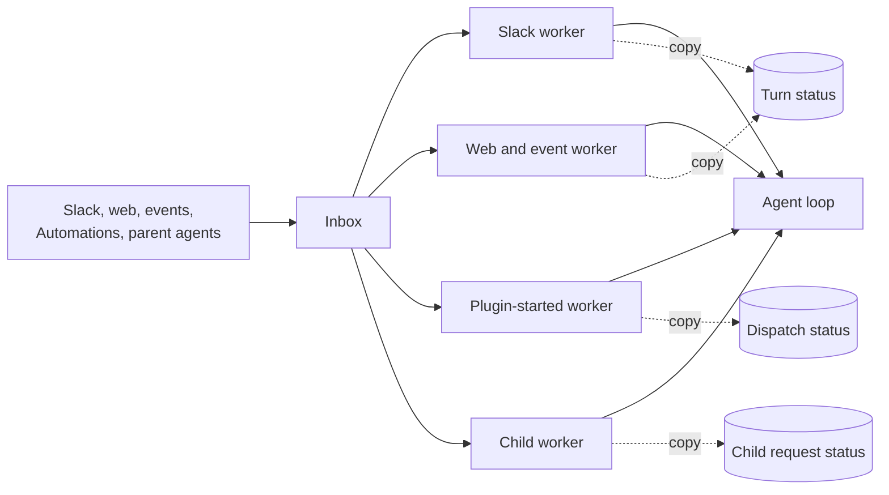
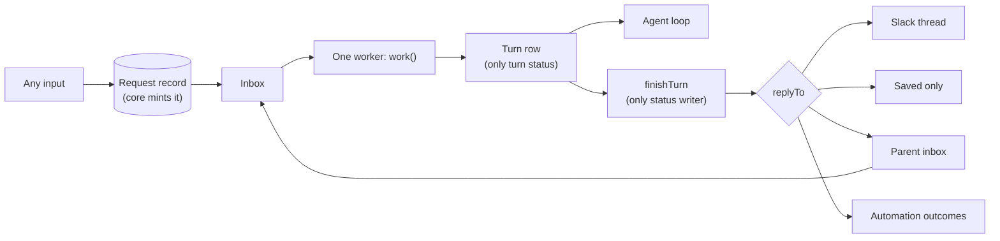
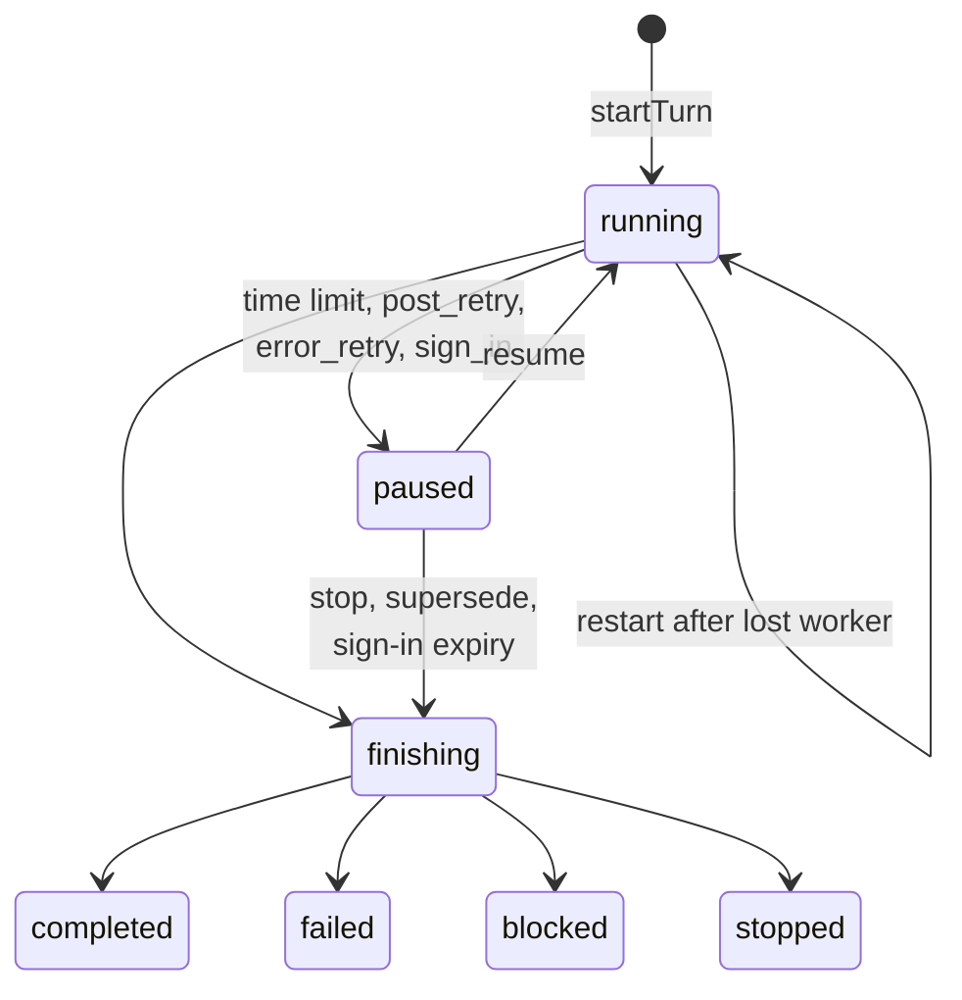

# Design

This file gives the words, the model, the rules and the answers (P-numbers).
`interfaces/` has the type sketches and worked examples: `inbox.md`,
`turn.md`, `agents.md`, `access.md` and `edges.md`. Labels:

- **Decided:** David Cramer answered it on #2567 or in the planning thread.
- **Proposed, needs sign-off:** a suggestion from this plan. Not decided.

Paths are under `packages/junior/src/chat/` unless noted. Evidence was read on
`main` at `d595bfb`. "Bug N" is the numbered bug list in #2567.

## Words

These are the #2567 words, plus three that this plan adds (marked).

- **conversation:** one thread of work with its own history. A child agent is
  one too.
- **turn:** Junior handles new input until it sends its response or an error
  message. It can take several attempts.
- **attempt:** one worker's run of a turn. At most 5 minutes. (Added.)
- **inbox:** a conversation's waiting messages. "Queue" means only the real
  work queue, which only carries "notify a worker" messages.
- **worker:** runs a conversation's next turn. **Notify a worker:** a queue
  message that names only the conversation.
- **worker lock:** only one worker runs a conversation at a time. The worker
  holding it checks in every 15 s. After 90 s with no check-in, it expires.
- **lock version:** goes up each time a worker takes the lock. Every save and
  post carries it, and an old version is refused.
- **checkpoint:** saved turn progress, kept outside the worker. Before the
  attempt limit, the worker saves one and the turn continues later.
- **actor:** the person or system the turn acts for. **Whose access:** whose
  credentials the turn uses.
- **request record:** who asked, with whose access, and where results go.
- **child agent, parent agent:** an agent that another agent started, and
  that agent. A **top-level agent** has no parent.
- **join now / wait:** a new message joins the running turn at its next safe
  point, or waits for its own turn.
- **plugin-started agent:** work that a plugin or Automation starts.
- **sandbox:** the VM where Junior runs commands, one per conversation. The
  **credential proxy** adds credentials to its calls, only for declared
  domains. A **sandbox pass** lets the sandbox use one turn's access. It ends
  with the turn.
- **sender check:** the check of who sent a saved message.
- **action review:** the check that runs before a risky tool call.
- **stop time:** saved on a conversation by a stop. A turn that took in
  input that Junior received before it is stopped. (Added.)
- **closing turn:** a turn row that takes in input and ends at once, without
  the agent. It records input that will not run. (Added, P30.)

**The response rule (Decided).** Junior sends each assistant response when it
is produced. A failed turn sends an error message. Every turn ends with
something the person can see. A turn that takes in several messages handles
them together, and the agent decides what to say. The runtime never splits,
merges or rewrites responses.

### Decided Rules

From the #2567 decision comments and the planning thread:

- Another person's message never joins a running turn. A plain reply from
  the turn's own person waits. Events never join.
- A message to a busy child joins its running turn (join now or wait, same
  actor and access). One result covers both requests.
- After a lost worker, every kind of turn gets one restart from its last
  checkpoint, and the restart counts as an error (P4). One retry limit per
  turn. Message delivery attempts stay separate.
- Every save and every post checks the lock version. A worker that lost its
  lock stops at its next check-in, save or post.
- An error after the input is saved retries from the last save. On the last
  try the turn fails visibly. Its error message is that turn's end.
- A stop after the provider accepted a post: the turn ends `stopped` and the
  post stays.
- New input from the same person ends a turn that waits for sign-in, with a
  short note. Then that new input runs. Other people and events wait until
  sign-in or link expiry (10 minutes). Same rule for every kind.
- Every stop of a top-level agent stops its tree. A child stopped by
  anything but `stopAgent` sends its parent a `stopped` result.
- A child that needs sign-in ends `blocked`.
- `maxAgentDepth` defaults to 1. The child result limit keeps today's rule.
- The sandbox pass ends with its turn. One sandbox per conversation; the
  sharing is explicit. Undeclared domains stay open; only declared domains
  get credentials.
- Any workspace bot can start a turn when no allowed domains are set.
  Allowed-domain checks cover all thread input, as part of this redesign.
- CLI top-level turns go through the inbox.
- Verified trusted authors and trusted system events go in. Unverified and
  untrusted authors are discarded (comment on #2567; P19 says where).

`TERMINOLOGY.md` still uses older words. Step 2 in `tasks.md` reconciles
them (P16).

### Code Names

Prose uses the words above. Code names appear in this table, in the type
sketches, and in evidence lines.

| Plain word                           | Code name today                                              |
| ------------------------------------ | ------------------------------------------------------------ |
| inbox                                | Mailbox, `pendingMessages` on Conversation execution         |
| worker lock                          | Lease (`execution.lease`)                                    |
| lock version                         | (new) replaces lease token fencing (`fenceLock`)             |
| check in                             | Lease check-in                                               |
| notify a worker                      | Queue wake                                                   |
| turn record                          | Turn cursor / `TurnRecord` (`task-execution/turn-cursor.ts`) |
| attempt                              | Run, Execution slice                                         |
| save a checkpoint and continue later | Yield                                                        |
| gave up after the last retry         | Dead-letter, retry exhaustion                                |
| joins the running turn               | Steering                                                     |
| join now / wait                      | `interrupt` / `defer`                                        |
| request record                       | Agent invocation row, Agent dispatch record                  |
| plugin-started agent                 | Agent dispatch                                               |
| whose access                         | Credential subject, `credentialContext`                      |
| credential proxy                     | Egress proxy                                                 |
| sandbox pass                         | Signed egress context token in the network policy            |
| sender check                         | Provenance                                                   |
| action review                        | Guardian                                                     |
| timer job                            | Heartbeat (`task-execution/heartbeat.ts`)                    |

## Today And Target





Turn states:



## Model

### Owners

Each fact has one owner and one store.

| Fact                                               | Owner          | Store                      |
| -------------------------------------------------- | -------------- | -------------------------- |
| Worker lock token, expiry and lock version         | worker lock    | SQL conversation row (P5)  |
| Stop time                                          | stop module    | SQL conversation row (P34) |
| Inbox, duplicate check, `inboxSeq`, wake time      | inbox module   | Redis conversation record  |
| Request records                                    | request module | SQL                        |
| Turn status, requests taken in, totals, deliveries | turn module    | SQL turn row (P2)          |
| Agent history and `turn_*` events                  | history module | SQL conversation events    |
| Sandbox ref                                        | sandbox module | SQL conversation row       |
| Current sandbox pass id                            | sandbox module | SQL turn row (P36)         |
| Agent bindings (named children)                    | agent module   | SQL (as today)             |

Deleted copies: Agent invocation run statuses and parent mailbox statuses,
dispatch progress statuses, Slack thread `activeTurnId` and `pendingAuth`,
the Redis turn cursor, the Redis worker lock, and the copied SQL
`execution_status` (P3).

### Rules The Model Holds

1. A conversation has at most one open turn (`running`, `paused` or
   `finishing`). The store enforces it (P2).
2. A finished turn (`completed`, `failed`, `blocked`, `stopped`) never
   changes.
3. Every turn save, history commit and delivery intent carries the lock
   token and version, and checks them in the same SQL write (P5). It also
   refuses when the turn is under the stop, except the saves of
   `finishTurn(stopped)` (P34).
4. A turn acts for one actor and one whose-access, taken from its starting
   request record. Input that joins must have the same actor, exactly the
   same signed subject and the same source (Decided, P20).
5. Another person's message never joins a running turn. Events never join
   (Decided). Results never join (today's rule).
6. A message is taken into a turn only after the turn row lists its request
   id. Then the inbox entry is removed. Never the other order.
7. Only `finishTurn` writes a finished turn status, and only `finishTurn`
   moves a request record out of `open`. Both writes are conditional: the
   turn row must still be open, and the record must still have
   `status = 'open'` (P30).
8. Only `credentialsForTurn` builds credentials.
9. A request record has no run status: `open`, `answered` or `stopped`.
10. Inbox entries hold no access. Core mints request ids. Access lives only
    on a request record in the receiving conversation whose
    `conversationId` and `inboundMessageId` match the message. A result or
    a message to the parent has its own record there, minted in the child's
    transaction. Its sender comes from the child's turn row, never from
    message fields (P26).
11. What differs by kind is stored data. The core takes no per-kind
    callbacks and has no per-kind branch.
12. Only core person ingress (Slack, web, ACP, CLI) makes a
    `VerifiedPersonActor`, and a person-actor record needs one. Only the
    core agent module (`finishTurn`, `askChild`, `messageParent`) makes
    `source: "agent"` messages and their records (P26, P39).
13. Server times (lock expiry, turn start, wake time) come from database
    `now()`. A stop and the input it judges are both stamped with database
    `now()` when Junior receives them (P34, P44).
14. A worker never releases the lock while its turn is `running`. When the
    pause save fails, the lock expires instead (P8).

### Lock Order (Decided: P5)

A worker takes locks in this order and never waits on another
conversation's worker lock:

1. Worker lock: one compare-and-set `UPDATE` on its SQL conversation row.
   It returns the new lock version.
2. Inside one save transaction: the conversation row (`FOR SHARE`, to check
   token and version), then the turn row, then conversation events.
3. Redis inbox writes happen only after the SQL transaction commits. They
   are never inside one.

Writes to another conversation are `send()` calls, which touch only the
target's Redis record, and the insert of a result record in the child's save
transaction, which takes no lock on the parent's row. `askChild` takes the
parent conversation row `FOR UPDATE` for the caps and the stop check,
inserts the child conversation and request record, commits, then calls
`send()`. This removes the per-turn Redis mutation lock
(`task-execution/turn-cursor.ts`, `withTurnCursorMutation`).

### What Differs By Kind

Stored once on the conversation (`ConversationPolicy`) and on each request
record (`replyTo`). There is no `kind` field: the rows below differ only in
these values. The only per-kind code is at the edges: ingress parsing, and
one delivery adapter per `replyTo.kind` (`interfaces/edges.md`).

| Kind           | Actor from                     | `canAskUser` | `joinRule`    | `whenBusy` | Default `replyTo`         |
| -------------- | ------------------------------ | ------------ | ------------- | ---------- | ------------------------- |
| Slack          | verified message author        | yes          | `now`         | `wait`     | `location`                |
| Web            | session user                   | yes          | `now`         | `wait`     | `stored`                  |
| ACP            | session user                   | yes          | `now`         | `refuse`   | `stored`                  |
| CLI            | local CLI user                 | yes          | `now`         | `wait`     | `stored`                  |
| Child agent    | request record from the parent | no           | `now_or_wait` | `wait`     | `parent`                  |
| Plugin-started | request record, system actor   | no           | `now`         | `wait`     | `location`                |
| Automation run | request record, system actor   | no           | `now`         | `wait`     | `stored`, plus `outcomes` |

`canAskUser` applies only when the turn's actor is a person (P13). Events
reach any kind. An event runs as the system actor, with access only from its
Watch or Automation grant, and never joins.

## Answers

Each item is **Proposed, needs sign-off** unless it says Decided. A
Decided item with no source line was accepted as written in the planning
thread. Numbers stay stable across reviews. Retired numbers say where they
went.

### P1. Which ships first (Q13) — Decided

- **Decided:** full design first. Source: the planning thread.
- **Detail:** pre-work ships first: the verification gate with the full
  model (step G), then the `TERMINOLOGY.md` words (P16). #2556 (a reviewed
  PR for a live bug) lands on its own, outside this plan and ungated. Then
  the new core is built beside today's code. It is not
  wired to production traffic; the conformance tests and the gate run
  against it. One cutover release routes every kind through `work()`
  (P45). A later release deletes today's workers and their records. The
  end state has one worker and no per-kind last-try branch.
- **Risk:** one large cutover, and no smaller-option fixes for today's
  workers before it.

### P2. Where turn status lives (Q6) — Decided

- **Decided:** a SQL turn row is the only turn status, with one open row
  per conversation (unique index). Source: the planning thread.
- **Detail:** a SQL turn row is the only turn status. A partial unique
  index allows one open row per conversation. `currentTurn` reads that row;
  there is no separate pointer. At cutover (P45), a worker that takes the lock and
  finds an open Redis turn cursor moves it into a SQL row and deletes the
  cursor in the same locked step. There is no read fallback, so two open
  turns can never exist.
- **Why:** history is already in SQL, so one transaction covers both. The
  Redis turn cursor expires (24 h open, 1 h finished), so status disappears.
- **Alternatives:** Redis turn record with a Lua compare-and-set (history is
  in another store, so a save needs two fence checks); a 24 h read fallback
  (allows two open turns during the window).
- **Evidence:** `task-execution/turn-cursor.ts` (`TURN_CURSOR_RESUME_TTL_MS`,
  `TURN_CURSOR_TERMINAL_TTL_MS`, `upsertTurnRecordLocked` has no finished
  guard); `conversations/projection.ts` (`commitMessages`).

### P3. SQL status column (Q5) — Decided

- **Decided:** remove the copied SQL status columns; reporting reads turn
  rows. Source: the planning thread.
- **Detail:** the copied columns are `execution_status` and `run_id`.
  Reporting, the dashboard and `listAgents` read the open turn row and the
  last finished turn row. The delete release removes their code, and the
  columns drop one release later (`tasks.md` steps 16 and 17).
- **Alternatives:** keep one column with one writer.
- **Evidence:** `conversations/sql/store.ts` (`recordExecution`).

### P4. Restart and the retry limit (Q3 open part) — Decided

- **Decided:** one restart after a lost worker, and the restart counts as
  an error. One retry limit per turn: 5 errors, restarts included. Message
  delivery attempts stay separate. Source: the planning thread.
- **Detail:** the turn row has `errors` and `restarts`. An error after
  take-in adds 1 to `errors` (P31). A lost-worker restart adds 1 to both.
  `restarts` (limit 1) only enforces the one restart. The fifth error ends
  the turn: `failed: error`, or `failed: lost_worker` when the fifth is a
  restart. A second lost worker ends it `failed: lost_worker`.
- **One failure counts once:** an error saves `paused: error_retry` with
  `errors + 1`. The next worker resumes a `paused` turn, so case 3 of
  `work()` does not fire and adds nothing. A turn is lost only when it is
  still `running` under an expired lock (P8). That happens when the
  worker died or its pause save failed, so no error was saved for it.
- **Evidence:** `task-execution/paused-turn.ts` (`MAX_LOST_WORKER_RESUMES`);
  `task-execution/state.ts` (`CONVERSATION_WORK_MAX_RETRIES = 5`).

### P5. Worker lock, fencing and lock order (gap 2) — Decided

- **Decided:** every save and post checks the lock version. A worker that
  lost its lock stops on its next check-in, save or post. The lock is a SQL
  worker lock taken with a compare-and-set (with P43). Source: #2567 and
  the planning thread.
- **The lock version, in plain words:** each time a worker takes the lock,
  the version goes up by one. Every save and post carries the version that
  the worker was given. The database refuses a write with an old version,
  so a worker that paused and lost its lock cannot overwrite the new
  worker's work.
- **Why not a plain Redis lock:** it stops two workers from starting at
  once. It cannot stop a worker that already holds a stale lock from
  committing a SQL write after the lock expired. Only a check inside the
  same SQL write can.
- **Detail:**
  - The worker lock lives on the SQL conversation row. The version only
    goes up. A Redis expiry cannot reset it.

    ```sql
    -- take: one compare-and-set
    UPDATE conversations
       SET lock_version = lock_version + 1, lock_token = $t,
           lock_expires_at = now() + interval '90 seconds'
     WHERE id = $c AND (lock_token IS NULL OR lock_expires_at < now())
    RETURNING lock_version;

    -- check in (no row: the lock is lost); release sets lock_token = NULL
    UPDATE conversations
       SET lock_expires_at = now() + interval '90 seconds'
     WHERE id = $c AND lock_token = $t AND lock_version = $v
       AND lock_expires_at > now();
    ```

  - Every save transaction first reads the row with the same `WHERE` and
    throws `LockLostError` on no match. Turn row, history and delivery
    intent writes are in that transaction.
  - Before each post, the worker checks in, then saves a checkpoint that
    commits the response to history and records the delivery intent with
    its id and text. It posts with the delivery id attached (Slack: message
    metadata), then saves the provider message id.
  - An expired lock needs no clearing: the next compare-and-set takes it.
    The timer job only notifies a worker.

- **Limit (Decided, the planning thread):** a post is not in a
  transaction. A worker that saved its intent and then stalls past 90 s
  can still post once after a new worker checked. A repeat post after a
  takeover is detected, not prevented (I7).
- **Alternatives:** a Redis lock with a SQL version counter (P43); a
  Redis lock plus a Redis counter that SQL writes only when higher (two
  stores to reason about); checking only at check-in (leaves a 90 s
  window).
- **Evidence:** `task-execution/state.ts` (`extendLock` then a separate
  `SET`; `CONVERSATION_WORK_LEASE_TTL_MS = 90_000`); `state/ttl.ts` (7-day
  record expiry); `providers/slack/turn.ts` (post before commit).

### P6. What "answered" means (gap 1) — Decided

- **Decided:** a turn answers the request records it took in. A later input,
  such as a grandchild result, starts a new turn. A request is answered when
  its posts are sent or failed; later output for it is a follow-up; no
  follow-up after a stop. Source: #2567 and the planning thread.
- **Detail:** `finishTurn` marks a record `answered` once its deliveries
  are `sent` or `failed` (P33). A later turn's output for an answered record
  goes as a follow-up. No follow-up for a `stopped` record. A turn started by
  a result for record `r` replies to the reply target of `r.onBehalfOf`.
- **Why:** keeps "one input, one output" and removes `replaced`.
- **Evidence:** `agent-invocations/store.ts` (`hasOpenChildWork`,
  `completeAgentInvocation`).

### P7. One repair job (gap 5) — Decided

- **Decided:** the timer job runs one repair pass with three parts:
  1. An `open` record with no `inputAppendedAtMs`, older than 60 s: call
     `send()` again with the fixed inbound message id. On `accepted` or
     `duplicate`, stamp `inputAppendedAtMs`. On `refused`, stamp
     `refusedAtMs`. After 5 attempts or 24 h, stamp `gaveUpAtMs`.
  2. Notify a worker for: a conversation with a refused or given-up record;
     a conversation with no live lock whose `wakeAtMs` has passed; a
     `running` turn whose lock expired, on the first pass after expiry.
     A Redis sorted set (member: conversation id, score: `wakeAtMs`) is
     the wake-time index. `send()`, `recordSignIn` and the pre-release set
     write it. An index on `lock_expires_at` for conversations with an open
     turn finds expired locks. With P32's delayed notify, the job is a
     backstop for wakes: L3 holds without it. A `running` turn whose worker
     died still waits for this job.
  3. Nothing else. The worker, not the job, closes records through a
     closing turn (P30), so `finishTurn` stays the only status writer.
- **Why:** a record and its inbox entry are in two stores. Lost wakes leave
  open turns idle (P32). One job covers both.
- **Deleted:** the Agent invocation result sweep, the dispatch outbox sweep
  with its 10,000-id list (bug 9), and the plugin-started 24 h failure rule.
- **Evidence:** `agent-dispatch/heartbeat.ts`; `agent-dispatch/store.ts`.

### P8. Lost worker and #2298 (gap 3) — Decided

- **Decided:** `work()` treats an open turn as lost only when it is
  `running` and the worker just took an expired lock. Every clean end of an
  attempt leaves the turn `paused` (P10) or finished, never `running`. A
  lost turn with `restarts: 0` restarts from its checkpoint and counts one
  error (P4); otherwise `finishTurn(failed: lost_worker)`. A worker saves its pause before it
  releases. If that save fails, it does not release: the lock expires, and
  the next worker treats the turn as lost.
- **Why:** #2298 made a live turn whose lock expired wait for one restart.
  With fenced saves, the old worker cannot save or post after the takeover.
- **Evidence:** `task-execution/paused-turn.ts` (`pauseLostWorkerTurn`).

### P9. Inbound message fields — Decided

- **Decided:** `source`, `join` (`now` or `wait`), `createdAtMs`,
  `receivedAtMs`, `attemptCount`, `traceContext`, event kind and
  `requestId`. "Delivery" means only sending responses.
- **Evidence:** `task-execution/state.ts` (`compareMessages`);
  `task-execution/mailbox-turn.ts` (event wait).

### P10. Pause reasons — Decided

- **Decided:** five reasons. `soft_time_limit` (was `yield`),
  `hard_time_limit` (was `timeout`), `post_retry` (a post failed and can be
  tried again), `error_retry` (P31) and `sign_in` (was `auth`). A lost
  worker is not a pause.
- **Why:** `retry` means two things today, with one limit.
- **Evidence:** `task-execution/turn-cursor.ts` (`TurnPauseReason`).

### P11. The no-progress rule — Decided

- **Decided:** a `soft_time_limit` pause at the boundary the turn resumed
  from ends the turn `failed: no_progress`. `hard_time_limit` may repeat;
  the attempt limit stops it. `post_retry` is exempt until its own limit
  (5 post attempts per delivery), then the turn fails.
- **Evidence:** `agent/resume.ts` ("Turn made no progress").

### P12. Per-turn limits — Decided

- **Decided:** the attempt (100), tool-call (1,000) and cost ($100) limits
  end the turn on the first try with `failed: limit`, after one wrap-up
  step, outside the retry limit. A child result for a limit says
  "progress". Source: the planning thread.
- **Evidence:** `config.ts` (`MAX_SLICES_PER_TURN`, `MAX_TOOL_CALLS_PER_TURN`,
  `MAX_TURN_COST_USD`); `agent-invocations/work.ts`.

### P13. Sign-in — Decided

- **Decided:**
  - Only a turn whose actor is a person, in a conversation with
    `canAskUser`, can pause for sign-in. A system-actor turn (a timer, or an
    event with a grant) ends `blocked` with the reason.
  - "Same person" for supersede means the new input's actor is a person
    actor equal to the turn's actor. A system actor never supersedes.
  - The private link and the short thread notice are runtime notices, not
    responses. A superseded or expired turn ends `stopped` with a short note.
  - The link is bound to the actor and the turn id, so it survives a
    restart.
- **Evidence:** `services/plugin-auth-orchestration.ts`; decision comment 3.

### P14. One conversation per plugin-started agent (Q9) — Decided

- **Decided:** keep it. Each run gets its own conversation with a fixed
  Location. Its request record replaces the dispatch record.
- **Evidence:** `agent-dispatch/store.ts` (`agent-dispatch:{id}`).

### P15. Who results and agent messages act for (Q11) — Decided

- **Decided:** a result acts for the person on the request record it
  answers. Other people's messages in that turn are outside text and never
  approval. Source: the planning thread.
- **Detail:** a result acts for the actor and whose-access of the request
  record it answers. A grandchild's record stores the child turn's actor,
  which came from the record that turn answered. In a result turn, messages
  from other actors reach the model marked as outside text, from before or
  after the record's `createdAtMs`. They do not count as approval. The
  `guardian` evals cover it (P41).
- **Why:** deletes "copy the latest request" (bug 12).
- **Evidence:** `agent-invocations/store.ts` (`createAgentInvocationFromLatest`).

### P16. Words in TERMINOLOGY.md (Q16) — Decided

- **Decided:** step 2 changes `TERMINOLOGY.md` first. Code names change
  only when a step touches that code.

### P17. Delegated access (Q17, J) — Decided

- **Decided:** core checks the signed grant at every turn start and
  resume, and the signature covers the run (its request id). Source: the
  planning thread.
- **Detail:** a plugin passes an unbound subject. Core binds and signs it,
  as on `main`. The signature covers kind, scope, `userId`, `teamId`,
  `dmChannelId` and the request id of the run (today it does not cover the
  run). `createRequest` takes the unbound subject, mints the request id,
  then calls `bindSubject`. `credentialsForTurn` checks it at every turn
  start and resume.
- **Evidence:** `agent-dispatch/context.ts` (`bindDispatchCredentialSubject`
  refuses a plugin binding); `credentials/subject.ts` (signs `allowedWhen`,
  `teamId`, `channelId`, `userId`).

### P18. Automation results (Q17) — Decided in part

- **Decided:** an Automation run is a conversation with no Slack reply
  target (`replyTo: stored`). Its responses go only to the web and dashboard
  view, like any conversation without a Slack Location. The run also makes
  one result, and the Automation's outcomes deliver it. Source: the
  planning thread.
- **Today** (`main` at `742ce0a`): a run is a dispatch record with
  `declaresResult` and up to 5 stored outcomes (`agent-dispatch/store.ts`).
  Each outcome is `send_message` to a Slack Destination:
  `current_conversation` is the Automation's Destination, and
  `task_creator` is a DM with the creator, opened when the outcome is saved
  (`task-outcomes.ts`, `resolveTaskOutcomes`). The run's final text is never
  posted (`deliversFinalText`). The run ends with `finishAutomationRun`:
  `send_message`, `no_action` or `misconfigured`; with no outcomes, the
  tool offers only the last two. After the run, `finishedRunReply` returns
  the declared message only for a successful `send_message`, and the Slack
  turn posts it to each outcome Destination in order
  (`providers/slack/turn.ts:821`). `runDispatchOutcome` maps
  `misconfigured` to `blocked` with the reason, a failed run to `failed`,
  and everything else to `completed`. A failure is never posted to the
  outcomes; it shows on the Automation. A run that stops with no result gets
  one reminder (`remindMissingAutomationResult`). If it still declares
  none, it ends `completed` and posts nothing.
- **Proposal (the rest):** David: "it's ok for this to vary."
  - The result comes from the finished run by default: a completed turn's
    final response is a `send_message` result, and a completed turn with
    no response is `no_action`. A `finishAutomationRun` call, when made,
    sets the result instead, so the source can vary. The missing-result
    reminder goes.
  - `send_message`: `finishTurn` delivers the message to each outcome, in
    order, with its own delivery id (P33). The run ends `completed`.
  - `no_action`: nothing is posted. The reason is saved on the run, which
    ends `completed`.
  - `misconfigured`: nothing is posted. The run ends `blocked` with the
    reason, and the Automation is blocked (plugin-started-agents › A Blocked
    Run Blocks Its Automation). A turn that ends `blocked` for a missing
    credential maps to the same.
  - A `failed` or `stopped` run posts nothing to the outcomes.
  - The request record carries `outcomes`. The `each | result | declared`
    field on the reply target goes: each reply target kind already fixes
    what it gets (`interfaces/edges.md`).
- **Evidence:** `automation-result.ts` (`finishedRunReply`,
  `runDispatchOutcome`); `tools/runtime/finish-automation-run.ts`; its
  TODO asks for the declared result to become the run's output format.

### P19. Untrusted event authors (Q17) — Decided

- **Decided:** decide trust at ingress. Unverified and untrusted authors
  are dropped with a recorded reason. A dropped event makes no request
  record. Source: the planning thread.
- **Evidence:** `events/notification.ts`;
  `openspec/changes/actor-identity-end-state`.

### P20. One access per event turn (Q17) — Decided

- **Decided:** split by person and exact signed access. Source: the
  planning thread.
- **Detail:** a mixed-access batch is never formed. Inbox selection groups
  event input in one window by actor and exact signed subject (scope
  included), in first-arrival order, before it becomes a turn. Each group
  is one turn, so no turn holds mixed access. Event author text is never
  approval.
- **Today (bug):** `timerWatchCredentialSubject`
  (`events/notification.ts:159-185`, `main` at `962eaf4`) returns no
  subject when a batch mixes timer creators, so the whole batch runs with
  no delegated access. This fails closed, so it is not a security hole.
  But a timer silently loses its creator's access because another Watch's
  event landed in the same window.
- **Check:** I6 (every taken batch has one actor and one exact signed
  subject); conversation-inbox › Events with different access.
- **Evidence:** `events/notification.ts`; `task-execution/attempt-selection.ts`.

### P21. Plugin view — Decided

- **Decided:** plugins keep `{id, status, resultMessageTs?, errorMessage?}`,
  computed from the request record and its turn's deliveries.
- **Evidence:** `agent-dispatch/types.ts`.

### P22. Error before the input is saved — Decided

- **Decided:** an error after the input is saved retries from the last
  save. An error before `startTurn` commits retries the message with no
  visible text and counts a delivery attempt. After 5, the worker runs a
  closing turn `failed: input_dropped`, which sends the error message.
  Source: the planning thread.
- **Separate limits:** these 5 delivery attempts belong to the message.
  They do not count against the turn error limit (P4), because no turn
  started. A turn that starts later begins with `errors: 0`.

### P23. One kind of request record — Decided

- **Decided:** core mints a stored request record for every input, before
  the inbox write. There is no inline form.
- **Why:** one shape for the match check (P26), one place for access, one
  repair path. The cost is one SQL insert per input at ingress.
- **Alternatives:** an inline request for person input (fewer writes, two
  shapes, and the inline form would need its own provenance rule).

### P24. Order after a supersede — Decided

The same person's new message ends the paused turn with a note and runs
next. Others wait. Not open. Source: decision comment 3 on #2567 ("Then
the new message runs").

### P25. Retired — Decided

Title lookups keep today's rule (Decided, the planning thread): no user
credentials outside a turn. A title lookup runs as a system actor
(`plugins/conversation-title-context.ts`).

### P26. Request ids and provenance — Decided

- **Decided:**
  - Core mints request ids in their own namespace (`req_…`). No caller
    chooses one.
  - The record stores `conversationId` and `inboundMessageId`.
    `selectTurnInput` drops a message whose record is missing or does not
    match both, with a recorded reason. It never fills in an actor.
  - Only core person ingress makes person-actor records. Only `finishTurn`,
    `askChild` and `messageParent` make `source: "agent"` messages.
  - A child result and a `messageParent` call each get their own record in
    the parent conversation. The child's `finishTurn` (or the fenced save
    of the `messageParent` call) mints it in the child's transaction, with
    `answers` naming the asked records and `sentBy` naming the child's
    turn. `send()` follows the commit; the repair job resends a lost one.
  - The parent accepts it only when the record matches the message (rule
    10), the `sentBy` turn row belongs to a child of the parent, and every
    `answers` record has that child as `conversationId` and the parent as
    `replyTo.parentConversationId`. Message fields are never trusted.
- **Evidence:** `task-execution/paused-turn.ts` (actor fallbacks, fixed five
  times).

### P27, P28. Moved to Later

See the Later list.

### P29. Retired

Replaced by P36. A new pass per attempt contradicts "the pass ends with its
turn".

### P30. Closing turns — Decided

- **Decided:** input that will not run still gets a turn row. The worker
  calls `closeInput`: `startTurn` and `finishTurn` in one locked step,
  without the agent. Used for: input older than a stop (P34), input past
  its delivery attempts (P22), records the repair job refused or gave up on
  (P7), and a late result after an explicit stop (P35).
- **Why:** `finishTurn` stays the only writer of request status, and every
  input has a recorded end.
- **Alternatives:** a second writer (`dropRequest`) for records no turn
  took in.

### P31. Error retry pause — Decided

- **Decided:** an error after take-in saves `paused: error_retry`,
  `errors + 1`, and releases the lock. The next worker resumes from the
  checkpoint. At the error limit, `finishTurn(failed: error)`.
- **Why:** today an error leaves the turn looking like a lost worker, so
  the restart rule fires instead of the error limit.

### P32. No lost wakes — Decided

- **Decided:**
  - `send()` appends, raises `inboxSeq`, sets `wakeAtMs = now`, writes the
    wake-time index (P7), then notifies. `recordSignIn` does the same
    before it notifies, without an append.
  - `nextRunAtMs(state)` is the one runnable test. `work()` uses it to
    choose what runs, and the release uses it too.
  - Before release, the worker reads the inbox and `inboxSeq`, computes
    `nextRunAtMs` (for example the link expiry, a delivery's
    `nextAttemptAtMs` or an event window end) and sets `wakeAtMs` to it
    with a compare-and-set on `inboxSeq`. When `inboxSeq` changed, it reads
    the inbox record again. The same set queues a delayed notify for
    `wakeAtMs`, so a link expiry or backoff fires without the repair job.
  - It releases the lock, then reads the inbox record again (inbox,
    `inboxSeq`, `wakeAtMs`). When `wakeAtMs <= now`, it notifies a worker.
  - Built in step 3, with the SQL lock.
  - Model check: without the `recordSignIn` change and the delayed notify,
    a sign-in during a held lock drops its notify, and L3 fails without
    the repair job (trace `wake_l3NoRepair_signInDuringLock` in the Quint
    drafts, P37).
- **Why:** a notification that arrives while the lock is held is dropped.
  The compare-and-set stops a later wake time from hiding a new message.
  The release-then-read order means one side always sees the other: if the
  new worker failed to take the lock, the release came after, so the read
  after the release sees the append.
- **Alternatives:** move the inbox to SQL (one transaction, more SQL load).

### P33. Delivery failure while finishing — Decided

- **Decided:** each delivery has `attempts` and `nextAttemptAtMs`. A
  `finishing` turn retries with backoff, up to 5 attempts. Then the delivery
  is `failed`, and `finishTurn` ends the turn anyway with
  `deliveryFailed: true` on `turn.terminal`. A permanent provider error
  (for example a missing channel) fails the delivery at once, with no
  backoff.
- **Why:** a turn must not stay `finishing` forever.

### P34. Stop time — Decided

- **Decided:** `stop()` saves its own database `now()` as the stop time on
  the conversation row (and on every conversation below it for a tree
  stop) and notifies each worker. It writes no turn row and no request
  record. Both sides of every compare are receive stamps (P44): "older
  than the stop" means Junior received it before the stop. Source: the
  planning thread.
  1. A turn is under the stop when any input it took in has `receivedAtMs`
     older than the stop time. The turn row keeps
     `oldestInputReceivedAtMs`.
  2. `startTurn` and a join (`saveCheckpoint` with `takeIn`) refuse input
     older than the stop time.
  3. Every fenced save and every delivery intent save of a turn under the
     stop refuses, except the saves of `finishTurn(stopped)`.
  4. `finishTurn(stopped)` puts taken-in input that is not older than the
     stop time back in the inbox. Its request record stays `open`.
  5. Person input older than the stop is saved to history as "not run"
     through a closing turn, so the person sees it and can ask again. Event
     and agent input older than the stop is dropped through a closing turn
     with no history.
- **Why:** a stop ends what the person sent before it, and nothing newer.
  The 5ed29c2 rule compared the stop with the turn's database
  `startedAtMs`. The model found it wrong both ways: a turn that started
  after the click but before `stop()` saved kept posting
  (`stop_turnBeforeStopKeepsPosting`), and with the source clock ahead, a
  newer message's turn was stopped (`stop_stopKillsNewerTurn`). The rule
  above passes every stop check when the stop and the input share a clock
  (`stop_proposed_*`); P44 makes that one clock.

### P35. Results after a stop — Decided

- **Decided:** an explicit stop stays stopped, everywhere. After a stop of
  the top-level agent's tree, or a parent's `stopAgent` on its child, a
  late result is recorded but never starts a turn. With no explicit stop, a
  child result is ordinary inbox input to the parent and wakes it like any
  other event. Source: the planning thread.
- **Detail:** the child's outcome goes on its asked request record, and the
  child mints no result record. A result already in the parent's inbox is
  older than the stop, so a closing turn records it (P30, P34). A child
  stopped alone, for example from the dashboard, is not a stop of the
  parent: its `stopped` result wakes the parent. The parent's stop time
  and the record's `createdAtMs` are both database stamps (P44).

### P36. Sandbox pass lifecycle (gap from review) — Decided

The pass sits in the sandbox network policy, so it applies to the whole VM,
not to one process (`sandbox/egress/session.ts`, module overview;
`sandbox/session.ts`, `targetSandbox.update({ networkPolicy })`).

- **Decided:**
  - One pass per turn, issued at its first sandbox use. Its id is saved on
    the turn row before the policy is applied. Each attempt renews its
    expiry (capped near the attempt limit). A soft-time-limit continuation
    or a restart keeps the same pass.
  - The proxy fails closed unless the pass id equals the open turn's
    `sandboxPassId` in SQL, that turn is `running`, and the conversation's
    `lockExpiresAtMs > now()`. Between attempts, and after a lost worker's
    lock expires, the proxy refuses it, so nothing runs with credentials
    while no worker watches the turn.
  - On `finishTurn`, and on `sign_in`, `post_retry` and `error_retry`
    pauses, the worker applies a no-credentials policy.
  - When a turn's actor or access differs from the last pass's turn, the
    worker kills user processes before it applies the new pass. Files stay
    (Decided: one sandbox per conversation, sharing explicit).
- **Limit:** processes from an earlier turn of the same actor and access
  keep running under the new pass. That is the same person's access.
- **Accepted risk, shared files** (Decided: accept as is, document it;
  the planning thread): one sandbox per conversation, and files stay. A
  file that one person's turn leaves in the sandbox can run in a later
  person's turn with that person's access. The user docs say so. The
  process kill and the pass that ends with its turn stay as above.
- **Alternatives:** a new pass per attempt (old P29); a sandbox per actor.

### P43. SQL lock or Redis lock with a SQL counter (from review) — Decided

- **Decided:** the SQL lock (P5). Source: the planning thread.
- **Cost:** an estimate to measure in step 3 (`tasks.md`): one indexed `UPDATE` per running turn every 15 s (300 running
  turns is 20 writes per second), and one indexed read per credentialed
  proxy call.
- **Why:** the lock, the version and the stop time sit on one row. Each
  save, the proxy and `startTurn` check them with one read in one store.
- **Alternative:** a Redis lock for take and check-in, plus a SQL version
  that goes up at each take. Check-ins cost no SQL write, and fencing still
  holds at the SQL save. But the proxy and the save check read two stores,
  and a take is two writes that a crash can split.
- **Note, switch rule:** if the step 3 measurement shows the check-in load
  is a problem, switch. Only the lock module changes.

### P44. One clock for a stop and the input it judges — Decided

- **Decided:** Junior's receive time everywhere. Core stamps every input at
  inbox append (`receivedAtMs`) and every stop in the `stop()` transaction
  with database `now()`. Core-minted input (child messages, results) and
  its request record get the database stamp of their own transaction.
  "Older than the stop" means Junior received it earlier. P34 and P35
  compare only these stamps. Source: the planning thread.
- **Accepted behavior:** a Slack message that Junior receives late, after a
  retry, counts as newer than a stop the person clicked after sending it,
  so it runs.
- **Why it was open:** the model showed source clocks failing across
  sources (checks `stop_proposed_crossAhead` and
  `stop_proposed_crossBehind`). An inbox sequence number alone also fails
  with late messages (check `stop_seq_same`).

### P45. A cutover that is safe under a rolling deploy (from P1)

Old and new workers run at once during each deploy.

- **Proposal:**
  - The conversation row gets a `core` field (`old` or `new`). The SQL
    lock take decides the path per conversation and sets `core` in the
    same compare-and-set. The reader release before the cutover (`tasks.md`
    step 14) teaches today's workers to read it: they refuse a conversation
    that the new core owns.
  - The first new-core lock take of a conversation also takes today's
    Redis lease, so it waits while an old worker is mid-turn. Then, in one
    locked step, it moves the state: an open Redis turn cursor into a turn
    row keyed by its turn id, active Agent invocation rows and dispatch
    records into request records, and Slack `activeTurnId` and
    `pendingAuth` into the turn row. Each move inserts once and then
    deletes the old state, so a repeat after a crash does nothing new.
  - A cutover switch decides whether a lock take on an old-core
    conversation moves it. The cutover release turns it on.
- **Rollback of the cutover release:** turn the switch off. No more
  conversations move. A new-core conversation goes back to today's workers
  at its next lock take once it has no open turn and no open record; open
  new-core work finishes on the new core first. History is already in SQL,
  so nothing moves back. When a count shows no new-core conversation,
  revert to the reader release.
- **What rollback cannot undo after the delete release:** today's workers
  and the move-back path are gone, so no conversation can go back. The
  moved Redis cursors, Agent invocation rows and dispatch records are not
  made again. After the columns and old tables drop, only fix forward.
- **Why:** the lock take is already the one place a worker decides to run
  a conversation, so the owner check costs no extra read.

## Verification

Requested by the maintainer in the planning thread: formal checks that the
code follows this design. Four layers catch different drift.
`specs/verification/spec.md` has the requirements. P37 to P42 are
Decided (the planning thread).

| Layer             | Catches                                        | Runs                       |
| ----------------- | ---------------------------------------------- | -------------------------- |
| Protocol model    | a design rule that cannot hold (races, orders) | TLC in CI                  |
| Conformance tests | code that does not do what the model does      | integration tests          |
| Structural rules  | a second writer or a bypass of a single owner  | types, import checks, lint |
| Traceability      | a requirement with no check, or a stale check  | CI script                  |

### P37. Protocol model — Decided

- **Decided:** TLA+, checked by TLC. TLC checks the safety invariants
  (I1–I14) and the liveness properties (L1–L3) exhaustively within the
  bound. Its breadth-first search prints a shortest counterexample trace.
  No Quint and no Apalache; Apalache comes back only if TLC cannot print
  the shortest traces. Each worked example in `interfaces/*.md` is a named
  trace (for example `turn_E3_slow_worker`). Source: the planning thread.
- **Target bound:** 2 conversations (a parent and a child), 2 person actors
  and the system actor, 4 inputs, 2 worker crashes, 2 lock expiries and 2
  delivery attempts per run.
- **Checked so far** (TLC, exhaustive, on the Quint drafts at repo-root
  `verification/` on branch `spec/shared-conversation-core-model` at
  7ca64c2). The drafts are being ported to TLA+; G.1 merges the TLA+
  model, not the drafts:
  - worker lock model (`worker_lock.qnt`): 1 conversation, 2 workers, 2
    person actors, 2 inputs, at most 2 crashes and lock expiries combined,
    2 post attempts per delivery, 2 turn errors;
  - wake liveness (`wakeLive_*`): the same model with no crashes or
    expiries and no soft pause;
  - stop model (`stop_clock.qnt`): 1 conversation, 1 person actor, 2
    inputs, 1 stop, 2 turns, 6 clock ticks, skew 0 and ±3.
- **Not modeled yet** (step G tasks G.1a–G.1f): parent and child
  conversations, the system actor, the adversarial `send`, request-record
  matching (I5, I6, I9, I12), tree-stop results (I8), sandbox process tags
  (I13), and the P44 receive clock. Until then, these invariants are not
  checked.
- **Adversary:** a `send` action that puts any message with any request id
  in any inbox, so I9 and the E5 traces are not vacuous.
- **Processes:** each sandbox process carries its creator's (actor,
  subject). The proxy invariant I13 then covers access E5. Files are not
  modeled: shared files are an accepted, documented limit (P36), not a
  gate check.
- **Not chosen:** Quint (typed syntax, younger tooling); P (state machines
  close to code, weaker for liveness and exhaustive checks).

### P38. Conformance tests — Decided

- **Decided:** fast-check model-based runs (`fc.commands`) on the
  integration harness: real Junior wiring, real Postgres and Redis, the
  Slack fake and the LLM fake (`policies/testing.md`). Each command is a
  model action. After each command, the run compares what the person sees
  (posts, reactions, history) and the durable records the specs name (turn
  row, request record, delivery) with the model. It does not check internal
  steps.
- **No mocks:** no mocks of Junior modules. Crashes come from the one
  `faults` port (P42).
- **Today's code:** the gate's first suite checks only what today's code
  already holds. Each step's Verify line adds what must be green after it.

### P39. Structural rules — Decided

- **Decided:** each rule uses the strongest check that can see it, and
  its message names the requirement it protects.
  - S1, S5: ast-grep rules in `ast-grep/rules/`, like
    `no-raw-slack-turn-post.yml`.
  - S2: `TurnCredentials` is a branded type whose constructor only
    `credentialsForTurn` has. An import rule keeps the low-level credential
    resolvers private to its module.
  - S3, S4: `VerifiedPersonActor` and the agent-message type are branded,
    made only in core ingress and the core agent module. An import-boundary
    check keeps `createRequest` and `send` out of plugin reach. The record
    write asserts the brand at run time too.
  - S6: an import rule in `scripts/check-test-architecture.mjs`.

### P40. Traceability and where the checks live — Decided

- **Decided:** the checks live in `packages/junior/verification/` from day
  one: the model, the scenario-id list and the trace check. This plan only
  links to them, so deleting it removes nothing that CI needs. Source: the
  planning thread.
- Each scenario id is capability, requirement and scenario titles in kebab
  case. Tests carry it in their name or a `// spec:` comment; rules in
  their `note`; model invariants in a comment. While this plan exists, the
  check also reads `specs/`, so the list cannot drift from it.
- The trace check also matches each fault point name (P42) with a crash
  action in the model, both ways.
- The scenarios of `specs/verification/` are exempt: the gate itself
  checks them.

### P41. The sign-off gate — Decided

- **Decided:** "the output adheres to the design" means the model check,
  the conformance tests and the structural rules are green, the trace check
  shows no gap, and the `guardian` eval suite passes for the P15 outside
  text and the P20 "never approval" rules. Source: the planning thread.
- **Timing:** the gate ships first (step G): the full model (G.1a–G.1f),
  the conformance harness with the `faults` port, the structural check
  runner and the trace check. The words step (step 2) follows. Each build
  step merges when the checks its Verify line names are green against the
  new core. The gate is green before the cutover release (step 15), and
  every later release keeps it green.

### P42. Crash points through one faults port — Decided

The crash-point list: after each durable SQL write, after each Redis
operation, after each post, and "the provider accepted a post but the reply
was lost".

- **Decided:** one injected `faults` port. Source: the planning thread.
  - Tests pass it through Junior's existing dependency wiring. It is
    optional and does nothing when absent. Production never passes it.
  - No global, no singleton and no test-only module API.
  - Each item on the crash-point list has a named point. The names match
    the model's crash actions, so a trace maps to a run (P40).
  - Step G amends `policies/testing.md` to allow this port.
- **Other boundaries that stay:**
  - Queue redelivery: the queue provider adapter (`queue/provider.ts`)
    redelivers an unacked message.
  - Lock expiry: the SQL fixture's database clock. All server times come
    from database `now()`, so one clock moves the lock, the turn start and
    the wake time.
  - Reply lost: the Slack fake accepts the post and drops the reply.
  - Compare-and-set contention: one suite runs two real workers on real
    Postgres.
- **Not chosen:** existing boundaries only, with model-only points where no
  boundary exists.

## Later, Not Needed For This Change

- **P27. Bot loops.** Count Slack bot input toward the automated-turn limit.
  No requirement here depends on it.
- **Input that does not start a turn.** A possible input mode that puts a
  message or event into history without starting a turn. David: "we MAY
  need a mode that doesnt force a turn... but i cant think of a reason
  yet." No design.
- **P28. Children of a turn with delegated access.** Until decided, keep
  today's behavior: the child's record gets the parent turn's actor and
  delegated subject (`agent-invocations/spawn.ts`, `credentialContext`
  copied to the child). Core binds the subject again for the child's
  request id (P17).

## Decisions Needed

Every item is **Proposed, needs sign-off**.

1. P18, the rest: where the Automation result comes from (the final
   response by default, or a `finishAutomationRun` call), the result
   mapping, and `outcomes` on the request record. David: "it's ok for this
   to vary."
2. P45: the `core` owner field, state moved on the first new-core lock
   take, a cutover switch and its rollback.
