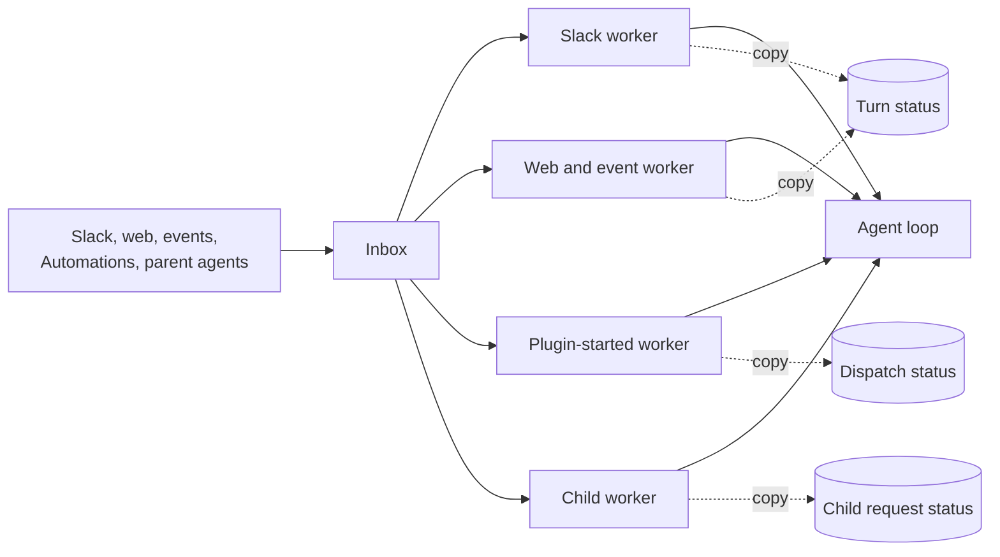
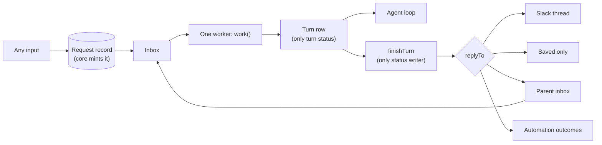
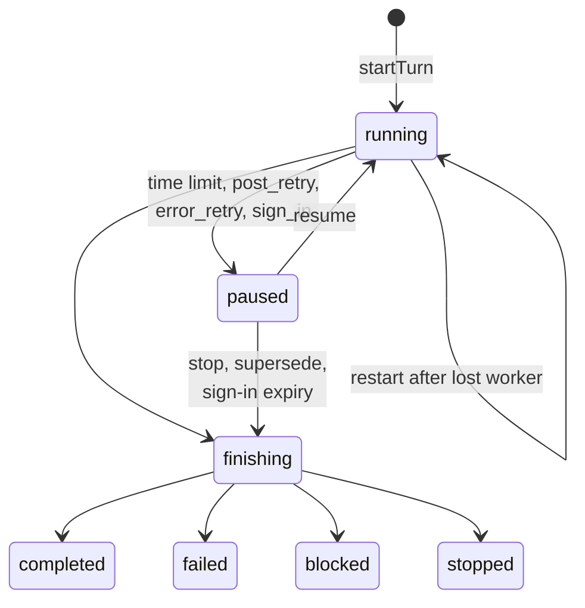

# Design

This file gives the words, the model, the rules and the proposed answers.
`interfaces/` has the type sketches and worked examples: `inbox.md`,
`turn.md`, `agents.md`, `access.md` and `edges.md`. Labels:

- **Decided:** David Cramer answered it on #2567 or in the planning thread.
- **Proposed, needs sign-off:** a suggestion from this plan. Not decided.

Paths are under `packages/junior/src/chat/` unless noted. Evidence was read on
`main` at `d595bfb`. "Bug N" is the numbered bug list in #2567.

## Words

These are the #2567 words, plus three that this plan adds (marked).

- **conversation:** one thread of work with its own history. A child agent is
  one too.
- **turn:** Junior handles new input until it sends its response or an error
  message. It can take several attempts.
- **attempt:** one worker's run of a turn. At most 5 minutes. (Added.)
- **inbox:** a conversation's waiting messages. "Queue" means only the real
  work queue, which only carries "notify a worker" messages.
- **worker:** runs a conversation's next turn. **Notify a worker:** a queue
  message that names only the conversation.
- **worker lock:** only one worker runs a conversation at a time. The worker
  holding it checks in every 15 s. After 90 s with no check-in, it expires.
- **lock version:** goes up each time a worker takes the lock. Every save and
  post carries it, and an old version is refused.
- **checkpoint:** saved turn progress, kept outside the worker. Before the
  attempt limit, the worker saves one and the turn continues later.
- **actor:** the person or system the turn acts for. **Whose access:** whose
  credentials the turn uses.
- **request record:** who asked, with whose access, and where results go.
- **child agent, parent agent:** an agent that another agent started, and
  that agent. A **top-level agent** has no parent.
- **join now / wait:** a new message joins the running turn at its next safe
  point, or waits for its own turn.
- **plugin-started agent:** work that a plugin or Automation starts.
- **sandbox:** the VM where Junior runs commands, one per conversation. The
  **credential proxy** adds credentials to its calls, only for declared
  domains. A **sandbox pass** lets the sandbox use one turn's access. It ends
  with the turn.
- **sender check:** the check of who sent a saved message.
- **action review:** the check that runs before a risky tool call.
- **stop time:** saved on a conversation by a stop. A turn that started
  before it is stopped. (Added.)
- **closing turn:** a turn row that takes in input and ends at once, without
  the agent. It records input that will not run. (Added, P30.)

**The response rule (Decided).** Junior sends each assistant response when it
is produced. A failed turn sends an error message. Every turn ends with
something the person can see. A turn that takes in several messages handles
them together, and the agent decides what to say. The runtime never splits,
merges or rewrites responses.

### Decided Rules

From the #2567 decision comments and the planning thread:

- Another person's message never joins a running turn. A plain reply from
  the turn's own person waits. Events never join.
- A message to a busy child joins its running turn (join now or wait, same
  actor and access). One result covers both requests.
- After a lost worker, every kind of turn gets one restart from its last
  checkpoint. One retry limit per turn. Message delivery attempts stay
  separate.
- Every save and every post checks the lock version. A worker that lost its
  lock stops at its next check-in, save or post.
- An error after the input is saved retries from the last save. On the last
  try the turn fails visibly. Its error message is that turn's end.
- A stop after the provider accepted a post: the turn ends `stopped` and the
  post stays.
- New input from the same person ends a turn that waits for sign-in, with a
  short note. Then that new input runs. Other people and events wait until
  sign-in or link expiry (10 minutes). Same rule for every kind.
- Every stop of a top-level agent stops its tree. A child stopped by
  anything but `stopAgent` sends its parent a `stopped` result.
- A child that needs sign-in ends `blocked`.
- `maxAgentDepth` defaults to 1. The child result limit keeps today's rule.
- The sandbox pass ends with its turn. One sandbox per conversation; the
  sharing is explicit. Undeclared domains stay open; only declared domains
  get credentials.
- Any workspace bot can start a turn when no allowed domains are set.
  Allowed-domain checks cover all thread input, as part of this redesign.
- CLI top-level turns go through the inbox.
- Verified trusted authors and trusted system events go in. Unverified and
  untrusted authors are discarded (comment on #2567; P19 says where).

`TERMINOLOGY.md` still uses older words. Step 2 in `tasks.md` reconciles
them (P16).

### Code Names

Prose uses the words above. Code names appear in this table, in the type
sketches, and in evidence lines.

| Plain word                           | Code name today                                              |
| ------------------------------------ | ------------------------------------------------------------ |
| inbox                                | Mailbox, `pendingMessages` on Conversation execution         |
| worker lock                          | Lease (`execution.lease`)                                    |
| lock version                         | (new) replaces lease token fencing (`fenceLock`)             |
| check in                             | Lease check-in                                               |
| notify a worker                      | Queue wake                                                   |
| turn record                          | Turn cursor / `TurnRecord` (`task-execution/turn-cursor.ts`) |
| attempt                              | Run, Execution slice                                         |
| save a checkpoint and continue later | Yield                                                        |
| gave up after the last retry         | Dead-letter, retry exhaustion                                |
| joins the running turn               | Steering                                                     |
| join now / wait                      | `interrupt` / `defer`                                        |
| request record                       | Agent invocation row, Agent dispatch record                  |
| plugin-started agent                 | Agent dispatch                                               |
| whose access                         | Credential subject, `credentialContext`                      |
| credential proxy                     | Egress proxy                                                 |
| sandbox pass                         | Signed egress context token in the network policy            |
| sender check                         | Provenance                                                   |
| action review                        | Guardian                                                     |
| timer job                            | Heartbeat (`task-execution/heartbeat.ts`)                    |

## Today And Target





Turn states:



## Model

### Owners

Each fact has one owner and one store.

| Fact                                               | Owner          | Store                      |
| -------------------------------------------------- | -------------- | -------------------------- |
| Worker lock token, expiry and lock version         | worker lock    | SQL conversation row (P5)  |
| Stop time                                          | stop module    | SQL conversation row (P34) |
| Inbox, duplicate check, wake time                  | inbox module   | Redis conversation record  |
| Request records                                    | request module | SQL                        |
| Turn status, requests taken in, totals, deliveries | turn module    | SQL turn row (P2)          |
| Agent history and `turn_*` events                  | history module | SQL conversation events    |
| Sandbox ref                                        | sandbox module | SQL conversation row       |
| Current sandbox pass id                            | sandbox module | SQL turn row (P36)         |
| Agent bindings (named children)                    | agent module   | SQL (as today)             |

Deleted copies: Agent invocation run statuses and parent mailbox statuses,
dispatch progress statuses, Slack thread `activeTurnId` and `pendingAuth`,
the Redis turn cursor, the Redis worker lock, and the copied SQL
`execution_status` (P3).

### Rules The Model Holds

1. A conversation has at most one open turn (`running`, `paused` or
   `finishing`). The store enforces it (P2).
2. A finished turn (`completed`, `failed`, `blocked`, `stopped`) never
   changes.
3. Every turn save, history commit and delivery intent carries the lock
   token and version, and checks them in the same SQL write (P5).
4. A turn acts for one actor and one whose-access, taken from its starting
   request record. Input that joins must have the same actor and exactly the
   same signed subject (Decided; P20 for "exactly").
5. Another person's message never joins a running turn. Events never join
   (Decided). Results never join (today's rule).
6. A message is taken into a turn only after the turn row lists its request
   id. Then the inbox entry is removed. Never the other order.
7. Only `finishTurn` writes a finished turn status, and only `finishTurn`
   moves a request record out of `open`. Both writes are conditional: the
   turn row must still be open, and the record must still have
   `status = 'open'` (P30).
8. Only `credentialsForTurn` builds credentials.
9. A request record has no run status: `open`, `answered` or `stopped`.
10. Inbox entries hold no access. Core mints request ids. Access lives only
    on a request record whose `conversationId` and `inboundMessageId` match
    the message (P26).
11. What differs by kind is stored data. The core takes no per-kind
    callbacks and has no per-kind branch.
12. Only core person ingress (Slack, web, ACP, CLI) makes a person-actor
    request record. Only the core agent module (`finishTurn`, `askChild`,
    `messageParent`) makes `source: "agent"` messages (P26).

### Lock Order (Proposed, needs sign-off; P5)

A worker takes locks in this order and never waits on another
conversation's worker lock:

1. Worker lock: one compare-and-set `UPDATE` on its SQL conversation row.
   It returns the new lock version.
2. Inside one save transaction: the conversation row (`FOR SHARE`, to check
   token and version), then the turn row, then conversation events.
3. Redis inbox writes happen only after the SQL transaction commits. They
   are never inside one.

Writes to another conversation are only `send()` calls, which touch only
the target's Redis record. `askChild` takes the parent conversation row
`FOR UPDATE` for the caps and the stop check, inserts the child conversation
and request record, commits, then calls `send()`. This removes the per-turn
Redis mutation lock (`task-execution/turn-cursor.ts`,
`withTurnCursorMutation`).

### What Differs By Kind

Stored once on the conversation (`ConversationPolicy`) and on each request
record (`replyTo`). There is no `kind` field: the rows below differ only in
these values. The only per-kind code is at the edges: ingress parsing, and
one delivery adapter per `replyTo.kind` (`interfaces/edges.md`).

| Kind           | Actor from                     | `canAskUser` | `joinRule`    | `whenBusy` | Default `replyTo`            |
| -------------- | ------------------------------ | ------------ | ------------- | ---------- | ---------------------------- |
| Slack          | verified message author        | yes          | `now`         | `wait`     | `location`, `each`           |
| Web            | session user                   | yes          | `now`         | `wait`     | `stored`, `each`             |
| ACP            | session user                   | yes          | `now`         | `refuse`   | `stored`, `each`             |
| CLI            | local CLI user                 | yes          | `now`         | `wait`     | `stored`, `each`             |
| Child agent    | request record from the parent | no           | `now_or_wait` | `wait`     | `parent`, `result`           |
| Plugin-started | request record, system actor   | no           | `now`         | `wait`     | `location`, `each`           |
| Automation run | request record, system actor   | no           | `now`         | `wait`     | `automation_run`, `declared` |

`canAskUser` applies only when the turn's actor is a person (P13). Events
reach any kind. An event runs as the system actor, with access only from its
Watch or Automation grant, and never joins.

## Proposed Answers

Each item is **Proposed, needs sign-off** unless it says Decided. Numbers
stay stable across reviews. Retired numbers say where they went.

### P1. Which ships first (Q13)

- **Proposal:** neither as an either/or. The smaller option's fixes (finish
  every turn in one place, fenced saves, one open turn, one stop) ship first
  as steps of the full design, for today's workers. Later steps move each
  worker onto `work()` and delete it. The end state has one worker and no
  per-kind last-try branch.
- **Why:** an early version of #2499 added a shared layer (seven callbacks,
  copies kept) and dropped it before merge. Fixes that lasted kept one owner
  and deleted a copy. Each step here deletes a copy.
- **Alternatives:** full design first (large cutover, no early bug fixes);
  smaller option only (keeps four workers and their join and lookup copies).
- **Evidence:** #2567, Why it keeps happening; #2499 PR body.

### P2. Where turn status lives (Q6)

- **Proposal:** a SQL turn row is the only turn status. A partial unique
  index allows one open row per conversation. `currentTurn` reads that row;
  there is no separate pointer. At cutover, a worker that takes the lock and
  finds an open Redis turn cursor moves it into a SQL row and deletes the
  cursor in the same locked step. There is no read fallback, so two open
  turns can never exist.
- **Why:** history is already in SQL, so one transaction covers both. The
  Redis turn cursor expires (24 h open, 1 h finished), so status disappears.
- **Alternatives:** Redis turn record with a Lua compare-and-set (history is
  in another store, so a save needs two fence checks); a 24 h read fallback
  (allows two open turns during the window).
- **Evidence:** `task-execution/turn-cursor.ts` (`TURN_CURSOR_RESUME_TTL_MS`,
  `TURN_CURSOR_TERMINAL_TTL_MS`, `upsertTurnRecordLocked` has no finished
  guard); `conversations/projection.ts` (`commitMessages`).

### P3. SQL status column (Q5)

- **Proposal:** remove the copied `execution_status` and `run_id` columns.
  Reporting, the dashboard and `listAgents` read the open turn row and the
  last finished turn row.
- **Alternatives:** keep one column with one writer.
- **Evidence:** `conversations/sql/store.ts` (`recordExecution`).

### P4. Restart and the retry limit (Q3 open part)

- **Decided:** one restart after a lost worker; one retry limit per turn;
  message delivery attempts separate.
- **Proposal:** a restart does not count against the retry limit. The turn
  row has `errors` (limit 5, today's number) and `restarts` (limit 1).
- **Why:** the retry limit counts errors that Junior saw. A restart is
  infrastructure loss.
- **Alternatives:** count restarts as errors.
- **Evidence:** `task-execution/paused-turn.ts` (`MAX_LOST_WORKER_RESUMES`);
  `task-execution/state.ts` (`CONVERSATION_WORK_MAX_RETRIES = 5`).

### P5. Worker lock, fencing and lock order (gap 2)

- **Decided:** every save and post checks the lock version. A worker that
  lost its lock stops on its next check-in, save or post.
- **Proposal:**
  - The worker lock lives on the SQL conversation row. The version only
    goes up. A Redis expiry cannot reset it.

    ```sql
    -- take: one compare-and-set
    UPDATE conversations
       SET lock_version = lock_version + 1, lock_token = $t,
           lock_expires_at = now() + interval '90 seconds'
     WHERE id = $c AND (lock_token IS NULL OR lock_expires_at < now())
    RETURNING lock_version;

    -- check in (no row: the lock is lost); release sets lock_token = NULL
    UPDATE conversations
       SET lock_expires_at = now() + interval '90 seconds'
     WHERE id = $c AND lock_token = $t AND lock_version = $v
       AND lock_expires_at > now();
    ```

  - Every save transaction first reads the row with the same `WHERE` and
    throws `LockLostError` on no match. Turn row, history and delivery
    intent writes are in that transaction.
  - Before each post, the worker checks in, saves a delivery intent with the
    response text, posts with the delivery id attached (Slack: message
    metadata), then saves the provider message id.
  - An expired lock needs no clearing: the next compare-and-set takes it.
    The timer job only notifies a worker.

- **Limit:** a post is not in a transaction. A worker that saved its intent
  and then stalls past 90 s can still post once after a new worker checked.
  A double post is detected, not prevented.
- **Alternatives:** Redis lock plus a Redis counter that SQL writes only
  when higher (two stores to reason about); checking only at check-in
  (leaves a 90 s window).
- **Evidence:** `task-execution/state.ts` (`extendLock` then a separate
  `SET`; `CONVERSATION_WORK_LEASE_TTL_MS = 90_000`); `state/ttl.ts` (7-day
  record expiry); `providers/slack/turn.ts` (post before commit).

### P6. What "answered" means (gap 1)

- **Decided:** a turn answers the request records it took in. A later input,
  such as a grandchild result, starts a new turn.
- **Proposal:** `finishTurn` marks a record `answered` once its deliveries
  are `sent` or `failed` (P33). A later turn's output for an answered record
  goes as a follow-up. No follow-up for a `stopped` record. A turn started by
  a result for record `r` replies to the reply target of `r.onBehalfOf`.
- **Why:** keeps "one input, one output" and removes `replaced`.
- **Evidence:** `agent-invocations/store.ts` (`hasOpenChildWork`,
  `completeAgentInvocation`).

### P7. One repair job (gap 5)

- **Proposal:** the timer job runs one repair pass with three parts:
  1. An `open` record with no `inputAppendedAtMs`, older than 60 s: call
     `send()` again with the fixed inbound message id. On `accepted` or
     `duplicate`, stamp `inputAppendedAtMs`. On `refused`, stamp
     `refusedAtMs`. After 5 attempts or 24 h, stamp `gaveUpAtMs`.
  2. Notify a worker for: a conversation with a refused or given-up record;
     a conversation with no live lock whose `wakeAtMs` passed more than
     60 s ago; an open turn with no live lock for 5 minutes.
  3. Nothing else. The worker, not the job, closes records through a
     closing turn (P30), so `finishTurn` stays the only status writer.
- **Why:** a record and its inbox entry are in two stores. Lost wakes leave
  open turns idle (P32). One job covers both.
- **Deleted:** the Agent invocation result sweep, the dispatch outbox sweep
  with its 10,000-id list (bug 9), and the plugin-started 24 h failure rule.
- **Evidence:** `agent-dispatch/heartbeat.ts`; `agent-dispatch/store.ts`.

### P8. Lost worker and #2298 (gap 3)

- **Proposal:** `work()` treats an open turn as lost only when it is
  `running` and the worker just took an expired lock. Every clean end of an
  attempt leaves the turn `paused` (P10) or finished, never `running`. A
  lost turn with `restarts: 0` restarts from its checkpoint; otherwise
  `finishTurn(failed: lost_worker)`.
- **Why:** #2298 made a live turn whose lock expired wait for one restart.
  With fenced saves, the old worker cannot save or post after the takeover.
- **Evidence:** `task-execution/paused-turn.ts` (`pauseLostWorkerTurn`).

### P9. Inbound message fields

- **Proposal:** `source`, `join` (`now` or `wait`), `createdAtMs`,
  `receivedAtMs`, `attemptCount`, `traceContext`, event kind and
  `requestId`. "Delivery" means only sending responses.
- **Evidence:** `task-execution/state.ts` (`compareMessages`);
  `task-execution/mailbox-turn.ts` (event wait).

### P10. Pause reasons

- **Proposal:** five reasons. `soft_time_limit` (was `yield`),
  `hard_time_limit` (was `timeout`), `post_retry` (a post failed and can be
  tried again), `error_retry` (P31) and `sign_in` (was `auth`). A lost
  worker is not a pause.
- **Why:** `retry` means two things today, with one limit.
- **Evidence:** `task-execution/turn-cursor.ts` (`TurnPauseReason`).

### P11. The no-progress rule

- **Proposal:** a `soft_time_limit` pause at the boundary the turn resumed
  from ends the turn `failed: no_progress`. `hard_time_limit` may repeat;
  the attempt limit stops it. `post_retry` is exempt until its own limit
  (5 post attempts per delivery), then the turn fails.
- **Evidence:** `agent/resume.ts` ("Turn made no progress").

### P12. Per-turn limits

- **Proposal:** the attempt (100), tool-call (1,000) and cost ($100) limits
  end the turn on the first try with `failed: limit`, after one wrap-up
  step, outside the retry limit. A child result for a limit says "progress".
- **Evidence:** `config.ts` (`MAX_SLICES_PER_TURN`, `MAX_TOOL_CALLS_PER_TURN`,
  `MAX_TURN_COST_USD`); `agent-invocations/work.ts`.

### P13. Sign-in

- **Proposal:**
  - Only a turn whose actor is a person, in a conversation with
    `canAskUser`, can pause for sign-in. A system-actor turn (a timer, or an
    event with a grant) ends `blocked` with the reason.
  - "Same person" for supersede means the new input's actor is a person
    actor equal to the turn's actor. A system actor never supersedes.
  - The private link and the short thread notice are runtime notices, not
    responses. A superseded or expired turn ends `stopped` with a short note.
  - The link is bound to the actor and the turn id, so it survives a
    restart.
- **Evidence:** `services/plugin-auth-orchestration.ts`; decision comment 3.

### P14. One conversation per plugin-started agent (Q9)

- **Proposal:** keep it. Each run gets its own conversation with a fixed
  Location. Its request record replaces the dispatch record.
- **Evidence:** `agent-dispatch/store.ts` (`agent-dispatch:{id}`).

### P15. Who results and agent messages act for (Q11)

- **Proposal:** a result acts for the actor and whose-access of the request
  record it answers. A grandchild's record stores the child turn's actor,
  which came from the record that turn answered. In a result turn, messages
  from other actors after the record's `createdAtMs` reach the model marked
  as outside text, and do not count as approval.
- **Why:** deletes "copy the latest request" (bug 12).
- **Evidence:** `agent-invocations/store.ts` (`createAgentInvocationFromLatest`).

### P16. Words in TERMINOLOGY.md (Q16)

- **Proposal:** step 2 changes `TERMINOLOGY.md` first. Code names change
  only when a step touches that code.

### P17. Delegated access (Q17, J)

- **Proposal:** a plugin passes an unbound subject. Core binds and signs it,
  as on `main`. The signature covers kind, scope, `userId`, `teamId`,
  `dmChannelId` and the request id of the run (today it does not cover the
  run). `credentialsForTurn` checks it at every turn start and resume.
- **Evidence:** `agent-dispatch/context.ts` (`bindDispatchCredentialSubject`
  refuses a plugin binding); `credentials/subject.ts` (signs `allowedWhen`,
  `teamId`, `channelId`, `userId`).

### P18. Automation results (Q17)

- **Proposal:** `replyTo.responses` says which responses are posted:
  `each`, `result` (one child result) or `declared` (only
  `finishAutomationRun` outcomes; other text is saved only). `deliver`
  reads the field; it has no branch on kind. A run with no declared outcome
  fails and shows on the Automation.
- **Evidence:** `automation-result.ts`.

### P19. Untrusted event authors (Q17)

- **Proposal:** decide trust at ingress. Unverified and untrusted authors
  are dropped with a recorded reason. A dropped event makes no request
  record.
- **Evidence:** `events/notification.ts`;
  `openspec/changes/actor-identity-end-state`.

### P20. Mixed-access event batches (Q17)

- **Proposal:** split. Group events in one window by actor and exact
  signed subject (scope included), in first-arrival order. Each group is one
  turn. Event author text is never approval.
- **Alternatives:** today's fallback: one turn with no delegated access.
- **Evidence:** `events/notification.ts`; `task-execution/attempt-selection.ts`.

### P21. Plugin view

- **Proposal:** plugins keep `{id, status, resultMessageTs?, errorMessage?}`,
  computed from the request record and its turn's deliveries.
- **Evidence:** `agent-dispatch/types.ts`.

### P22. Error before the input is saved

- **Decided:** an error after the input is saved retries from the last save.
- **Proposal:** an error before `startTurn` commits retries the message with
  no visible text and counts a delivery attempt. After 5, the worker runs a
  closing turn `failed: input_dropped`, which sends the error message.

### P23. One kind of request record

- **Proposal:** core mints a stored request record for every input, before
  the inbox write. There is no inline form.
- **Why:** one shape for the match check (P26), one place for access, one
  repair path. The cost is one SQL insert per input at ingress.
- **Alternatives:** an inline request for person input (fewer writes, two
  shapes, and the inline form would need its own provenance rule).

### P24. Order after a supersede — Decided

The same person's new message ends the paused turn with a note and runs
next. Others wait. Not open.

### P25. Retired

Title lookups keep today's rule: a system actor with no user credentials
(`plugins/conversation-title-context.ts`).

### P26. Request ids and provenance

- **Proposal:**
  - Core mints request ids in their own namespace (`req_…`). No caller
    chooses one.
  - The record stores `conversationId` and `inboundMessageId`.
    `selectTurnInput` drops a message whose record is missing or does not
    match both, with a recorded reason. It never fills in an actor.
  - Only core person ingress makes person-actor records. Only `finishTurn`,
    `askChild` and `messageParent` make `source: "agent"` messages.
  - A result is accepted only when its record has `replyTo.kind = "parent"`,
    `replyTo.parentConversationId` = the receiving conversation, and
    `conversationId` = the child that sent it.
- **Evidence:** `task-execution/paused-turn.ts` (actor fallbacks, fixed five
  times).

### P27, P28. Moved to Later

See the Later list.

### P29. Retired

Replaced by P36. A new pass per attempt contradicts "the pass ends with its
turn".

### P30. Closing turns

- **Proposal:** input that will not run still gets a turn row. The worker
  calls `closeInput`: `startTurn` and `finishTurn` in one locked step,
  without the agent. Used for: input older than a stop (P34), input past
  its delivery attempts (P22), records the repair job refused or gave up on
  (P7), and a result for a stopped tree (P35).
- **Why:** `finishTurn` stays the only writer of request status, and every
  input has a recorded end.
- **Alternatives:** a second writer (`dropRequest`) for records no turn
  took in.

### P31. Error retry pause

- **Proposal:** an error after take-in saves `paused: error_retry`,
  `errors + 1`, and releases the lock. The next worker resumes from the
  checkpoint. At the error limit, `finishTurn(failed: error)`.
- **Why:** today an error leaves the turn looking like a lost worker, so
  the restart rule fires instead of the error limit.

### P32. No lost wakes

- **Proposal:** `send()` sets `wakeAtMs = now` after its append, then
  notifies. A worker releases the lock first, then reads the Redis record;
  if the inbox has work or `wakeAtMs <= now`, it notifies a worker. P7 part
  2 catches anything left.
- **Why:** a notification that arrives while the lock is held is dropped.
  The release-then-read order means one of the two sides always sees the
  other: if the new worker failed to take the lock, the release came after,
  so the read after the release sees the append. Release and re-check
  cannot be one atomic step across SQL and Redis; this order gives the same
  result.
- **Alternatives:** move the inbox to SQL (one transaction, more SQL load).

### P33. Delivery failure while finishing

- **Proposal:** each delivery has `attempts` and `nextAttemptAtMs`. A
  `finishing` turn retries with backoff, up to 5 attempts. Then the delivery
  is `failed`, and `finishTurn` ends the turn anyway with
  `deliveryFailed: true` on `turn.terminal`.
- **Why:** a turn must not stay `finishing` forever.

### P34. Stop time

- **Proposal:** `stop()` saves a stop time on the conversation row (and on
  every conversation below it for a tree stop) and notifies each worker. It
  writes no turn row and no request record. A worker stops an open turn that
  started before the stop time. `startTurn` checks the stop time in its
  transaction and refuses input older than it. Person input older than the
  stop is saved to history as "not run" through a closing turn, so the
  person sees it and can ask again. Event and agent input older than the
  stop is dropped through a closing turn with no history.
- **Why:** one rule, no race between stop and turn start.

### P35. Results under a tree stop

- **Proposal:** under a tree stop, a child's `stopped` result is recorded on
  its request record but starts no parent turn. This is a proposed reading
  of the decision "a child stopped by something other than `stopAgent`
  sends its parent `stopped`": the parent is stopped too, so nobody is there
  to tell. A child stopped alone (dashboard) still sends the result.

### P36. Sandbox pass lifecycle (gap from review)

The pass sits in the sandbox network policy, so it applies to the whole VM,
not to one process (`sandbox/egress/session.ts`, module overview;
`sandbox/session.ts`, `targetSandbox.update({ networkPolicy })`).

- **Proposal:**
  - One pass per turn, issued at its first sandbox use. Its id is saved on
    the turn row before the policy is applied. Each attempt renews its
    expiry (capped near the attempt limit). A soft-time-limit continuation
    or a restart keeps the same pass.
  - The proxy fails closed unless the pass id equals the open turn's
    `sandboxPassId` in SQL and that turn is `running`. Between attempts the
    proxy refuses it, so nothing runs with credentials while no worker
    watches the turn.
  - On `finishTurn`, and on `sign_in`, `post_retry` and `error_retry`
    pauses, the worker applies a no-credentials policy.
  - When a turn's actor or access differs from the last pass's turn, the
    worker kills user processes before it applies the new pass. Files stay
    (Decided: one sandbox per conversation, sharing explicit).
- **Limit:** processes from an earlier turn of the same actor and access
  keep running under the new pass. That is the same person's access.
- **Alternatives:** a new pass per attempt (old P29); a sandbox per actor.

## Verification

David asked for formal checks that the code follows this design. Four
layers catch different drift. `specs/verification/spec.md` has the
requirements. The model itself lives in `verification/`, drafted
separately. Every item is **Proposed, needs sign-off**.

| Layer             | Catches                                        | Runs                |
| ----------------- | ---------------------------------------------- | ------------------- |
| Protocol model    | a design rule that cannot hold (races, orders) | model checker in CI |
| Conformance tests | code that does not do what the model does      | integration tests   |
| Structural rules  | a second writer or a bypass of a single owner  | ast-grep, lint      |
| Traceability      | a requirement with no check, or a stale check  | CI script           |

### P37. Protocol model

- **Proposal:** Quint, checked with Apalache (bounded, symbolic) and TLC
  where state spaces are small. The model covers the items in
  `specs/verification/spec.md` and checks invariants I1–I8 and liveness
  L1–L3. Each worked example in `interfaces/*.md` is a named trace (for
  example `turn_E3_slow_worker`).
- **Alternatives:**
  - Quint: typed, TypeScript-like syntax that this team reads easily; younger
    tooling.
  - TLA+: the most mature tools and literature; syntax few here read.
  - P: state machines close to code and good for testing; weaker for
    liveness and exhaustive checks.
- **Scope limit:** the model treats the sandbox as "pass applied" or "no
  credentials". It does not model processes or files.

### P38. Conformance tests

- **Proposal:** fast-check model-based tests (`fc.commands`) drive real
  Junior wiring with fake Slack and a fake LLM (`policies/testing.md`).
  Each command is a model action (send, work, crash after write N, expire
  lock, stop, sign in, post fails). After each command, the test compares
  the turn rows, request records, inbox and deliveries with the model
  state. Counterexample traces from the checker are added as fixed runs.
- **Today's code:** step 0 adds the harness. An invariant that today's code
  breaks is listed as "expected to fail" with the step that fixes it. That
  step makes it required. The traceability check refuses a step that
  claims an invariant and leaves it expected to fail.
- **Alternatives:** hand-written scenario tests only (cannot find
  interleavings); replaying model traces only (no generated crashes).

### P39. Structural rules

- **Proposal:** ast-grep rules in `ast-grep/rules/`, like the existing
  `no-raw-slack-turn-post.yml`, for S1–S6. Each rule's message names the
  requirement it protects. Import boundaries that ast-grep cannot see use
  the existing `scripts/check-test-architecture.mjs` pattern.

### P40. Traceability

- **Proposal:** each scenario has an id: capability, requirement and
  scenario titles in kebab case. Tests carry it in their name or a
  `// spec:` comment; ast-grep rules carry it in their `note`; model
  invariants carry it in a comment. A CI script reads the spec headings and
  these tags and fails on gaps either way.
- **Conflict to settle:** repo rule says a finished plan is deleted, and
  lasting rules move to code, tests and policies. Proposed: at step 22 the
  model moves out of the change folder, and the scenario ids move to a
  policy file that the trace check then reads.

### P41. The sign-off gate

- **Proposal:** "the output adheres to the design" means the model check,
  conformance tests and structural rules are green, and traceability shows
  no gap. Step 0 ships before any step that changes protocol code. Every
  later step keeps the gate green.

## Later, Not Needed For This Change

- **P27. Bot loops.** Count Slack bot input toward the automated-turn limit.
  No requirement here depends on it.
- **P28. Children of a turn with delegated access.** Until decided, a child
  gets the parent turn's actor but no delegated subject. It fails closed.

## Decisions Needed

Every item is **Proposed, needs sign-off**.

1. P1: smaller-option fixes ship first; end state has one worker (Q13).
2. P2: SQL turn row; migrate open cursors on lock take; no fallback (Q6).
3. P3: remove the copied SQL status columns (Q5).
4. P4: a restart does not count against the retry limit; error limit 5 (Q3).
5. P5: SQL worker lock with compare-and-set; fenced saves; delivery intent
   with saved text before every post.
6. P6: "answered", follow-ups, and where a result turn replies.
7. P7: one repair job: resend, stamp, cap, notify; never writes status.
8. P8: lost only when `running` under an expired lock.
9. P9: inbound message fields; `join` replaces `delivery`.
10. P10: five pause reasons.
11. P11: no-progress rule; `post_retry` has its own limit.
12. P12: per-turn limits end the turn on the first try.
13. P13: sign-in only for person actors; system actors end `blocked`.
14. P14: one conversation per plugin-started agent (Q9).
15. P15: results act for the record's actor; later messages are outside
    text (Q11).
16. P16: `TERMINOLOGY.md` first (Q16).
17. P17: core binds and signs delegated access, including the run id;
    checked at every start and resume (Q17, J).
18. P18: `replyTo.responses` decides what is posted.
19. P19: drop untrusted event authors at ingress (Q17).
20. P20: split mixed-access batches by exact subject (Q17).
21. P21: plugin view computed from the record.
22. P22: errors before take-in count delivery attempts.
23. P23: one kind of request record, minted by core for every input.
24. P26: core-minted ids, match check, provenance and result checks.
25. P30: closing turns.
26. P31: `error_retry` pause.
27. P32: release, then re-check; `wakeAtMs`.
28. P33: delivery attempts and backoff while finishing.
29. P34: stop time on the conversation.
30. P35: no parent turn for results under a tree stop.
31. P36: sandbox pass lifecycle.
32. P37: Quint model with Apalache and TLC; worked examples as traces.
33. P38: fast-check conformance tests; expected-to-fail list per step.
34. P39: ast-grep rules S1–S6, each naming its requirement.
35. P40: scenario ids and a two-way trace check; where they live after the
    plan is deleted.
36. P41: the gate is model, conformance and structural rules green, with no
    trace gap.
