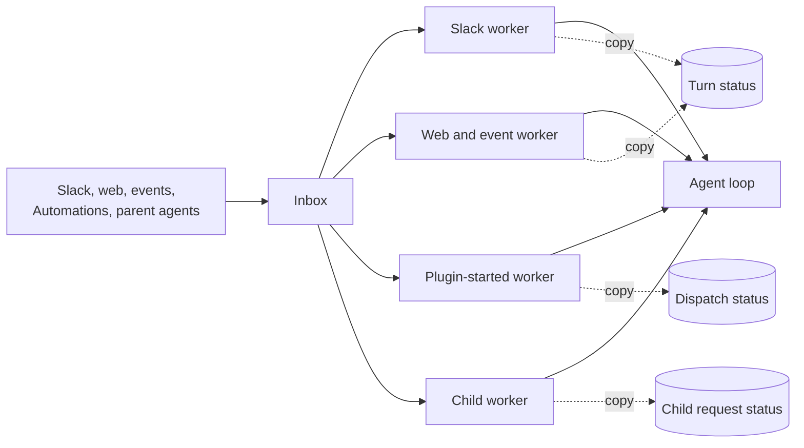
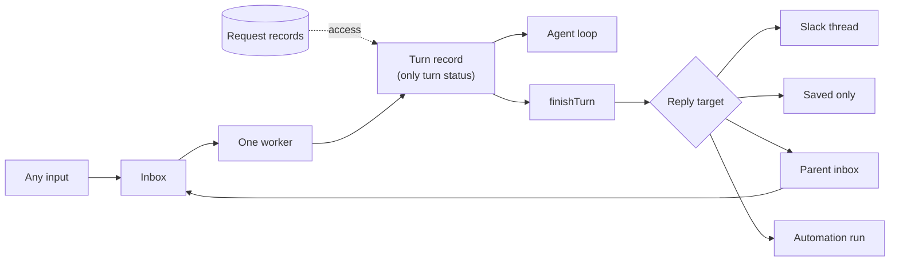

# Design

This file gives the words, the model, the rules and the proposed answers.
`interfaces/` has the type sketches and worked examples: `inbox.md`,
`turn.md`, `agents.md`, `access.md` and `edges.md`. Labels:

- **Decided:** David Cramer answered it on #2567 or in the planning thread.
- **Proposed, needs sign-off:** a suggestion from this plan. Not decided.

Paths are under `packages/junior/src/chat/` unless noted. Evidence was read on
`main` at `d595bfb`. "Bug N" is the numbered bug list in #2567.

## Words

These are the #2567 words. Use them in this plan and in the code comments of
each step.

- **conversation:** one thread of work with its own history. A child agent is
  one too.
- **turn:** Junior handles new input until it sends its response or an error
  message. It can take several attempts.
- **inbox:** a conversation's waiting messages. "Queue" means only the real
  work queue, which only carries "notify a worker" messages.
- **worker:** runs a conversation's next turn. **Notify a worker:** a queue
  message that names only the conversation.
- **worker lock:** only one worker runs a conversation at a time. The worker
  holding it checks in every 15 s. After 90 s with no check-in, it expires.
- **lock version:** goes up each time a worker takes the lock. Every save and
  post carries it, and an old version is refused.
- **checkpoint:** saved turn progress, kept outside the worker. A worker runs
  at most 5 minutes. Before that, it saves one and the turn continues later.
- **actor:** the person or system the turn acts for. **Whose access:** whose
  credentials the turn uses.
- **request record:** who asked, with whose access, and where results go.
- **child agent, parent agent:** an agent that another agent started, and
  that agent. A **top-level agent** has no parent.
- **join now / wait:** a new message joins the running turn at its next safe
  point, or waits for its own turn.
- **plugin-started agent:** work that a plugin or Automation starts.
- **sandbox:** the VM where Junior runs commands, one per conversation. The
  **credential proxy** adds credentials to its calls, only for declared
  domains. A **sandbox pass** lets the sandbox use one turn's access. It ends
  with the turn.
- **sender check:** the check of who sent a saved message.
- **action review:** the check that runs before a risky tool call.

**The response rule (Decided).** Junior sends each assistant response when it
is produced. A failed turn sends an error message. Every turn ends with
something the person can see. A turn that takes in several messages handles
them together, and the agent decides what to say. The runtime never splits,
merges or rewrites responses.

### Decided Rules

From the #2567 decision comments and the planning thread:

- Another person's message never joins a running turn. A plain reply from
  the turn's own person waits. Events never join.
- A message to a busy child joins its running turn (join now or wait, same
  actor and access). One result covers both requests.
- After a lost worker, every kind of turn gets one restart from its last
  checkpoint. One retry limit per turn. Message delivery attempts stay
  separate.
- Every save and every post checks the lock version. A worker that lost its
  lock stops at its next check-in, save or post.
- An error after the input is saved retries from the last save. On the last
  try the turn fails visibly. Its error message is that turn's end.
- A stop after the provider accepted a post: the turn ends `stopped` and the
  post stays.
- New input from the same person ends a turn that waits for sign-in, with a
  short note. Other people and events wait until sign-in or link expiry (10
  minutes). Same rule for every kind.
- Every stop of a top-level agent stops its tree. A child stopped by
  anything but `stopAgent` sends its parent a `stopped` result.
- A child that needs sign-in ends `blocked`.
- `maxAgentDepth` defaults to 1. The child result limit keeps today's rule.
- The sandbox pass ends with its turn. One sandbox per conversation.
  Undeclared domains stay open; only declared domains get credentials.
- Any workspace bot can start a turn when no allowed domains are set.
  Allowed-domain checks cover all thread input, as part of this redesign.
- CLI top-level turns go through the inbox.
- Verified trusted authors and trusted system events go in. Unverified and
  untrusted authors are discarded (comment on #2567; P19 says where).

`TERMINOLOGY.md` still uses older words (mailbox, Turn as
"request-to-final-response cycle", Run, Execution slice). Step 2 in
`tasks.md` reconciles them (Q16).

### Code Names

Prose uses the words above. Code names appear in this table, in the type
sketches, and in evidence lines.

| Plain word                           | Code name today                                              |
| ------------------------------------ | ------------------------------------------------------------ |
| inbox                                | Mailbox, `pendingMessages` on Conversation execution         |
| worker lock                          | Lease (`execution.lease`)                                    |
| lock version                         | (new) replaces lease token fencing (`fenceLock`)             |
| check in                             | Lease check-in                                               |
| notify a worker                      | Queue wake                                                   |
| turn record                          | Turn cursor / `TurnRecord` (`task-execution/turn-cursor.ts`) |
| attempt                              | Run                                                          |
| save a checkpoint and continue later | Execution slice, yield                                       |
| gave up after the last retry         | dead-letter, retry exhaustion                                |
| joins the running turn               | Steering                                                     |
| join now / wait                      | `interrupt` / `defer`                                        |
| request record                       | Agent invocation row, Agent dispatch record                  |
| plugin-started agent                 | Agent dispatch                                               |
| whose access                         | Credential subject, `credentialContext`                      |
| credential proxy                     | Egress proxy                                                 |
| sandbox pass                         | Signed egress credential token                               |
| sender check                         | Provenance                                                   |
| action review                        | Guardian                                                     |

## Today And Target

## Model

### Owners

Each fact has one owner and one store.

| Fact                                                                    | Owner          | Store                       |
| ----------------------------------------------------------------------- | -------------- | --------------------------- |
| Inbox, duplicate check, worker lock token, wake time                    | inbox module   | Redis conversation record   |
| Lock version counter                                                    | worker lock    | SQL conversation row        |
| Request records                                                         | request module | SQL                         |
| Turn status, requests taken in, totals, deliveries, pause, stop request | turn module    | SQL turn row (Proposed, P2) |
| Agent history and `turn_*` events                                       | history module | SQL conversation events     |
| Sandbox ref                                                             | sandbox module | SQL conversation row        |
| Sandbox pass revocation                                                 | sandbox module | Redis, by pass id           |
| Agent bindings (named children)                                         | agent module   | SQL (as today)              |

Deleted copies: Agent invocation run statuses and parent mailbox statuses,
dispatch progress statuses, Slack thread `activeTurnId` and `pendingAuth`,
the Redis turn cursor, and the copied SQL `execution_status` (P3).

### Rules The Model Holds

1. A conversation has at most one open turn (`running`, `paused` or
   `finishing`). The store enforces it (P2).
2. A finished turn (`completed`, `failed`, `blocked`, `stopped`) never
   changes.
3. Every turn save, history commit and post carries the lock version. A save
   with an old version fails, and the worker stops (P5).
4. A turn acts for one actor and one whose-access, taken from its starting
   request record. Input that joins the turn must have the same actor and
   whose-access (Decided).
5. Another person's message never joins a running turn (Decided). Events
   never join (Decided).
6. A message is taken into a turn only after the turn row lists its request
   id. Then the inbox entry is removed. Never the other order.
7. Only `finishTurn` writes a finished status. It runs only in a worker that
   holds the lock.
8. Only `credentialsForTurn` builds credentials. Tools, MCP, the sandbox pass
   and the credential proxy read its result.
9. A request record has no run status. Its status is `open`, `answered` or
   `stopped`.
10. Inbox entries hold no delegated access. Delegated access lives only on a
    stored request record.
11. What differs by kind is stored data on the conversation and the request
    record. The core never takes per-kind callbacks.

### Lock Order (Proposed, needs sign-off; P5)

A worker takes locks in this order and never waits on another
conversation's worker lock:

1. Redis worker lock for its conversation (token).
2. SQL conversation row: raise the lock version. The new value is the
   worker's lock version.
3. SQL event lock for the conversation, only inside one save transaction.

Writes to another conversation are only `send()` calls. `send()` takes only
the target's short Redis inbox lock. It never takes the target's worker lock.
`spawnAgent` takes the SQL parent lock for the caps, then releases it before
it calls `send()`. This removes the per-turn Redis mutation lock
(`task-execution/turn-cursor.ts`, `withTurnCursorMutation`).

### What Differs By Kind

Stored once on the conversation (`ConversationPolicy`) and on each request
record (`replyTo`). The core reads these fields. It does not call back into
per-kind code. The only per-kind code is at the edges: ingress parsing, and
one `deliver` function per reply target kind (Slack posts, Automation
outcomes). Core owns the runtime; plugins own provider formatting.

| Kind           | Actor from                                               | Can ask a person | Join rule                               | Default reply target          | Busy input |
| -------------- | -------------------------------------------------------- | ---------------- | --------------------------------------- | ----------------------------- | ---------- |
| Slack          | verified message author                                  | yes              | join now, same actor                    | Slack thread                  | waits      |
| Web            | session user                                             | yes              | join now, same actor                    | saved only                    | waits      |
| ACP            | session user                                             | yes              | join now, same actor                    | saved only                    | refused    |
| CLI            | local CLI user                                           | yes              | join now, same actor                    | saved only                    | waits      |
| Child agent    | request record (parent turn's actor)                     | no               | join now or wait, same actor and access | parent inbox                  | waits      |
| Plugin-started | request record (system actor, optional delegated access) | no               | none joins                              | Automation run or plugin view | waits      |

Events reach any kind. An event runs as the system actor, with access only
from its Watch or Automation grant. It never joins a running turn.

## Proposed Answers

Each item is **Proposed, needs sign-off** unless it says Decided.

### P1. Which ships first (Q13)

- **Proposal:** neither as an either/or. The smaller option's fixes (finish
  every turn in one place, lock version on saves, one open turn, one stop)
  are the first steps of the full design. Steps 3–11 in `tasks.md` ship
  them for today's workers. Steps 12–13 then move child agents and
  plugin-started agents onto the one worker.
- **Why:** an early version of #2499 added a shared layer (seven callbacks,
  copies kept) and dropped it before merge. Fixes that lasted kept one owner and deleted a copy. Each
  step here deletes a copy.
- **Alternatives:** full design first (large cutover, no early bug fixes);
  smaller option only (keeps four workers and their join and lookup copies).
- **Evidence:** #2567, Why it keeps happening; #2499 PR body.

### P2. Where turn status lives (Q6)

- **Proposal:** a SQL turn row is the only turn status. A partial unique
  index allows one open row per conversation. The "current turn" is that
  row; there is no separate pointer to keep in sync. Turn saves and history
  commits run in one transaction with one lock version check.
- **Why:** history is already in SQL, so one transaction covers both. The
  Redis turn cursor expires (24 h open, 1 h finished), so status disappears.
  A database index enforces rule 1 instead of code that assumes it.
- **Alternatives:** Redis turn record next to the worker lock with a Lua
  compare-and-set (faster, but the history commit is in another store, so a
  save needs two fence checks); both with one owner (copies again).
- **Evidence:** `task-execution/turn-cursor.ts` (`TURN_CURSOR_RESUME_TTL_MS`,
  `TURN_CURSOR_TERMINAL_TTL_MS`, `upsertTurnRecordLocked` has no finished
  guard); `conversations/projection.ts` (`commitMessages`); #1848 moved exact
  history out of the Redis cursor.

### P3. SQL status column (Q5)

- **Proposal:** remove the copied `execution_status` and `run_id` columns.
  Reporting, the dashboard and `listAgents` read the open turn row and the
  last finished turn row.
- **Why:** two writers fill them today and the newer wall-clock time wins. No
  scheduling code reads them.
- **Alternatives:** keep one column with one writer (`finishTurn` and turn
  start).
- **Evidence:** #2567 Reference, Four status records; `conversations/sql/store.ts`
  (`recordExecution`).

### P4. Restart and the retry limit (Q3 open part)

- **Decided:** every kind of turn gets one restart from its last checkpoint
  after a lost worker. One retry limit per turn; message delivery attempts
  stay separate.
- **Proposal:** a restart does not count against the turn's retry limit. The
  turn row has two counters: `errors` (limit 5) and `restarts` (limit 1).
  Both stay under the slice limit (100).
- **Why:** the retry limit counts errors that Junior can see. A restart is
  infrastructure loss. #2298 already keeps a separate lost-worker count.
- **Alternatives:** count restarts as errors (one number, but five quick
  errors after a restart would fail sooner than intended).
- **Evidence:** `task-execution/paused-turn.ts` (`MAX_LOST_WORKER_RESUMES`);
  `task-execution/state.ts` (`CONVERSATION_WORK_MAX_RETRIES`).

### P5. Fencing and lock order (gap 2)

- **Decided:** every save and post checks the lock version. A worker that
  lost its lock stops on its next check-in, save or post.
- **Proposal:**
  - The lock version is a counter on the SQL conversation row. A worker takes
    the Redis lock, then raises the counter in SQL and uses the new value.
    Redis expiry cannot reset it.
  - Every turn save and history commit is one SQL transaction that first
    checks `lock_version = mine`. A mismatch throws `LockLostError`.
  - Before each post, the worker checks in, saves a delivery intent with the
    fence check, then posts with the delivery id attached (Slack: message
    metadata; a provider idempotency key where one exists), then saves the
    provider message id. A later worker that finds an intent
    with no message id asks the provider adapter whether that delivery id
    exists before it posts again (Slack: message metadata in the thread).
  - Inbox removal stays a Redis token check, after the SQL save.
- **Why:** today the fence is `extendLock` then a separate `SET`, and turn
  and history writes do not check the lock at all. One counter in the store
  that holds the turn row makes the check part of the write.
- **Alternatives:** Redis-only version (lost on the 7-day record expiry);
  checking the lock only at check-in (leaves a 90 s window).
- **Limit:** a post cannot be part of a transaction. An old worker that
  saved its intent and then stalls past 90 s can still post once after a
  new worker checked. The check-in before the intent keeps that window to
  one stall. The intent plus the provider check makes a repeat post
  detectable, not impossible.
- **Evidence:** `task-execution/state.ts` (lease fence then `SET`);
  `task-execution/turn-cursor.ts` (`withTurnCursorMutation`);
  `providers/slack/turn.ts` (post before commit).

### P6. What "answered" means (gap 1)

- **Decided:** a turn answers the request records it took in. One batch, one
  output. A later input, such as a grandchild result, starts a new turn.
- **Proposal:** a request record is `answered` when the turn that took it in
  reaches `finishTurn` and the delivery to its reply target is saved. A
  request record that a later turn answers again gets a **follow-up**, not a
  second "answer": the delivery names the request and says it is a
  follow-up. A follow-up to a `stopped` request record is not sent.
- **Where a result turn replies:** a turn started by a result for request
  `r` replies to the reply target of `r.onBehalfOf`. When `r.onBehalfOf` is
  an inline request (a Slack or web message), it uses the conversation's
  default reply target. See `interfaces/agents.md`, E2.
- **Why:** this keeps "one input, one output" and removes `replaced`. The
  parent decides what a follow-up means.
- **Evidence:** `agent-invocations/store.ts` (`hasOpenChildWork`,
  `completeAgentInvocation`).

### P7. The repair job between SQL and Redis (gap 5)

- **Proposal:** one repair job remains, keyed by request record id. It finds
  `open` request records with no `inputAppendedAtMs` that are older than 60 s
  and calls `send()` again with the fixed inbound message id. Results need no
  repair job: `finishTurn` is resumable, and a turn in `finishing` keeps the
  conversation runnable, so the next worker finishes it.
- **Why:** creating a request record and adding its input cross two stores.
  A parent's tool call usually retries this itself, but not when the parent
  turn fails before its next checkpoint.
- **Deleted:** the Agent invocation result sweep and the dispatch outbox
  sweep with its 10,000-id list (bug 9).
- **Evidence:** `agent-dispatch/heartbeat.ts`; `agent-dispatch/store.ts`.

### P8. Lost worker and #2298 (gap 3)

- **Proposal:** the timer job only clears an expired worker lock and
  notifies a worker. It never finishes a turn. The next worker that takes the
  lock finds the open turn still `running`. If `restarts` is 0 and slices are
  left, it restarts from the last checkpoint. Otherwise it calls
  `finishTurn` with `failed: lost_worker`.
- **Why:** a lock can expire while the old worker is alive. #2298 made that
  case wait for one restart. With the lock version, the old worker cannot
  save or post after the new worker takes the lock, so the restart is safe.
- **Evidence:** `task-execution/paused-turn.ts` (`pauseLostWorkerTurn`);
  `task-execution/state.ts` (`clearExpiredConversationLease`).

### P9. Inbound message fields

- **Proposal:** keep `source`, `delivery`, `createdAtMs`, `receivedAtMs`,
  `attemptCount`, `traceContext` and event kind on `InboundMessage`. Ordering,
  people-before-events, the event wait window and the stop cutoff read them.
  Add `requestId`. Person input carries an inline request (actor and reply
  target) instead of a SQL row (P23).
- **Evidence:** `task-execution/state.ts` (`compareMessages`);
  `task-execution/mailbox-turn.ts` (event wait).

### P10. Pause reasons

- **Proposal:** four reasons. `soft_time_limit` (was `yield`),
  `hard_time_limit` (was `timeout`), `post_retry` (a provider post failed and
  can be tried again; was part of `retry`) and `sign_in` (was `auth`). A lost
  worker is not a pause. It is a restart, counted in `restarts`.
- **Why:** `retry` means two things today, with one limit.
- **Evidence:** `task-execution/turn-cursor.ts` (`TurnPauseReason`);
  `agent/resume.ts`.

### P11. The no-progress rule

- **Proposal:** keep today's rule. A `soft_time_limit` or `post_retry` pause
  at the same boundary the turn resumed from fails the turn with
  `no_progress`. A `hard_time_limit` pause may repeat; the slice limit stops
  it.
- **Evidence:** `agent/resume.ts` ("Turn made no progress").

### P12. Per-turn limits

- **Proposal:** the slice (100), tool-call (1,000) and cost ($100) limits end
  the turn on the first try with `failed: limit`, after one wrap-up step. They
  do not use the retry limit. A child result for a limit says "progress", as
  today.
- **Evidence:** `agent/index.ts` (turn budgets); `agent-invocations/work.ts`.

### P13. Sign-in notices and the link

- **Proposal:** the private link and the short thread notice are runtime
  notices, not responses. A turn that waits for sign-in has not ended. When it
  ends by supersede or link expiry, it ends `stopped`, and the short ending
  note is its visible end. The link is bound to the actor and the turn id,
  not to a per-attempt id, so it still works after a lost-worker restart.
- **Alternatives:** count the notice as the response (then a supersede would
  end with no note); end a superseded turn `failed` (it did not fail).
- **Evidence:** `services/plugin-auth-orchestration.ts`; decision comment 3.

### P14. One conversation per plugin-started agent (Q9)

- **Proposal:** keep it. Each run gets its own conversation with a fixed
  Location. Its request record replaces the dispatch record.
- **Why:** run history, access and stop stay per run. Sharing would bring
  back mixed-access batches.
- **Evidence:** `agent-dispatch/store.ts` (`agent-dispatch:{id}`).

### P15. Who results and agent messages act for (Q11)

- **Proposal:** a result message points to the request record that asked for
  the work. The new turn acts for that record's actor and whose-access. A
  grandchild's request record stores the actor of the child turn that made
  it, which came from the request record that turn answered. A child's
  message to its parent acts for the actor of the child's current turn.
- **Why:** this deletes "copy the latest request" (bug 12). The top-level
  path already uses this rule.
- **Evidence:** `agent-invocations/store.ts` (`createAgentInvocationFromLatest`);
  `agent-invocations/result.ts`.

### P16. Words in TERMINOLOGY.md (Q16)

- **Proposal:** step 2 changes `TERMINOLOGY.md` to the words in this file
  before any code step. Code names change only when a step touches that code.
  Old names stay at storage keys until their data migrates.

### P17. When delegated access is checked (Q17, J)

- **Proposal:** `credentialsForTurn` checks the signed binding at every turn
  start and every resume. A revoked or switched Automation stops using the
  creator's access at its next turn.
- **Alternatives:** check only when the request record is created (today for
  dispatches).
- **Evidence:** `agent-dispatch/context.ts`; `credentials/subject.ts`;
  `task-execution/conversation-turn.ts` (timer re-check).

### P18. Automation results and the response rule (Q17)

- **Proposal:** for an `automation_run` reply target, the responses are the
  messages the run declares with `finishAutomationRun`. Other assistant text
  is saved only. A run that ends without a declared outcome fails, and the
  failure shows on the Automation. A blocked run DMs the creator once.
- **Why:** "every turn ends with something visible" holds: the person who
  asked is the creator, and the Automation shows the outcome.
- **Evidence:** `automation-result.ts`; stories part 3, Automations.

### P19. Untrusted event authors (Q17)

- **Proposal:** decide trust at ingress, before `send()`. Verified trusted
  authors and trusted system events go in. Unverified and untrusted authors
  are dropped with a recorded drop. A dropped event never creates a request
  record.
- **Why:** David's comment on #2567: unverified and untrusted actors are
  discarded.
- **Evidence:** `events/notification.ts`; `openspec/changes/actor-identity-end-state`.

### P20. Mixed-access event batches (Q17)

- **Proposal:** split. Inside one event wait window, group events by actor
  and whose-access, in order of the first arrival. Each group is one turn.
- **Alternatives:** today's fallback: one turn with no delegated access.
- **Evidence:** `events/notification.ts`; `task-execution/attempt-selection.ts`.

### P21. Plugin view of a plugin-started agent

- **Proposal:** plugins keep `{id, status, resultMessageTs?, errorMessage?}`.
  `status` is computed: `running` while the request record is `open`, then
  its `outcome`.
- **Evidence:** `agent-dispatch/types.ts`.

### P22. Error after the input is saved

- **Decided:** retry from the last save. On the last try, fail visibly.
- **Proposal:** an error before the turn row lists the input retries the
  message with no visible text and counts a delivery attempt. An error after
  that counts a turn error.

### P23. Inline request records for person input

- **Proposal:** Slack, web, ACP and CLI person input, and events with no
  grant, carry an inline request (actor, reply target) in the inbox entry.
  Its request id is the inbound message id. Input with delegated access, a
  parent, an Automation or a plugin reply target must use a stored request
  record.
- **Why:** a SQL row per Slack message adds a cross-store write at ingress.
  Person input has no delegated access, so rule 10 holds.
- **Alternatives:** a stored record for every message (one form, more
  writes).

### P24. Order after a supersede

- **Decided:** "then the new message runs".
- **Proposal:** the superseding message starts the next turn, ahead of
  earlier waiting messages from other people. After it, normal order.
- **Alternatives:** normal order (an earlier message from another person
  would run first, which reads against the decision).

### P25. Lookups outside a turn

- **Proposal:** conversation title lookups use the credentials of the
  conversation's latest person turn, not installation credentials.
- **Evidence:** `plugins/conversation-title-context.ts`.

### P26. Input whose request record is missing

- **Proposal:** `selectTurnInput` drops a message whose stored request
  record is missing or invalid, records the drop, and starts no turn. It
  never fills in an actor from another source.
- **Why:** resume identity was fixed five times by adding fallbacks.
- **Alternatives:** keep it until the delivery attempt limit (slower, same
  end).
- **Evidence:** `task-execution/paused-turn.ts` (actor fallbacks).

### P27. Bot loops

- **Decided:** any workspace bot can start a turn when no allowed domains
  are set.
- **Proposal:** Slack input from a bot counts as an automated turn, so the
  automated-turn limit (25) also stops a loop between Junior and another bot.
- **Evidence:** `services/automated-turn-limit.ts` (not applied to Slack).

### P28. Children of a turn with delegated access

- **Proposal:** a child gets the parent turn's actor and subject (P15). The
  subject scope check uses the root conversation, so a timer grant works in
  the timer's tree and nowhere else.
- **Alternatives:** children get no delegated access (safer, but timer work
  that delegates loses access).
- **Evidence:** `tools/watch-timer.ts`; `agent-invocations/result.ts`.

### P29. A pass for a long turn

- **Proposal:** each attempt issues its own pass, so a turn longer than the
  sandbox timeout (30 minutes) gets a new one per attempt. A new attempt
  revokes the last pass first.
- **Evidence:** `sandbox/sandbox.ts`; `sandbox/egress/session.ts`.

## Decisions Needed

Every item is **Proposed, needs sign-off**.

1. P1: smaller-option fixes ship first as steps of the full design (Q13).
2. P2: SQL turn row is the only turn status, one open row per conversation
   by unique index (Q6).
3. P3: remove the copied SQL status columns (Q5).
4. P4: a restart does not count against the retry limit (Q3).
5. P5: lock version counter in SQL, fence check in every save, delivery
   intent before every post, and the lock order.
6. P6: "answered" and follow-ups.
7. P7: one repair job keyed by request record; no result sweep.
8. P8: the timer job never finishes a turn; the next worker restarts or
   fails it.
9. P9: inbound message fields.
10. P10: four pause reasons; restart is not a pause.
11. P11: keep the no-progress rule.
12. P12: limits end the turn on the first try.
13. P13: sign-in notices are not responses.
14. P14: one conversation per plugin-started agent (Q9).
15. P15: results act for the request record's actor (Q11).
16. P16: `TERMINOLOGY.md` first (Q16).
17. P17: check delegated access at every turn start and resume (Q17, J).
18. P18: Automation responses are the declared `finishAutomationRun` messages.
19. P19: drop unverified and untrusted event authors at ingress.
20. P20: split mixed-access event batches.
21. P21: plugin status computed from the request record.
22. P22: errors before the input is taken in count delivery attempts.
23. P23: inline request records for person input.
24. P24: normal inbox order after a supersede.
25. P25: title lookups use the latest person turn's credentials.
26. P26: drop input whose request record is missing.
27. P27: bot input counts toward the automated-turn limit.
28. P28: children inherit delegated access inside the root's tree only.
29. P29: one sandbox pass per attempt.
30. P13 detail: a superseded or expired sign-in turn ends `stopped`.
